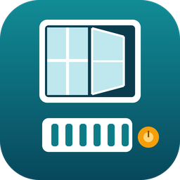
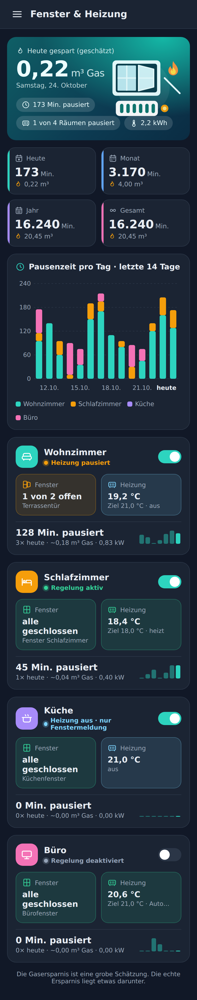
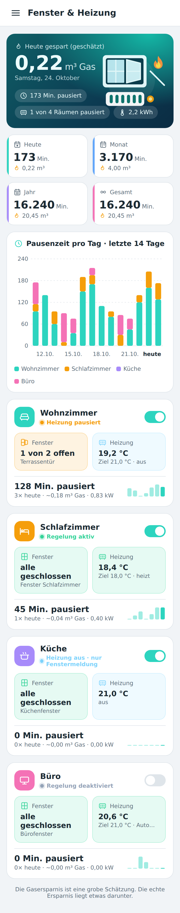
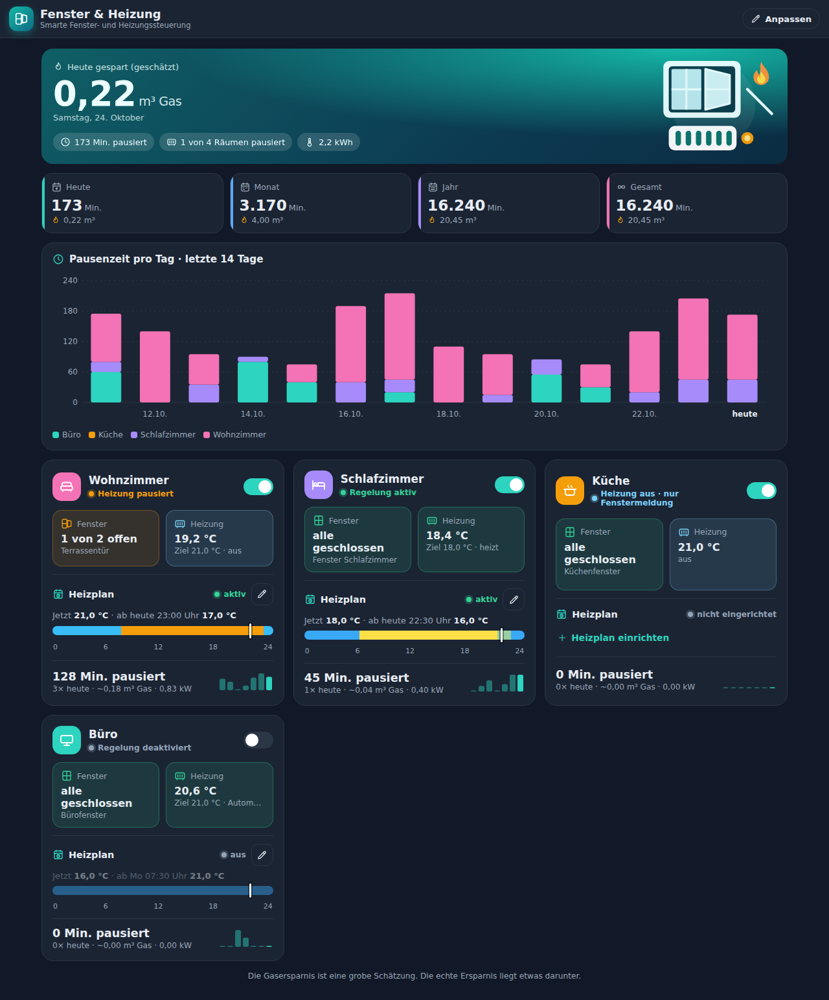
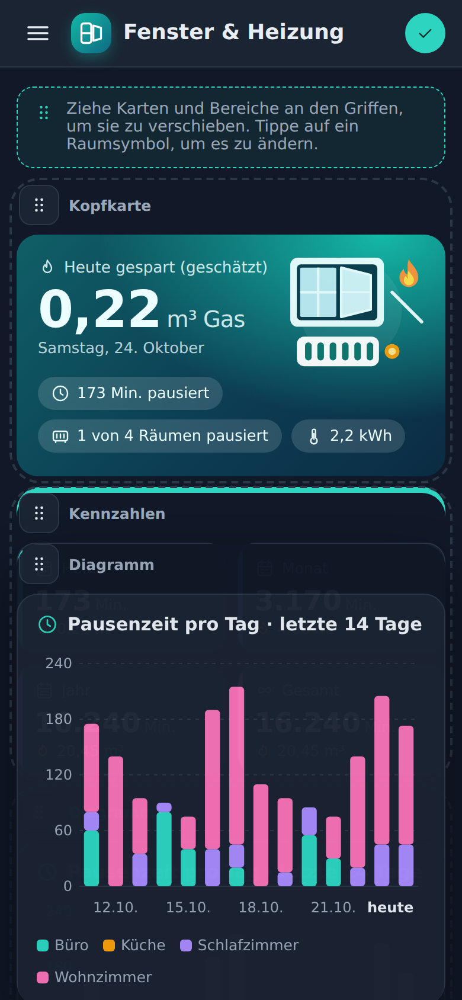
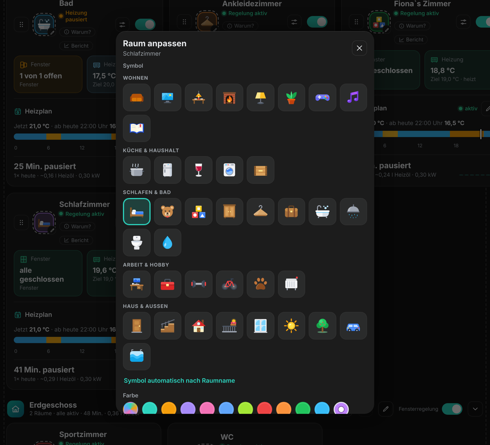
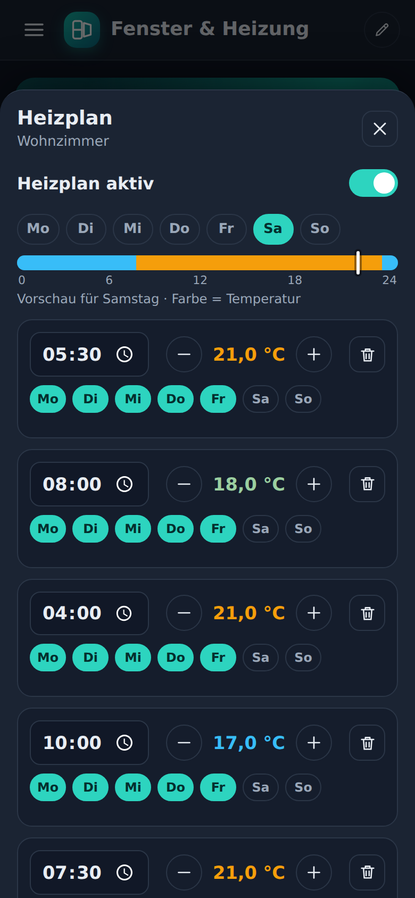

# Fenster & Heizung

Home-Assistant-Integration: Pausiert Heizungsthermostate, solange Fenster offen sind, führt einen Heizplan aus und bringt ein eigenes Dashboard mit.

## Dashboard
Die Integration legt den Eintrag „Fenster & Heizung“ in der Seitenleiste an. Das Dashboard füllt sich automatisch mit allen eingerichteten Räumen.

 

- Kopfkarte mit dem heute gesparten Gas, Kacheln für Heute, Monat, Jahr und Gesamt
- Balkendiagramm der Pausenzeit der letzten 14 Tage, nach Räumen gestapelt
- Raumkarten mit Status, Fenster, Heizung, Heizplan und 7-Tage-Verlauf
- Hell und Dunkel folgen dem Design von Home Assistant

### Anpassen (nur Administratoren)
Mit „Anpassen“ oben rechts lassen sich die Bereiche und die Raumkarten an den Griffen verschieben. Ein Tipp auf das Raumsymbol öffnet die Auswahl mit 16 Symbolen. Die Anordnung wird gespeichert und gilt für alle Nutzer.

 

## Heizplan
Pro Raum gibt es einen Heizplan aus Schaltpunkten: Tage, Uhrzeit und Temperatur. Bearbeitet wird er im Dashboard über den Stift am Raum (nur Administratoren).

- Pro Schaltpunkt wählst du mehrere Tage, die Uhrzeit und die Temperatur. Kürzel: „Mo–Fr“, „Sa–So“, „Alle Tage“.
- Zu jedem Schaltpunkt wird die Zieltemperatur an die Thermostate gesendet. Ausgeschaltete Thermostate schaltet der Plan je nach Einstellung ein: „Nein“, „Heizen“ oder „Automatik“. Andere Modi (z. B. cool) bleiben unberührt.
- Dazwischen bleibt eine manuelle Änderung bis zum nächsten Schaltpunkt bestehen.
- Während ein Fenster die Heizung pausiert, greift der Plan nicht. Nach dem Schließen gilt die Temperatur, die dann laut Plan dran ist.
- Steht der eigene Heizungs-Sensor auf „Heizung aus“, wird der Plan nicht ausgeführt.
- Der Schalter „Heizplan aktiv“ und der Sensor „Heizplan Solltemperatur“ (mit nächster Änderung als Attribut) lassen sich in Automationen verwenden.

## Funktionen
- Einrichtung pro Raum über das Menü: Fenstersensoren und Thermostate frei wählbar
- Thermostat ausschalten oder auf Absenktemperatur stellen, mit Verzögerung nach Öffnen und Schließen
- Sperrzeit (z. B. nachts) und Außentemperatur-Bedingung
- Erinnerung bei langem Lüften: Aktionen per Auswahlmenü, eigener Titel und Text mit den Platzhaltern `{raum}`, `{minuten}`, `{fenster}`
- Eigener Heizungs-Sensor wählbar (z. B. climate, Schalter, Sommer-Modus): steht er auf „Heizung aus“, wird nicht geregelt und nur die Fenstermeldung bleibt aktiv
- Sensoren „Heizung pausiert“ für heute, Monat, Jahr und gesamt (Minuten) mit geschätztem gespartem Gas (m³ und kWh) als Attribut; optional aus Raumfläche, Heizlast und Außentemperatur berechnet
- Sensor „Betriebszustand“: Regelung aktiv, Heizung pausiert, Heizung aus (nur Fenstermeldung) oder Regelung deaktiviert
- Schalter „Fensterregelung aktiv“ und „Heizplan aktiv“ pro Raum

## Installation über HACS
1. HACS → drei Punkte → **Benutzerdefinierte Repositories**
2. URL dieses Repos eintragen, Kategorie **Integration**
3. „Fenster & Heizung“ installieren und Home Assistant neu starten
4. Einstellungen → Geräte & Dienste → Integration hinzufügen → „Fenster & Heizung“

## Neue Version veröffentlichen
1. `version` in `custom_components/fenster_heizung/manifest.json` erhöhen
2. Auf GitHub ein **Release** mit passendem Tag erstellen (z. B. `v2.0.1`)
3. HACS zeigt das Update an

## Änderungen
Alle Versionen siehe [CHANGELOG.md](CHANGELOG.md).
