# Fenster & Heizung

Home-Assistant-Integration (HACS): Pausiert Heizungsthermostate, solange Fenster offen sind, führt einen Heizplan aus, kennt Anwesenheit und Urlaub und bringt ein eigenes Dashboard mit Tagesberichten pro Raum mit. Aktuelle Version: **2.6.0**.

## Inhalt
- [Dashboard](#dashboard)
- [Räume und Gruppen](#räume-und-gruppen)
- [Bericht pro Raum](#bericht-pro-raum)
- [Heizplan](#heizplan)
- [Raumeinstellungen im Dashboard](#raumeinstellungen-im-dashboard)
- [Darstellung: Farben, Symbole, Fotos, Wetter](#darstellung-farben-symbole-fotos-wetter)
- [„Warum?“ pro Raum](#warum-pro-raum)
- [Raumluft: Lüften und Schimmel](#raumluft-lüften-und-schimmel)
- [Wetter-Anpassung und Sommermodus](#wetter-anpassung-und-sommermodus)
- [Sichern und Wiederherstellen](#sichern-und-wiederherstellen)
- [Meine Ansicht](#meine-ansicht)
- [Update-Hinweis](#update-hinweis)
- [Anwesenheit und Urlaub](#anwesenheit-und-urlaub)
- [Brennstoff und Ersparnis](#brennstoff-und-ersparnis)
- [Einrichtung und Einstellungen](#einrichtung-und-einstellungen)
- [Entitäten](#entitäten)
- [Installation über HACS](#installation-über-hacs)
- [Update und Hinweise](#update-und-hinweise)
- [Neue Version veröffentlichen](#neue-version-veröffentlichen)

## Dashboard
Die Integration legt den Eintrag „Fenster & Heizung“ in der Seitenleiste an. Das Dashboard füllt sich automatisch mit allen eingerichteten Räumen. Oben steht der Titel „Modul 1 – Fenster & Heizung“ mit der installierten Versionsnummer; in der Kopfkarte sitzt das MADDOG3010-Logo (`frontend/logo.png`, austauschbar).

 

- Kopfkarte mit der heute gesparten Menge (je nach Brennstoff), Außentemperatur und Wetter sowie Kacheln für Heute, Monat, Jahr und Gesamt
- Balkendiagramm der Pausenzeit der letzten 14 Tage, nach Räumen gestapelt
- Raumkarten mit Status, Fenster, Heizung, Heizplan und 7-Tage-Verlauf, umschaltbar zwischen **Detail** und **Kompakt**
- Karte „Anwesenheit & Urlaub“
- Hell und Dunkel folgen dem Design von Home Assistant, das Layout passt sich Handy und Desktop an

### Anpassen (nur Administratoren)
Mit dem Stift oben rechts lassen sich die Bereiche und die Raumkarten an den Griffen verschieben. Ein Tipp auf das Raumsymbol öffnet die Auswahl mit 16 Symbolen. Die Anordnung wird gespeichert und gilt für alle Nutzer.

 

### Ansicht: Detail oder Kompakt
Oben im Raumbereich schaltest du zwischen „Detail“ (Karten) und „Kompakt“ (eine Zeile pro Raum) um. Die Kompaktansicht ist praktisch bei vielen Räumen, etwa sechs auf dem Tablet: Raumname, Fenster, Ist- und Zieltemperatur, Heizplan und Pausenzeit stehen in einer Zeile, Knöpfe für Bericht, „Warum?“, Heizplan und Einstellungen sitzen rechts. Die Auswahl wird pro Browser gemerkt.

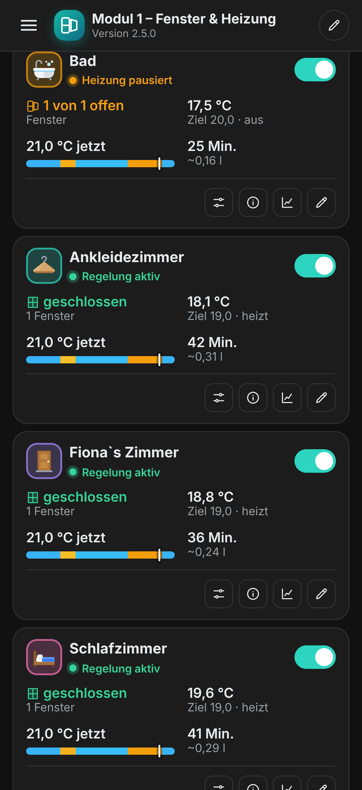 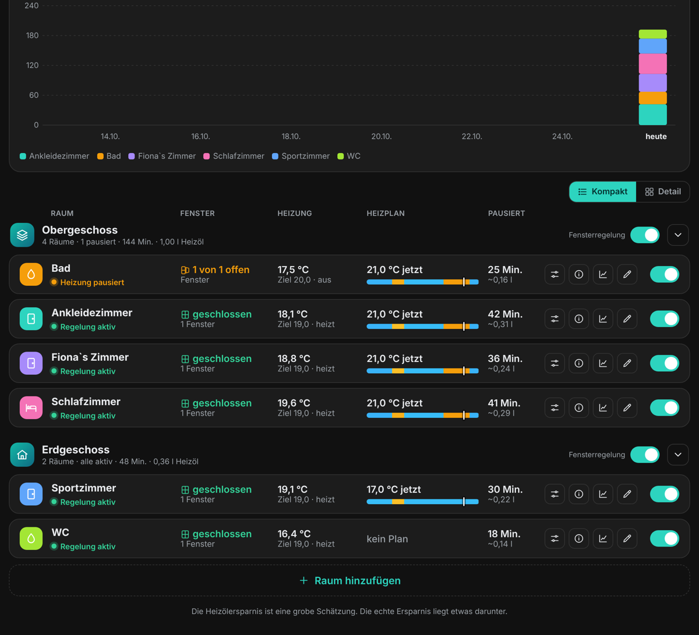

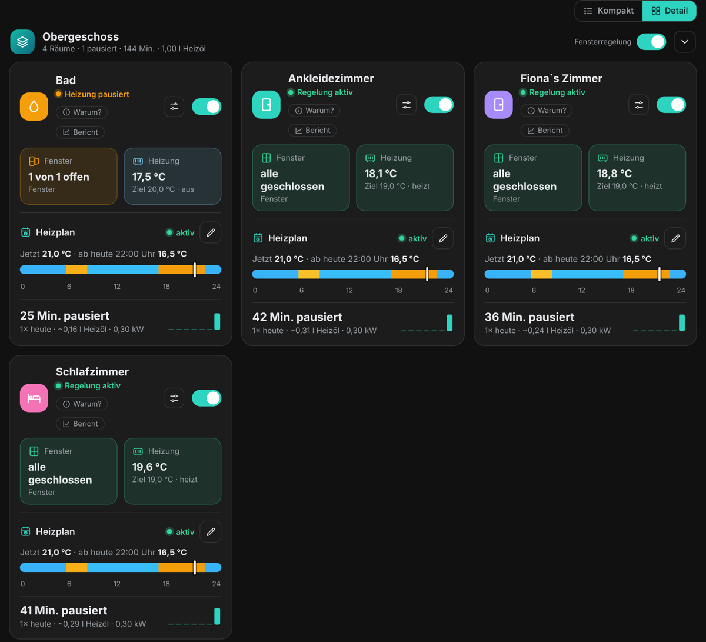

## Räume und Gruppen
Räume lassen sich zu Gruppen (Zonen) zusammenfassen, zum Beispiel „Obergeschoss“ und „Erdgeschoss“.

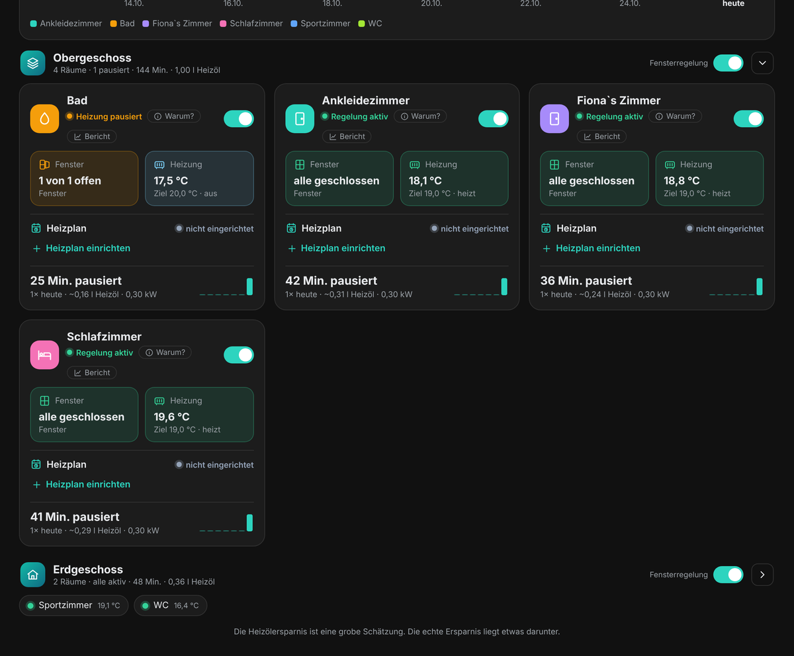

- Jede Gruppe hat eine Kopfzeile mit Symbol, Name, Zusammenfassung (Anzahl Räume, pausierte Räume, Pausenzeit, gesparte Menge) und einem gemeinsamen Schalter für die Fensterregelung aller Räume der Gruppe.
- Mit dem Pfeil klappst du eine Gruppe ein. Dann bleiben nur kleine Chips mit Raumname und Temperatur sichtbar. Der Zustand wird pro Browser gemerkt.
- Im Anpassen-Modus legst du Gruppen an, benennst sie, wählst eines von fünf Symbolen und die Räume. Ein Raum gehört immer nur zu einer Gruppe, nicht zugeordnete Räume erscheinen unter „Weitere Räume“. Die Reihenfolge der Gruppen änderst du mit den Pfeiltasten.
- Höchstens 12 Gruppen. Gespeichert wird für alle Nutzer gemeinsam.

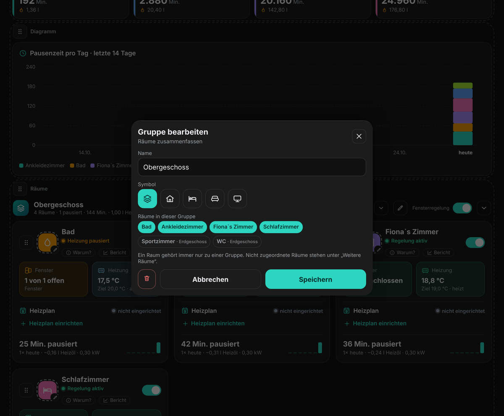

## Bericht pro Raum
Der Knopf „Bericht“ auf jeder Raumkarte öffnet einen Tagesbericht.

Ganz oben zeigt der Bericht die **gelernte Aufheizzeit**: Die Integration erkennt jede Aufheizphase (mindestens 1 K unter dem Ziel bis zum Erreichen) und merkt sich die Minuten pro Kelvin, getrennt nach Frost, kühl und mild. Ab drei Phasen erscheint die Zeit von 17 auf 21 °C mit einem Tipp, Heizplan-Einträge entsprechend früher zu legen. Phasen mit offenem Fenster oder geänderter Zieltemperatur zählen nicht.

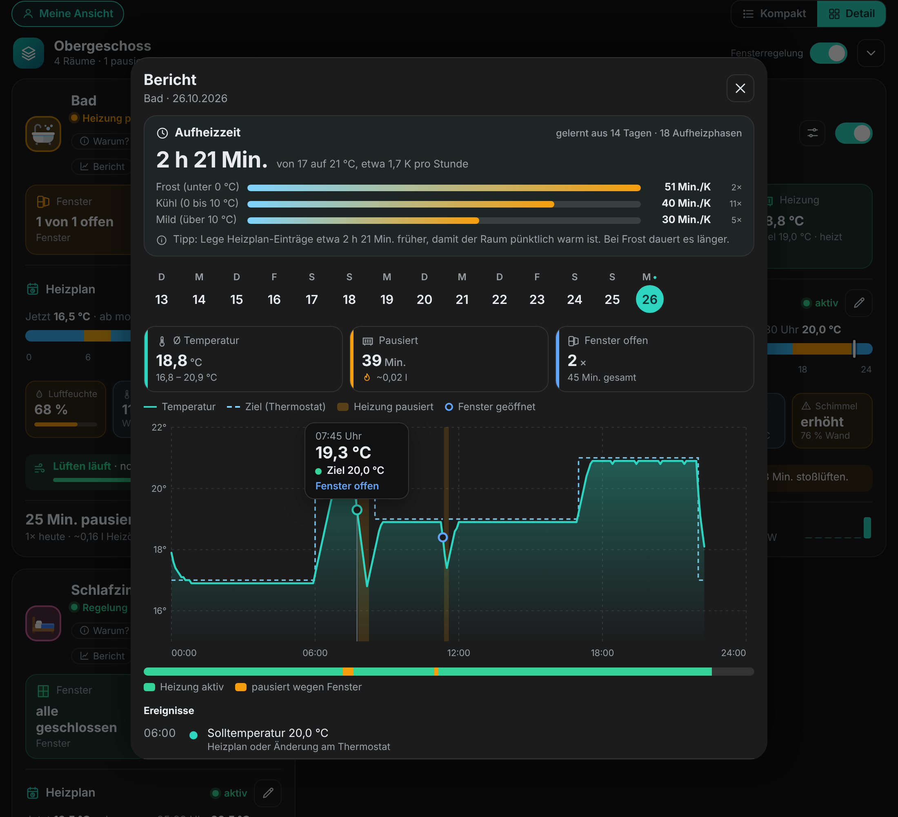

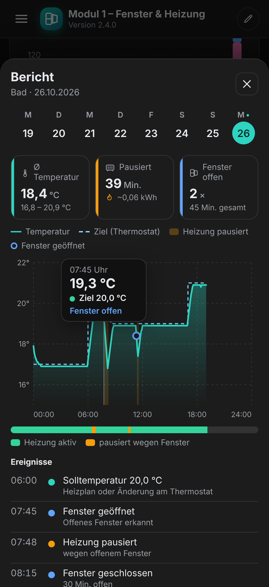 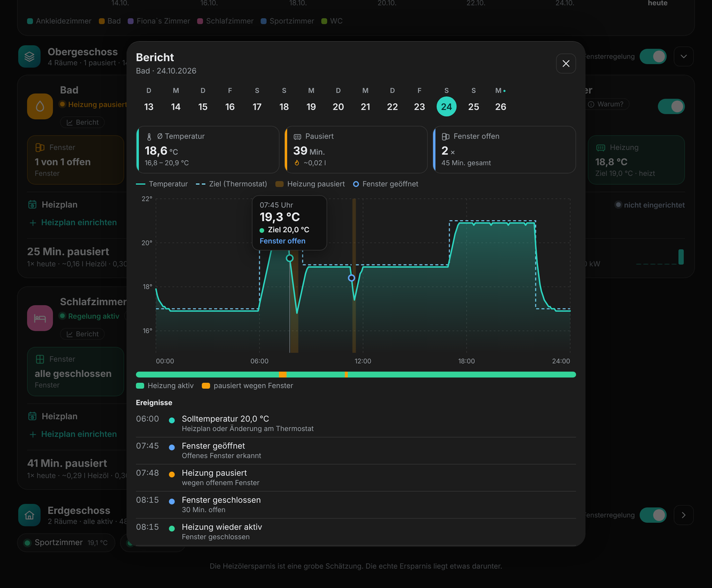

- 7-Tage-Leiste zum Umschalten des Tages (heute ist markiert)
- Kacheln: Ø Temperatur mit Minimum und Maximum, Pausenzeit mit eingesparter Energie, Anzahl und Dauer der Fensteröffnungen
- Verlaufsdiagramm: Temperatur, Ziel des Thermostats (gestrichelt), Pausenzeiten als Band, Fenster-Markierungen; beim Darüberfahren oder Tippen erscheint ein Tooltip mit Uhrzeit, Temperatur, Ziel und Fensterstatus
- Balken „Heizung aktiv / pausiert wegen Fenster“ über den Tag
- Ereignisliste: Solltemperatur-Änderungen, Fenster geöffnet/geschlossen, Heizung pausiert/fortgesetzt

Die Daten stammen aus dem Verlauf von Home Assistant (Thermostate, Fenstersensoren und Betriebszustand). Für volle 7 Tage muss der Recorder mindestens so lange aufbewahren (Standard: 10 Tage). Ältere Tage zeigen eine Meldung statt Daten.

## Heizplan
Pro Raum gibt es einen Heizplan aus Schaltpunkten: Tage, Uhrzeit und Temperatur. Bearbeitet wird er im Dashboard über den Stift am Raum (nur Administratoren).

**Wochenansicht:** Im Editor zeigen sieben Balken untereinander alle Wochentage auf einen Blick, jeweils mit den Temperaturstufen über 24 Stunden. Der Tag, den du gerade bearbeitest, ist hervorgehoben, die übrigen sind abgedunkelt. Ein Tipp auf einen Balken wählt den Tag.

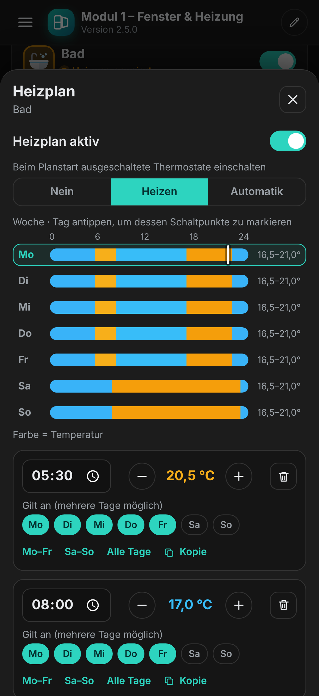 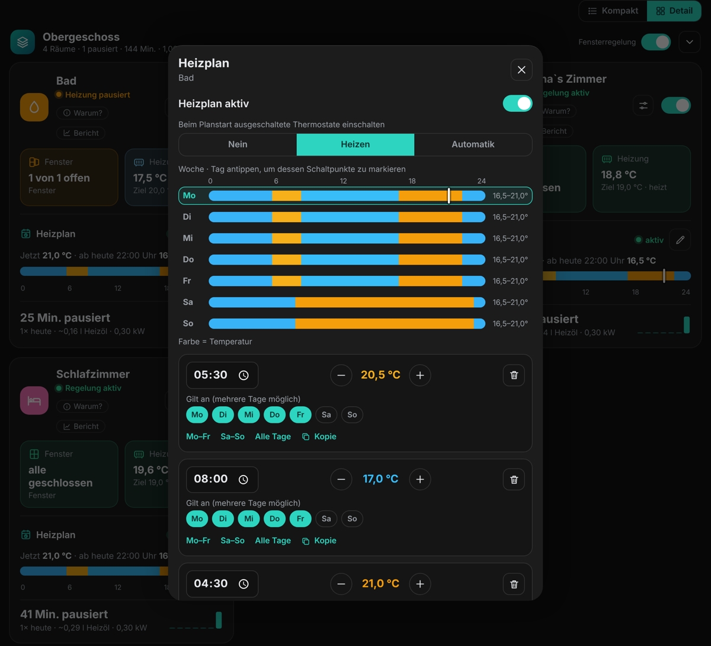

- Pro Schaltpunkt wählst du mehrere Tage, die Uhrzeit und die Temperatur. Kürzel: „Mo–Fr“, „Sa–So“, „Alle Tage“.
- Zu jedem Schaltpunkt wird die Zieltemperatur an die Thermostate gesendet. Ausgeschaltete Thermostate schaltet der Plan je nach Einstellung ein: „Nein“, „Heizen“ oder „Automatik“. Andere Modi (z. B. cool) bleiben unberührt.
- Dazwischen bleibt eine manuelle Änderung bis zum nächsten Schaltpunkt bestehen.
- Während ein Fenster die Heizung pausiert, greift der Plan nicht. Nach dem Schließen gilt die Temperatur, die dann laut Plan dran ist.
- Steht der eigene Heizungs-Sensor auf „Heizung aus“, wird der Plan nicht ausgeführt.
- Der Schalter „Heizplan aktiv“ und der Sensor „Heizplan Solltemperatur“ (mit nächster Änderung als Attribut) lassen sich in Automationen verwenden.

## Raumeinstellungen im Dashboard
Das Zahnrad auf jeder Raumkarte (nur Administratoren) öffnet die Einrichtung des Raums direkt im Dashboard, ohne Umweg über die Home-Assistant-Einstellungen. Fünf aufklappbare Abschnitte:

- **Geräte:** Fenstersensoren und Thermostate (als Chips hinzufügen und entfernen)
- **Regelung:** Verzögerungen, Aktion (ausschalten oder Absenktemperatur), Absenktemperatur, Heizungs-Sensor
- **Bedingungen:** Sperrzeit und Außentemperatur
- **Erinnerung:** Benachrichtigungsdienste (mehrere möglich), Titel, Text, Wartezeit
- **Energie:** Brennstoff, Energie pro Einheit, JAZ/COP, Heizleistung, Fläche, Heizlast, Auslegungstemperatur

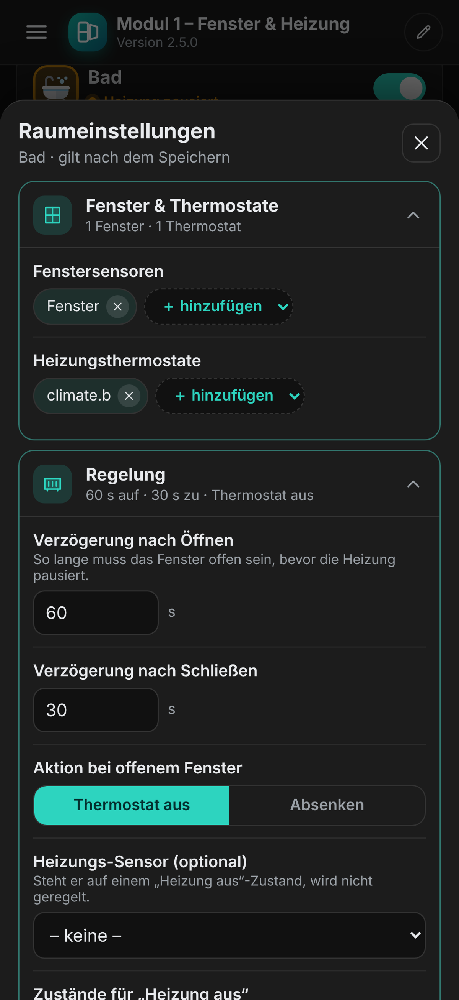 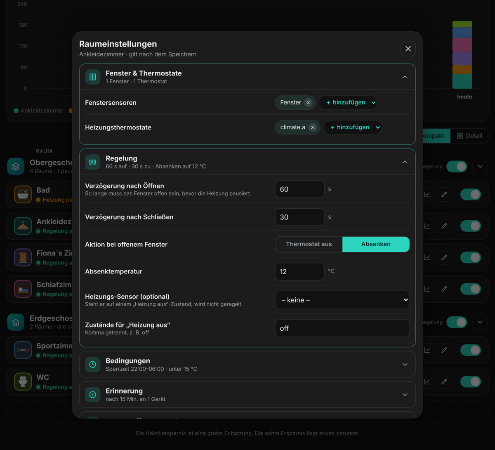

Eingaben werden vor dem Speichern geprüft; Fehler erscheinen direkt im Dialog. Nach dem Speichern lädt die Integration den Raum neu. „Raum hinzufügen“ und „Raum entfernen“ öffnen die Integrationsseite von Home Assistant, dort werden Einträge angelegt und gelöscht.

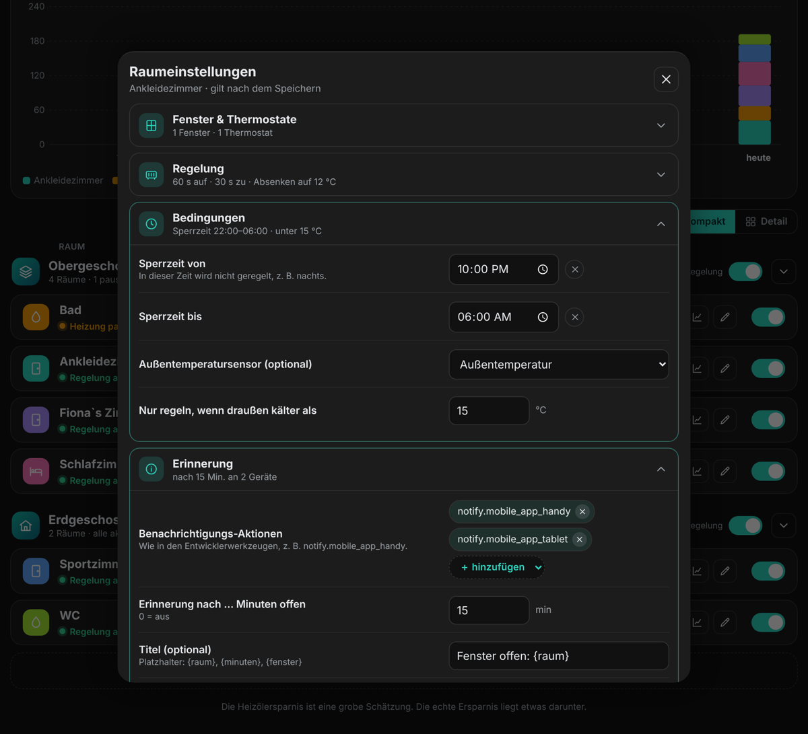

## Darstellung: Farben, Symbole, Fotos, Wetter
Alles hier stellt ein Administrator im Dashboard ein (Stift „Anpassen“) und gilt für alle Nutzer.

### Akzentfarbe
Unter **Darstellung** wählst du die Akzentfarbe aus 8 Farben oder über „Eigene“. Sie färbt Kopfkarte, Knöpfe, Schalter, Links und Diagramme. Die Textfarbe auf Knöpfen passt sich automatisch an, damit sie lesbar bleibt.

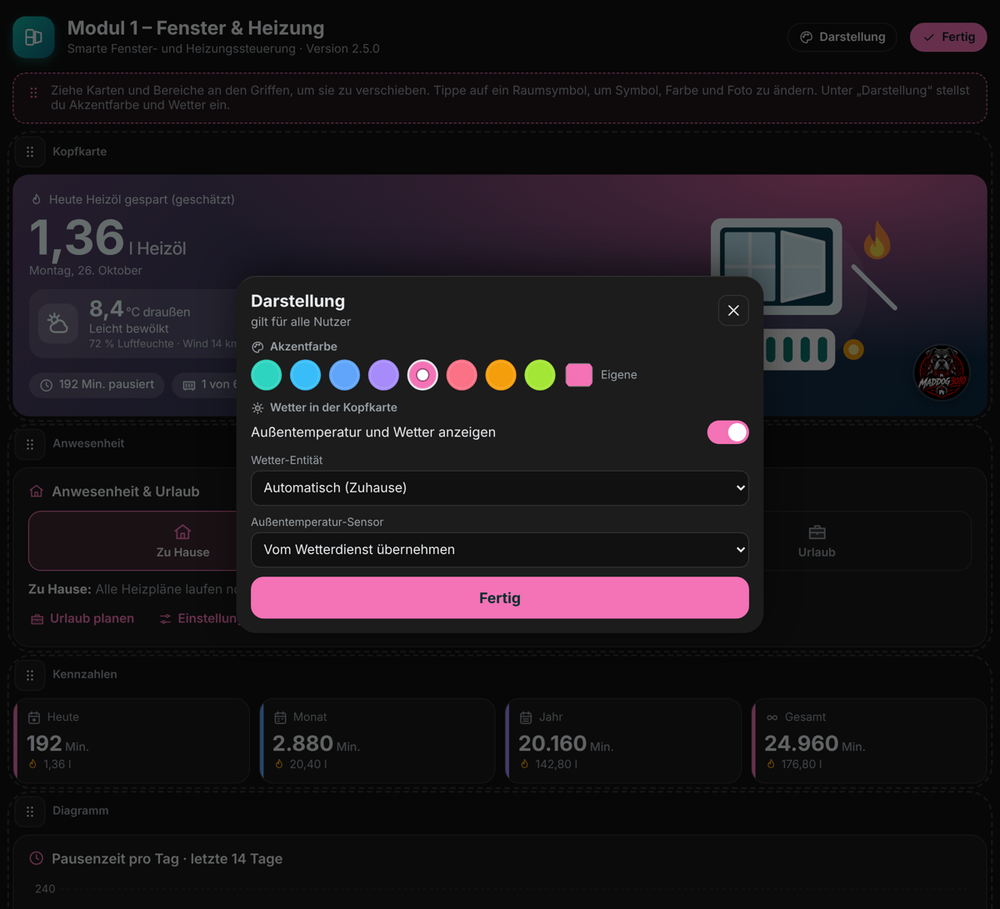

### Raumfarben, Symbole und Foto
Im Anpassen-Modus öffnet ein Tipp auf das Raumsymbol den Dialog „Raum anpassen“:

- **Symbol:** 39 farbige Symbole in fünf Gruppen (Wohnen, Küche & Haushalt, Schlafen & Bad, Arbeit & Hobby, Haus & Außen). Die Namen stehen als Tooltip an den Symbolen. „Symbol automatisch nach Raumname“ erkennt Begriffe wie Ankleide, Keller, Garage, Dusche oder Fitness.
- **Farbe:** 12 Farben, „Eigene“ oder „Automatisch“. Die Raumfarbe rahmt das Symbol und gilt im Pausen-Diagramm und in der Legende.
- **Foto:** Optionales Raumfoto als abgedunkelter Kartenhintergrund, in Detail- und Kompaktansicht. Das Bild wird im Browser auf etwa 560 px verkleinert und höchstens ca. 110 KB groß gespeichert. Höchstens 12 Fotos.

 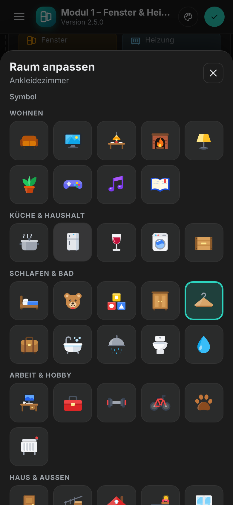

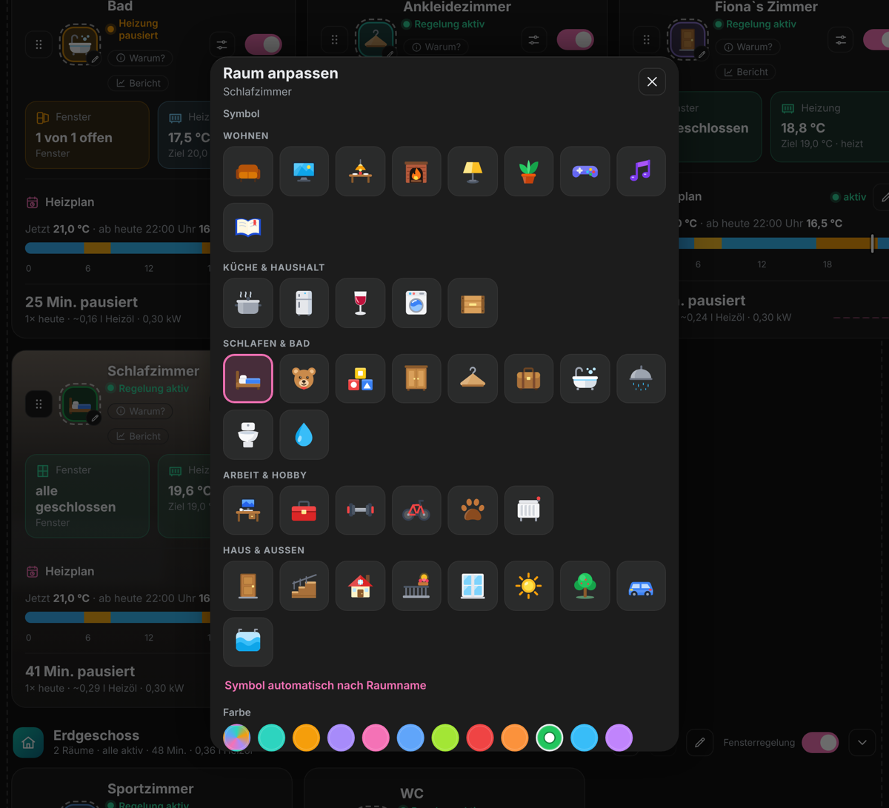

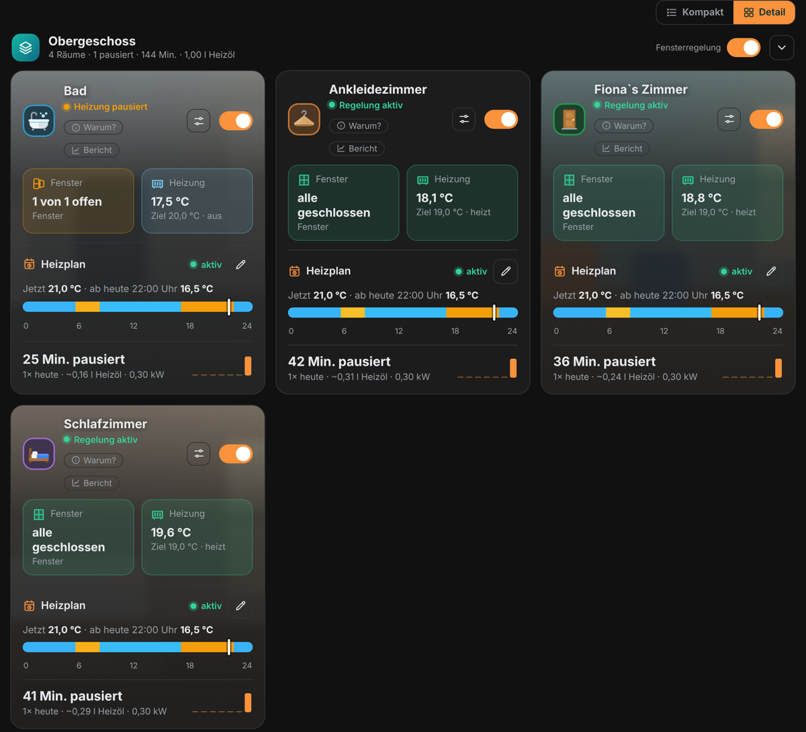

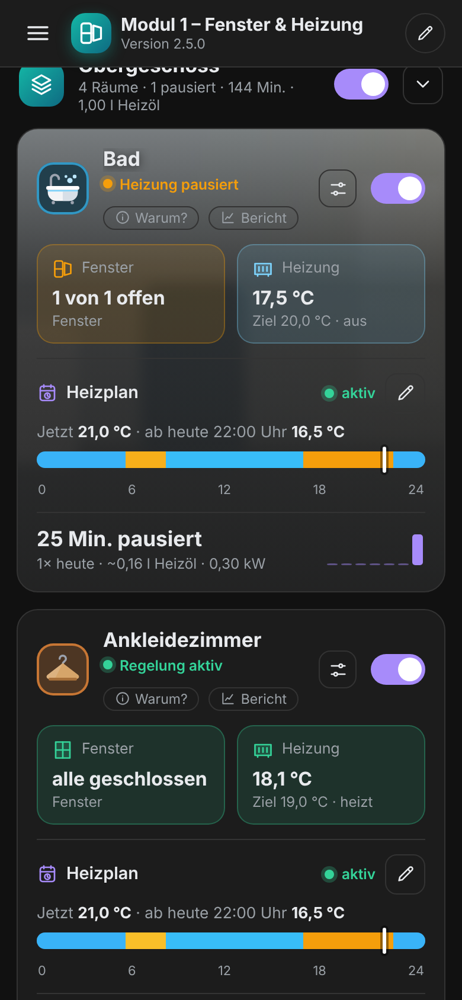 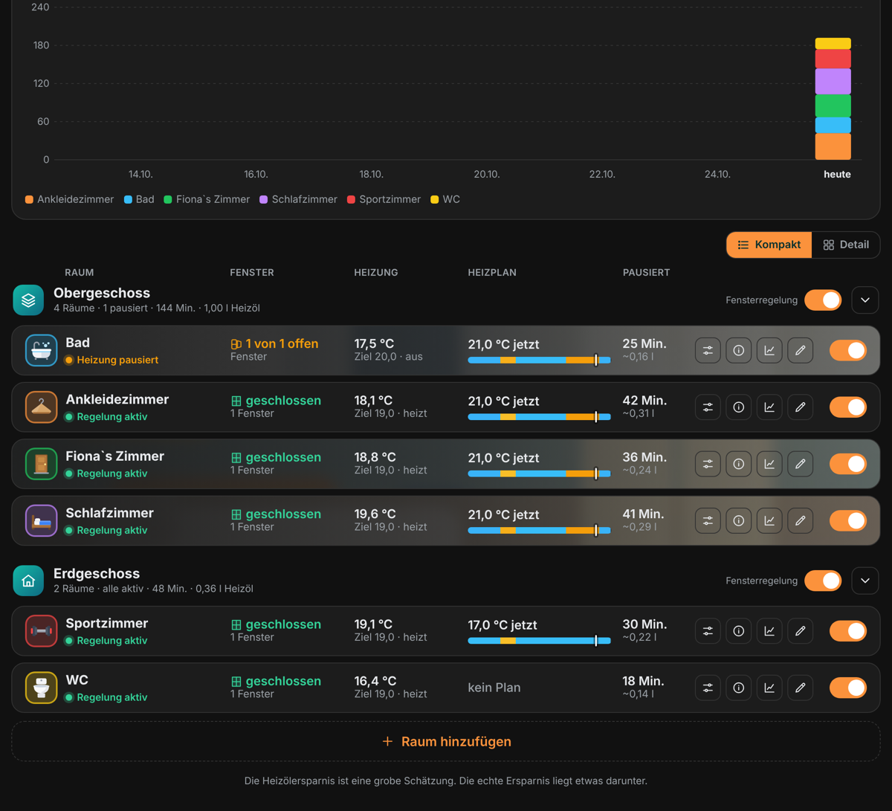

### Außentemperatur und Wetter
Die Kopfkarte zeigt unter dem Datum Wettersymbol, Außentemperatur, Zustand sowie Luftfeuchte und Wind, soweit deine Wetter-Entität sie liefert.

- Die Wetter-Entität wird automatisch gefunden (erste `weather.*`). Unter **Darstellung** wählst du eine andere.
- Optional nimmst du einen eigenen Außentemperatur-Sensor, sonst gilt die Temperatur des Wetterdienstes.
- Mit dem Schalter lässt sich die Anzeige ausblenden.

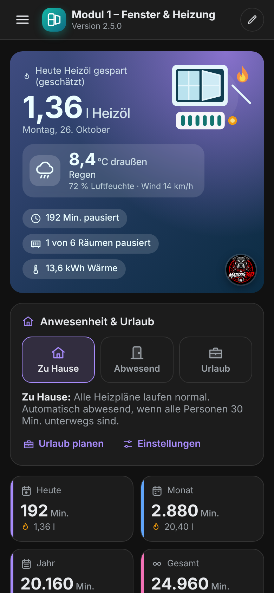 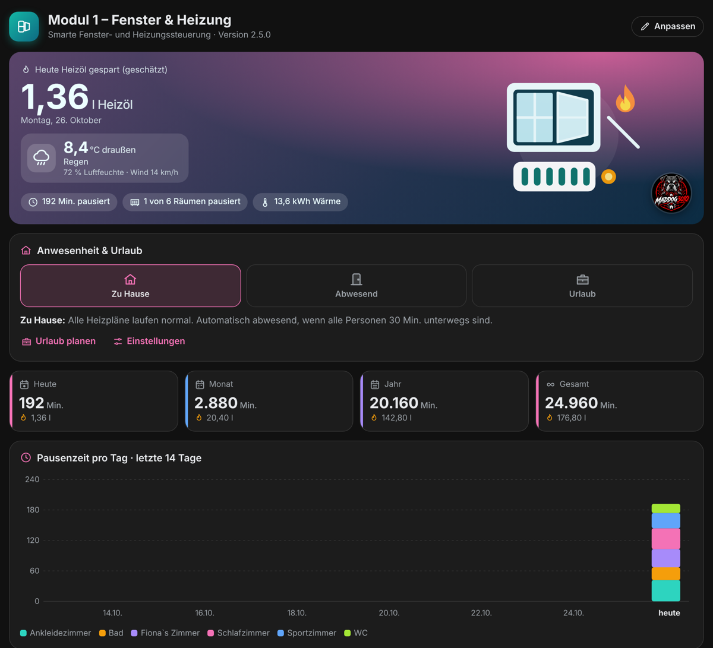

## Raumluft: Lüften und Schimmel
Hat ein Raum einen Luftfeuchte-Sensor, zeigt die Karte **Luftfeuchte**, **Taupunkt** und **Schimmelrisiko** (gering, erhöht, hoch) mit einer Empfehlung.

- Der Sensor wird unter **Raumeinstellungen › Raumluft** gewählt. Dort lassen sich die Hinweise auch abschalten.
- Das Schimmelrisiko beruht auf der Luftfeuchte an der kalten Wandoberfläche (Außenwand). Die Rechnung nutzt Raumtemperatur, Außentemperatur und Luftfeuchte. Es ist eine Schätzung, kein Messwert.
- Die Empfehlung nennt die Dauer zum Stoßlüften, abhängig von der Außentemperatur. Ist die Außenluft feuchter als die Raumluft, rät die Karte vom Lüften ab.
- Bei offenem Fenster läuft ein **Countdown** mit Fortschrittsbalken. Danach heißt es „genug gelüftet, Fenster schließen“.
- In der Kompaktliste steht ein kleiner Chip unter dem Raumnamen.

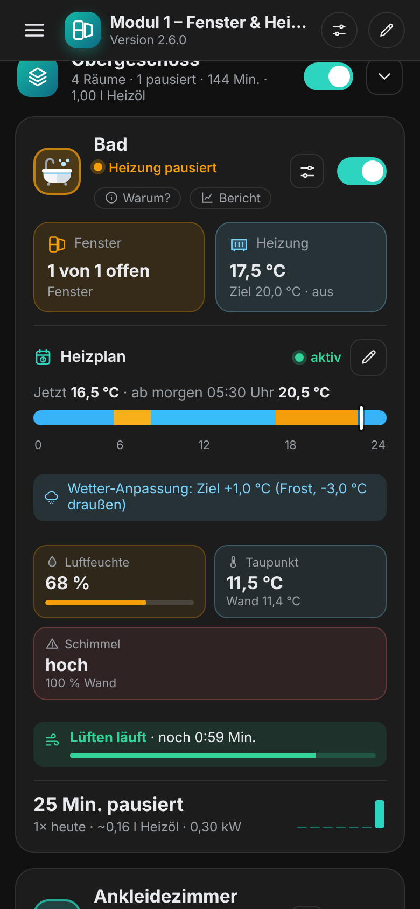 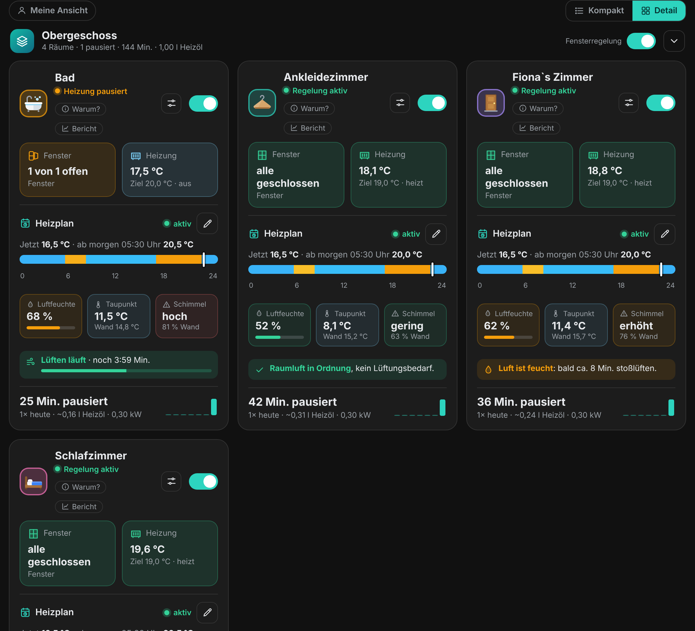

## Wetter-Anpassung und Sommermodus
Beides stellst du unter **Allgemein** (Knopf oben rechts, nur Administratoren) ein.

### Wetterabhängige Absenkung
Bei Sonne oder milder Luft sinkt die Zieltemperatur des Heizplans, bei Frost steigt sie. Standardmäßig ist die Funktion **aus**.

- Du legst fest: „Mild ab“ (z. B. 12 °C), „absenken um“, „Frost bis“ (z. B. 0 °C) und „anheben um“ (in Kelvin). Bei Sonne gilt „mild“ schon 5 °C früher. Ein Spielraum von 1 K verhindert ständiges Umschalten.
- Gilt nur für den Heizplan, nicht für Abwesenheit oder Urlaub. Einzelne Räume lassen sich unter **Raumeinstellungen › Wetter-Anpassung** ausnehmen.
- Die Außentemperatur kommt aus dem Sensor oder der Wetter-Entität, die du unter **Darstellung** gewählt hast. Die Karten zeigen den Hinweis „Wetter-Anpassung: Ziel +1,0 °C (Frost, −3,0 °C draußen)“.

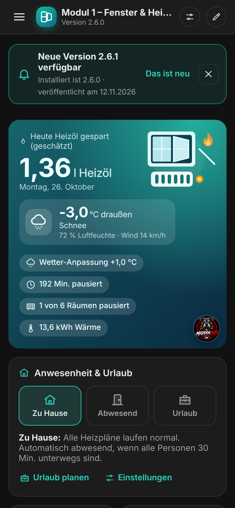 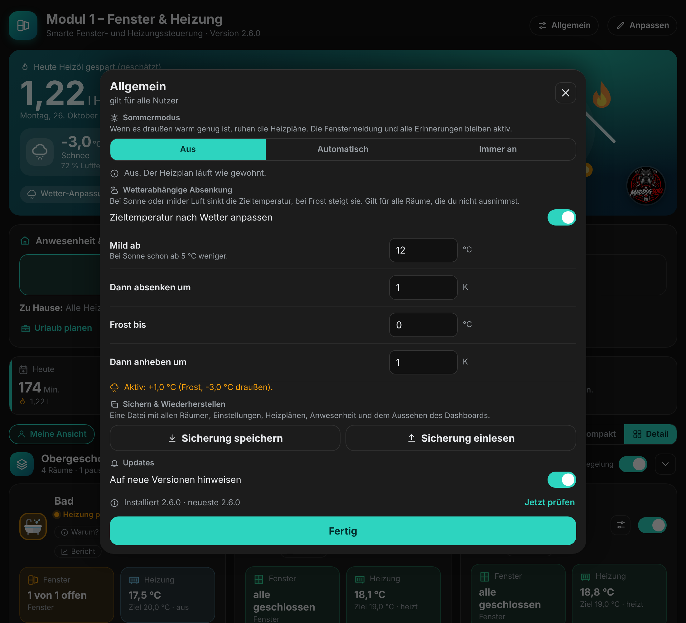

### Sommermodus
Aus, Automatisch oder Immer an. Bei „Automatisch“ ruhen die Heizpläne, wenn die mittlere Außentemperatur der letzten 1, 3 oder 7 Tage die Schwelle (Standard 18 °C) erreicht. Die Fenstermeldung und alle Erinnerungen bleiben aktiv. Die Kopfkarte zeigt den Chip „Sommermodus“, die Pläne sind abgedimmt.

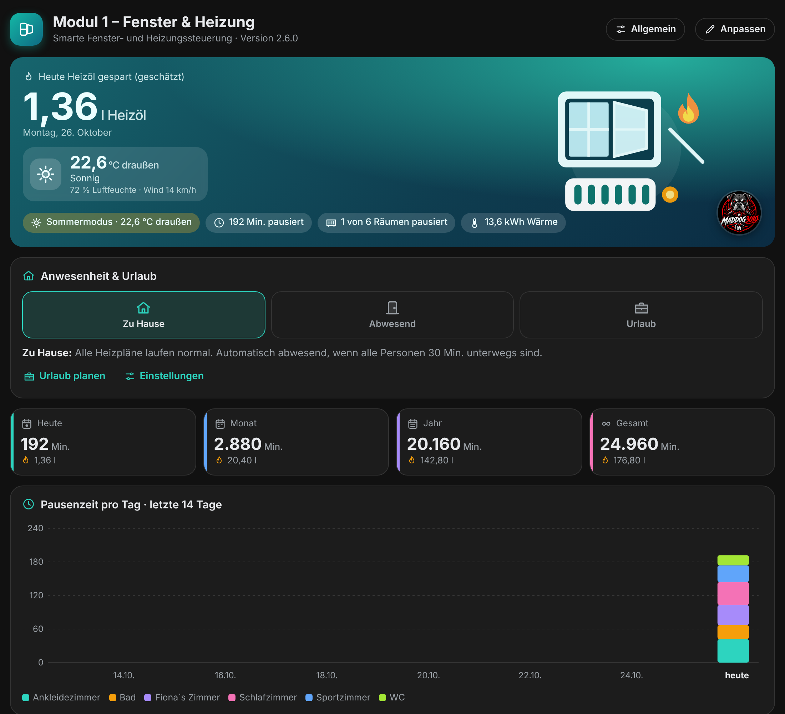

## Sichern und Wiederherstellen
Unter **Allgemein › Sichern & Wiederherstellen** speicherst du eine JSON-Datei mit allen Räumen und Raumeinstellungen, Heizplänen, Anwesenheit, Aussehen (Farben, Symbole, Fotos, Gruppen) und den allgemeinen Einstellungen.

- „Sicherung einlesen“ zeigt zuerst eine Zusammenfassung. Erst „Wiederherstellen“ ersetzt die aktuellen Einstellungen.
- Räume werden anhand ihrer ID zugeordnet, sonst über einen eindeutigen Namen. Räume, die es nicht mehr gibt, werden übersprungen. Das Dashboard meldet, wie viele.
- Entitäten, die auf dem neuen System fehlen, führen dazu, dass der Raum seine bisherigen Einstellungen behält.

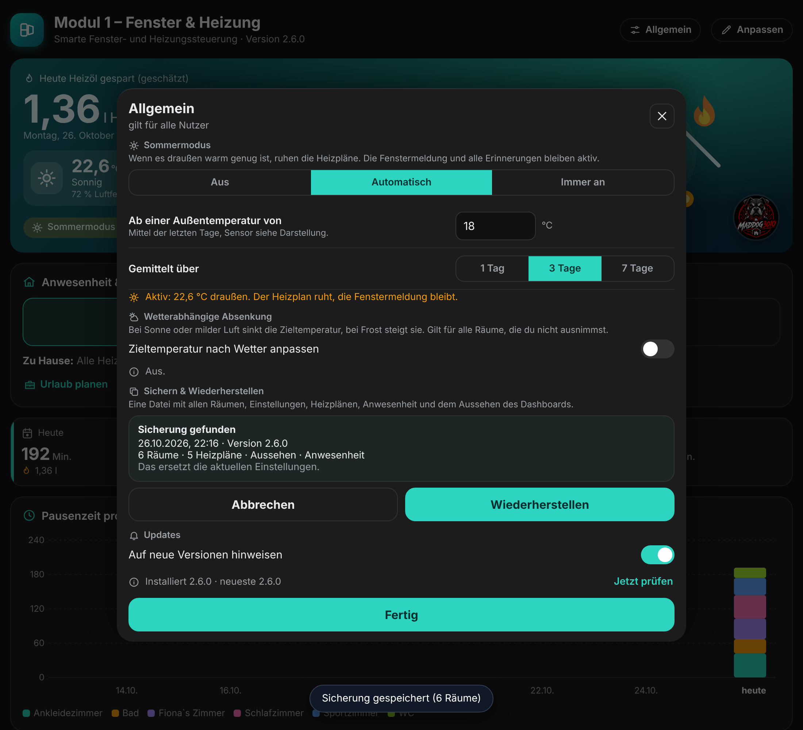

## Meine Ansicht
Der Knopf **Meine Ansicht** links über den Raumkarten gilt nur für dich in diesem Browser. Du kannst Räume ein- und ausblenden, ihre Reihenfolge ändern und ganze Bereiche (Kopfkarte, Anwesenheit, Kennzahlen, Diagramm, Räume) ausblenden. Die gemeinsame Ansicht der anderen Nutzer bleibt unverändert. „Zurücksetzen“ stellt alles zurück.

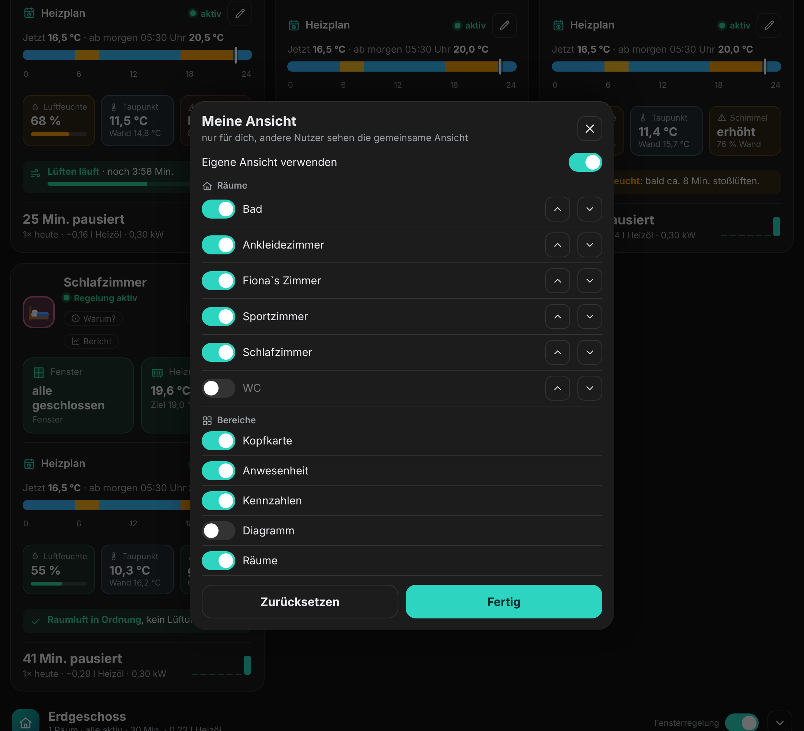

## Update-Hinweis
Administratoren sehen oben ein Banner, wenn auf GitHub eine neuere Version veröffentlicht wurde („Neue Version 2.7.0 verfügbar“). **Das ist neu** zeigt die Punkte aus der Release-Beschreibung (Aufzählungen mit `-` oder `*`), „In HACS öffnen“ führt zum Update, „Überspringen“ blendet die Version aus.

- Die Prüfung fragt höchstens alle 6 Stunden die öffentliche GitHub-Schnittstelle ab. Unter **Allgemein › Updates** lässt sie sich ausschalten.
- Schreibe in jedem Release kurze Aufzählungspunkte, dann erscheinen sie im Dashboard.

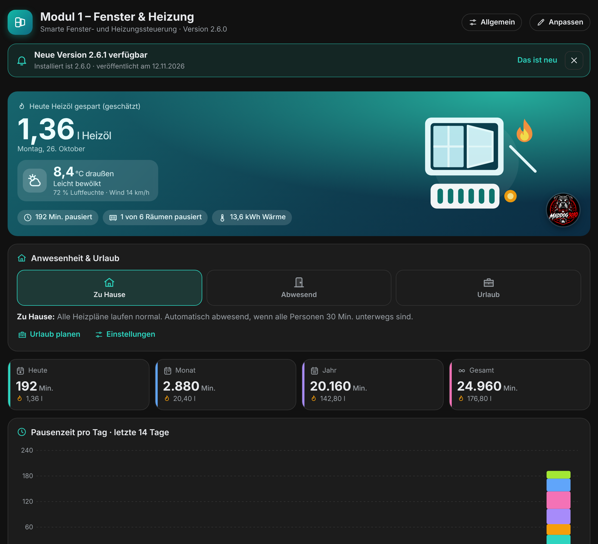 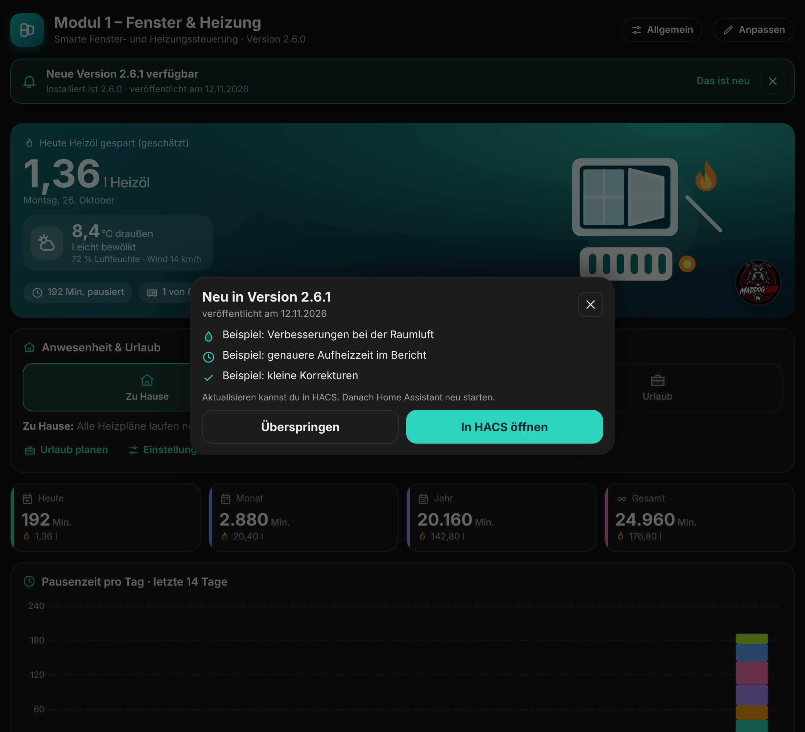

## „Warum?“ pro Raum
Der Knopf „Warum?“ auf jeder Raumkarte erklärt den aktuellen Zustand: welches Fenster seit wann offen ist, ob die Verzögerung erreicht ist und wann die Heizung pausiert, Sperrzeit, Außentemperatur, Heizplan und Abwesenheit.

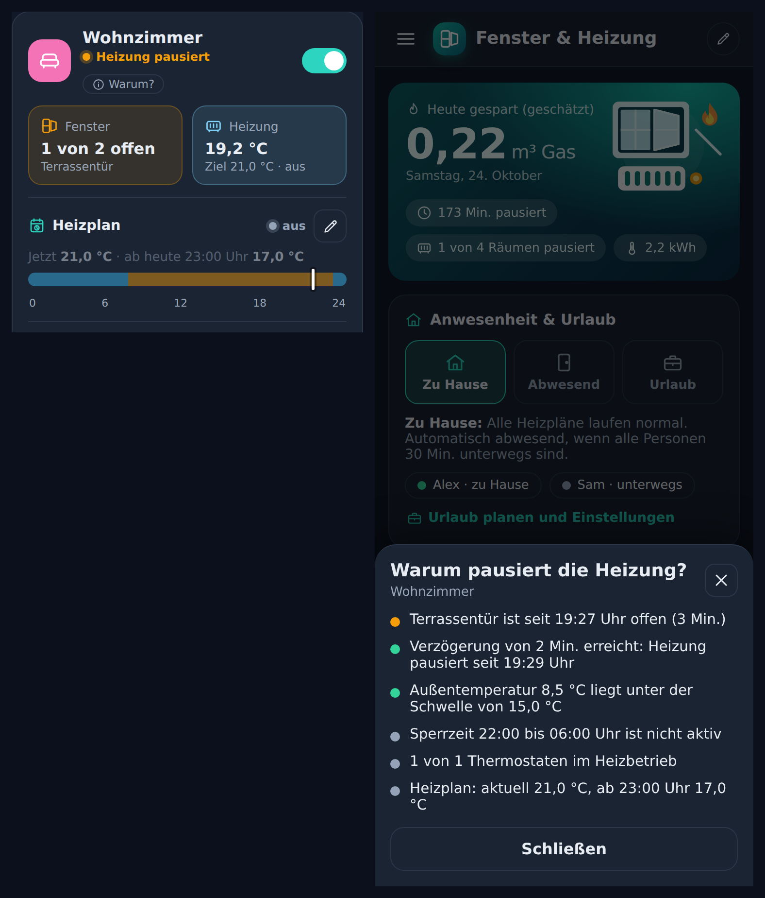

## Anwesenheit und Urlaub
Eine Karte im Dashboard stellt alle Räume gemeinsam um: **Zu Hause**, **Abwesend** oder **Urlaub**. Zwei getrennte Knöpfe öffnen je einen Dialog:

- **Urlaub planen:** Von, Bis und Vorheizen am Rückkehrtag. Danach schaltet der Zustand von selbst auf „Zu Hause“.
- **Einstellungen:** Absenktemperatur für Abwesenheit und Urlaub sowie die automatische Erkennung (Personen, Wartezeit). Speichern ändert den aktuellen Modus nicht.

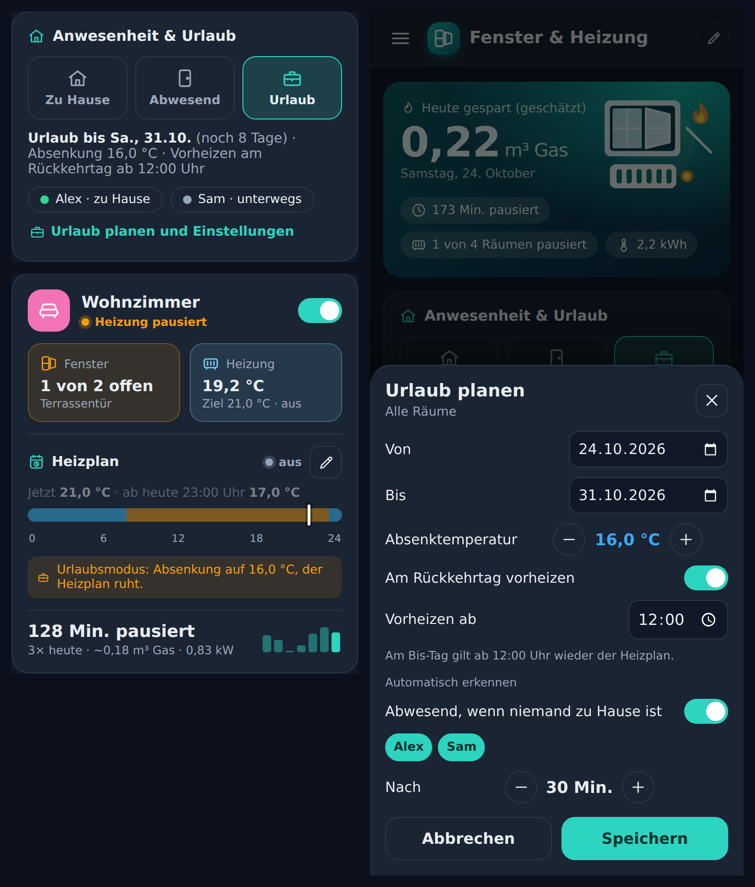 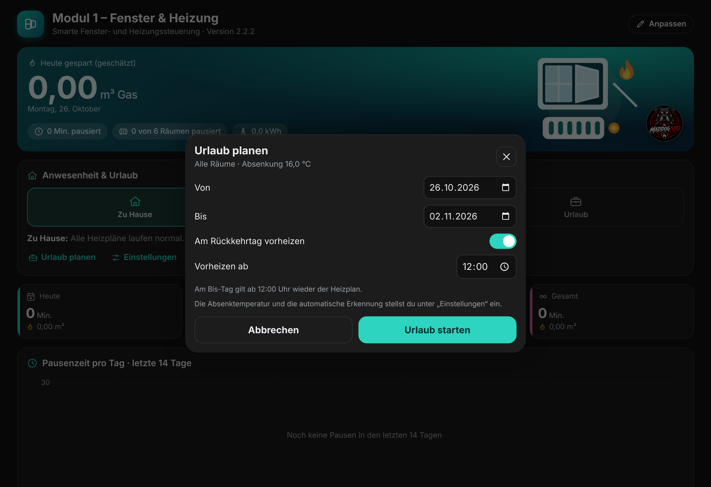 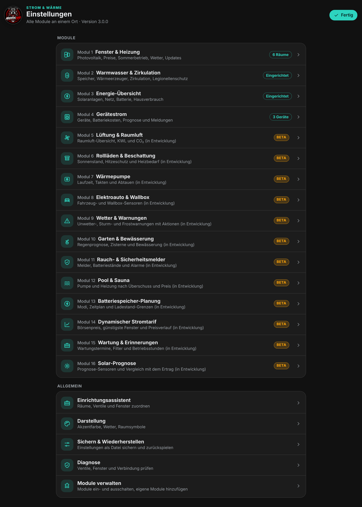

- Bei Abwesenheit und Urlaub werden Thermostate im Modus `heat` oder `auto` auf die Absenktemperatur gestellt, der Heizplan ruht.
- Bei der Rückkehr gilt wieder der Heizplan, ohne Plan werden die vorherigen Temperaturen wiederhergestellt.
- Automatisch abwesend, wenn alle gewählten Personen eine einstellbare Zeit unterwegs sind.

## Brennstoff und Ersparnis
Die Integration schätzt, wie viel Heizenergie durch die Pausen gespart wurde, und rechnet sie in die Menge deines Brennstoffs um. Den Brennstoff wählst du pro Raum.

| Brennstoff | Einheit | Standard: kWh pro Einheit |
|---|---|---|
| Erdgas | m³ | 10 |
| Heizöl | l | 10 |
| Flüssiggas | l | 6,6 |
| Pellets | kg | 4,8 |
| Wärmepumpe / Strom | kWh | 1 (mit JAZ/COP, Standard 3,5) |

- „Energie pro Einheit (kWh)“ ist je Brennstoff vorbelegt und anpassbar. Leer oder 0 bedeutet Standardwert.
- Bei Wärmepumpe/Strom wird die Wärme durch die JAZ/COP geteilt, um den Stromverbrauch zu erhalten.
- Beschriftungen, Einheiten und der Hinweistext im Dashboard folgen dem Brennstoff („Heizöl gespart“, „l“ statt „m³“). Bei gemischten Brennstoffen zeigt das Dashboard die Ersparnis als kWh Heizenergie.
- Die Ersparnis ist eine grobe Schätzung, die echte liegt etwas darunter. Die Heizleistung ist fest einstellbar oder wird aus Raumfläche, Heizlast und Außentemperatur berechnet.

## Einrichtung und Einstellungen
Jeder Raum wird als eigener Eintrag über das Menü eingerichtet: Einstellungen → Geräte & Dienste → Integration hinzufügen. Danach lassen sich alle Werte auch im Dashboard ändern, siehe [Raumeinstellungen im Dashboard](#raumeinstellungen-im-dashboard).

- Fenstersensoren und Thermostate frei wählbar
- Thermostat ausschalten oder auf Absenktemperatur stellen, mit Verzögerung nach Öffnen und Schließen
- Sperrzeit (z. B. nachts) und Außentemperatur-Bedingung
- Erinnerung bei langem Lüften: Aktion per Auswahlmenü, eigener Titel und Text mit den Platzhaltern `{raum}`, `{minuten}`, `{fenster}`
- Eigener Heizungs-Sensor wählbar (z. B. climate, Schalter, Sommer-Modus): steht er auf „Heizung aus“, wird nicht geregelt und nur die Fenstermeldung bleibt aktiv
- Brennstoff, Energie pro Einheit, JAZ/COP, Heizleistung, Raumfläche, Heizlast und Auslegungstemperatur für die Ersparnis

## Entitäten
Pro Raum:

| Entität | Beschreibung |
|---|---|
| Schalter „Fensterregelung aktiv“ | Regelung ein/aus |
| Schalter „Heizplan aktiv“ | Heizplan ein/aus |
| Sensor „Heizung pausiert“ (heute, Monat, Jahr, gesamt) | Minuten; Attribute: `gespart_menge`, `einheit`, `brennstoff`, `gespartes_gas_kwh`, bei Erdgas zusätzlich `gespartes_gas_m3` |
| Sensor „Betriebszustand“ | Regelung aktiv, Heizung pausiert, Heizung aus (nur Fenstermeldung) oder Regelung deaktiviert |
| Sensor „Heizplan Solltemperatur“ | aktuelle Vorgabe des Plans, nächste Änderung als Attribut; dazu `sommermodus` und `wetter_anpassung` |

## Installation über HACS
1. HACS → drei Punkte → **Benutzerdefinierte Repositories**
2. URL dieses Repos eintragen, Kategorie **Integration**
3. „Fenster & Heizung“ installieren und Home Assistant neu starten
4. Einstellungen → Geräte & Dienste → Integration hinzufügen → „Fenster & Heizung“

## Update und Hinweise
- Nach einem Update Home Assistant neu starten und die Seite einmal neu laden (Strg+F5), damit das neue Dashboard geladen wird.
- Der bisherige Wert „Energie pro m³ Gas“ bleibt für Erdgas erhalten.
- Die Raumeinstellungen im Dashboard nutzen die neuen WebSocket-Befehle `fenster_heizung/get_options` und `fenster_heizung/set_options` (nur Administratoren). Neue Werte werden wie in den Home-Assistant-Optionen gespeichert.
- Farben, Fotos, Symbole und die Wetteranzeige werden im gemeinsamen Layout gespeichert (WebSocket-Befehl `fenster_heizung/set_layout`, nur Administratoren). Das Backend prüft Farben, Foto-Format und -Größe sowie die Entitäten.
- Version 2.6.0 fügt die WebSocket-Befehle `get_general`, `set_general`, `get_update`, `get_learning` und `restore` hinzu. Das Backend prüft alle Werte; Änderungen sind nur für Administratoren erlaubt.
- Neue Raumeinstellungen (`humidity_sensor`, `air_hint`, `weather_adj`) erscheinen nur im Dashboard. Beim Speichern im HA-Optionsdialog bleiben sie erhalten.
- Der Bericht braucht Verlaufsdaten im Recorder, siehe [Bericht pro Raum](#bericht-pro-raum).

## Neue Version veröffentlichen
1. `version` in `custom_components/fenster_heizung/manifest.json` erhöhen
2. Auf GitHub ein **Release** mit passendem Tag erstellen (z. B. `v2.6.0`) und kurze Aufzählungspunkte in die Beschreibung schreiben (sie erscheinen im Update-Hinweis)
3. HACS zeigt das Update an

## Unterstützen
Gefällt dir die Integration? Über [GitHub Sponsors](https://github.com/sponsors/maddog3010) kannst du die Weiterentwicklung unterstützen. Danke!

## Änderungen
Alle Versionen siehe [CHANGELOG.md](CHANGELOG.md).
