

  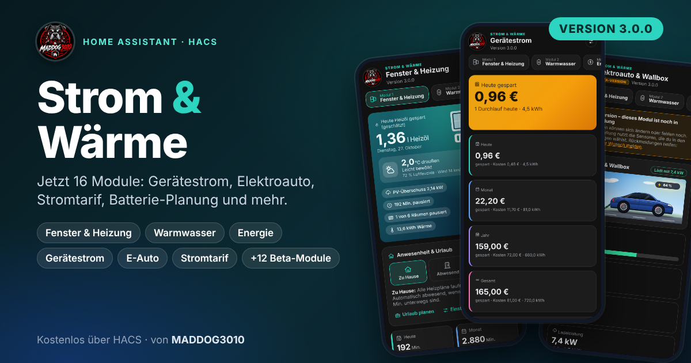

<h1 align="center">Strom & Wärme</h1>

  
  
  
  
  

  
  

<b>Heizung, Strom und Haus auf einer Seite in Home Assistant.</b> 
Heizkörper pausieren bei offenem Fenster, Solarstrom landet im Heizer, im Warmwasser und im Auto, und du siehst, woher der Strom deiner Geräte kommt. Du schaltest nur die Module ein, die du brauchst.

 

  <a href="#neu-in-2026112">Neu</a> ·
  <a href="#installation">Installation</a> ·
  <a href="#module">Module</a> ·
  <a href="#bedienung">Bedienung</a> ·
  <a href="#labs">Labs</a> ·
  <a href="#versionen-und-updates">Versionen</a> ·
  <a href="#sponsor-werden">Sponsor</a> ·
  <a href="https://youtube.com/@strom_und_waerme"><b>▶️ YouTube</b></a> ·
  <a href="#häufige-fragen">Fragen</a> ·
  <a href="https://github.com/Maddog3010/ha-fenster-heizung/blob/main/CHANGELOG.md">Änderungen</a>

> 💗 **Kostenlos, offen und ohne Werbung, und das bleibt so.** Wenn dir die Integration hilft, freue ich mich über dein [Sponsoring](#sponsor-werden).

---

## Neu in 2026.11.2

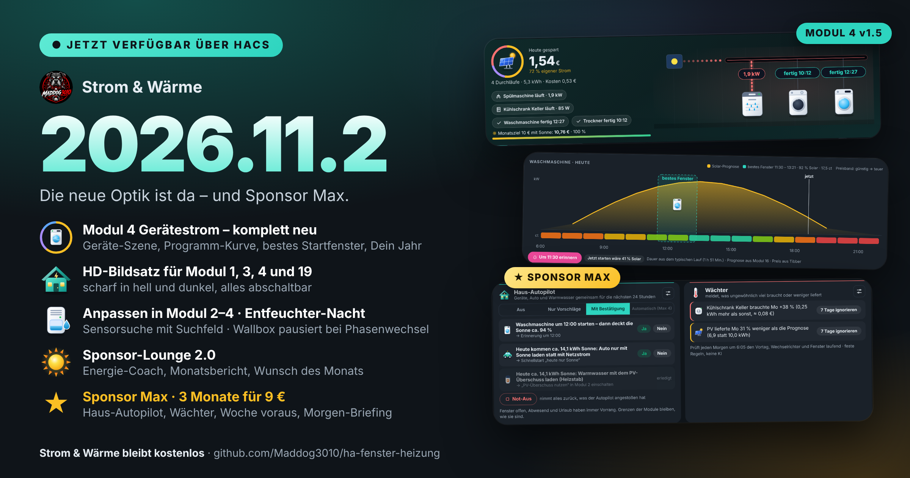

**Die neue Optik ist da.** Ein HD-Bildsatz für Modul 1, 3, 4 und 19, ein komplett neues Modul 4 und dazu die Sponsor-Lounge 2.0 mit Sponsor Max. Alles Neue lässt sich mit „wie bisher“ abschalten.

| | Was ist neu |
|---|---|
| 🧺 **Modul 4 Gerätestrom v1.5** | **Geräte-Szene** im Banner (Kabel leuchtet gelb bei Solar, violett bei Akku, rot bei Netz), **Gerätekarten 2.0** mit Herkunfts-Ring, Restzeit „noch ~ Min.“ und Startempfehlung mit **Erinnern**, **Geräte-Seite** mit Programm-Kurve, Durchlauf-Protokoll und typischem Lauf, **bestes Startfenster** als Bild mit Solarprognose und Preisband, **Startfenster aller Geräte**, **Standby** in W und € im Jahr, **Monatsziel**, **Dein Jahr** als Bild zum Teilen, **Tablet-Wand** und Bewegung (Aus · Dezent · Voll) |
| 🖼️ **HD-Bildsatz** | 38 Symbole für Räume, Energie und Geräte, scharf in hell und dunkel. Modul 19 mit 24 HD-Bildern, die den Zustand zeigen (Wasser in der Trommel, Akku mit Füllstand) |
| ✋ **Anpassen in Modul 2, 3 und 4** | Karten am Griff verschieben, mit dem Auge ausblenden, in Modul 4 auch die Geräte sortieren |
| 💧 **Modul 1 · Entfeuchter-Nachtmodus** | Eigene Nachtzeit, nachts nur bei hoher Feuchte oder ganz aus, Leise-Modus des Geräts, Meldungen erst am Morgen |
| 🔎 **Sensorsuche** | Suchfeld über allen Reitern, im Filter alle Räume und Integrationen |
| 🔐 **Beta-Freigabe** | Testversionen mit Sponsor Max sofort, als Sponsor 3 Tage nach Erscheinen. Stabile Versionen bleiben für alle frei |
| 🛠️ **Behoben** | Messräume verschwinden nicht mehr (mit „Zurückholen“ aus der Sicherung) · Wallbox lädt nach einem Phasenwechsel weiter · Akkukapazität mit Nachkommastelle · Standort und Abwesenheits-Temperatur fallen nicht mehr zurück · eigenes mdi-Symbol in Modul 19 · Zeile „Startseite“ in der Darstellung |
| 💗 **Sponsor-Lounge 2.0** | Energie-Coach (jeden Montag drei Tipps mit Euro-Betrag), Monatsbericht „Dein Haus im Monat“ als Bild, Wunsch des Monats mit Abstimmung auf GitHub |
| ⭐ **Sponsor Max** ($3 im Monat oder $10 einmalig) | Haus-Autopilot, Wächter, Woche voraus, Was wäre wenn …, Heizplan-Assistent, Morgen-Briefing, Jahres-Poster, Beta-Kanal |

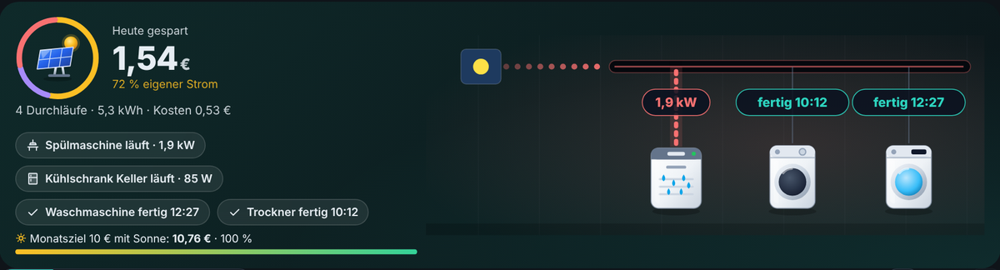

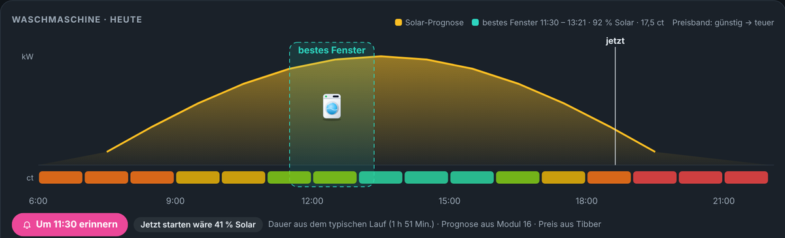 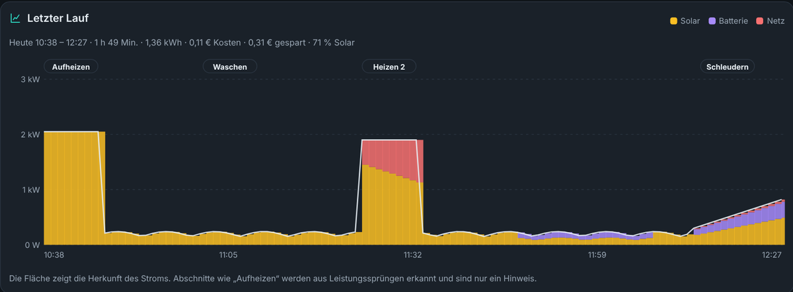

▶️ [**Video zu 2026.11.2 auf YouTube**](https://youtube.com/@strom_und_waerme) · 📖 [**Bedienungsanleitung (PDF)**](https://github.com/Maddog3010/ha-fenster-heizung/blob/main/docs/Bedienungsanleitung.pdf), komplett neu für 2026.11.2 · 📲 [**Tags & Karten mit dem iPhone anlernen**](https://github.com/Maddog3010/ha-fenster-heizung/blob/main/docs/Anleitung_Tags_iPhone.pdf) · [Alle Änderungen](https://github.com/Maddog3010/ha-fenster-heizung/blob/main/CHANGELOG.md)

---

## Das steckt drin

| | Bereich | Was du bekommst |
|---|---|---|
| 🪟 | **Fenster & Heizung** | Pause bei offenem Fenster, Heizpläne, Anwesenheit und Urlaub, Raumsensor, Messräume, Luftentfeuchter mit Nachtmodus, Berichte, Elektroheizer mit PV-Überschuss |
| 🚿 | **Warmwasser** | Speicher, Zeitplan, Zirkulation, Legionellenschutz, Heizstab bei Überschuss |
| ⚡ | **Energie und Gerätestrom** | Solar, Netz, Batterie, Kosten und Autarkie. Pro Gerät: woher kam der Strom, was hat der Lauf gekostet, wann startest du am besten |
| 🚗 | **Elektroauto** | go-e Charger lokal regeln, nach Sonne, Strompreis und Abfahrtszeit laden, Ladestatistik |
| 🌦️ | **Wetter und Sicherheit** | Eigene und amtliche Warnungen, Rauch-, Gas- und Wassermelder mit Grundriss und Wartung |
| 🏠 | **Startseite** | Ampel, Wetter, Personen, Alarm und Hinweise auf einen Blick |
| 📱 | **Tablet-Modus** | Große Knöpfe, Ruhemodus, PIN und Display per Bewegungsmelder, Geräte-Wand |
| 🏷️ | **Tags & Karten** | RFID-Karten und NFC-Sticker lösen feste Aktionen aus |
| 🧪 | **Labs** | Neue Funktionen zum Ausprobieren, ab Werk aus |
| 🧩 | **Addons** | Module zum Installieren: Müllabfuhr, Licht & Lampen, Saugroboter |
| ⚙️ | **Einstellungen** | Alles an einem Ort: Haus-Werte, Messwerk, Suche, Verlauf mit Rückgängig |
| 💾 | **Sicherung** | Als Datei oder automatisch auf deinen Homeserver |
| 💗 | **Sponsor-Lounge** | Extras für Sponsoren, Sponsor Max mit Haus-Autopilot |

---

## Installation

**Du brauchst:** Home Assistant 2024.11 oder neuer und [HACS](https://hacs.xyz).

1. **HACS** öffnen, oben rechts die drei Punkte, **Benutzerdefinierte Repositories**.
2. `https://github.com/Maddog3010/ha-fenster-heizung` eintragen, Kategorie **Integration**.
3. **Strom & Wärme** installieren und Home Assistant **neu starten**.
4. **Einstellungen → Geräte & Dienste → Integration hinzufügen → Strom & Wärme**. Pro Raum ein Eintrag mit Fenstersensoren und Thermostaten.
5. In der Seitenleiste **Strom & Wärme** öffnen. Der **Einrichtungsassistent** führt in acht Schritten durch Räume, Fenstermeldung, Heizung, Luftfeuchte, PV und Meldungen. Jeden Schritt außer dem ersten kannst du überspringen.

Die Module 2 bis 4 sind ab Werk an, alle weiteren aus. Einschalten und einrichten kannst du sie unter **Einstellungen → Module**.

---

## Module

Jedes Modul hat eine eigene **Version mit Build** (zum Beispiel „v1.5 · Build 1“) und eine **Stufe**. Ein Tipp auf die Plakette im Modulkopf zeigt die letzten Änderungen. Alle Module zusammen stehen unter **Einstellungen → System → Versionen → Modulversionen**.

| Stufe | Version | Bedeutung |
|---|---|---|
| 🟢 **Stabil** | ab 1.0 | Geprüft und für den Alltag gedacht. Einstellungen bleiben bei Updates erhalten. |
| 🔵 **Vorabversion** | 0.9 | Fertig bis auf Feinschliff. Einstellungen bleiben erhalten. |
| 🟠 **Beta** | 0.5 bis 0.8 | Arbeitet mit echten Daten, zum Testen. Fehler sind möglich. |
| ⚪ **In Entwicklung** | 0.1 bis 0.4 | Konzept zum Durchklicken mit Beispielwerten, steuert noch nichts. |

Eine neue Funktion hebt die Modulversion um 0.1 und setzt den Build auf 1. Eine Fehlerbehebung erhöht nur den Build.

| Nr. | Modul | Stufe | Was es macht |
|---|---|---|---|
| 1 | **Fenster & Heizung** | Stabil 1.7 | Pause bei offenem Fenster, Heizpläne, Anwesenheit und Urlaub, Raumsensor, Messräume, Luftentfeuchter mit Nachtmodus, Berichte, Elektroheizer |
| 2 | **Warmwasser & Zirkulation** | Stabil 1.1 | Speicher, Zeitplan, Zirkulationspumpe, Legionellenschutz, Heizstab bei PV-Überschuss, Anpassen |
| 3 | **Energie** | Stabil 1.2 | Solar, Netz, Batterie und Hausverbrauch, Tag/Woche/Monat/Jahr, Kosten und Autarkie, Anpassen |
| 4 | **Gerätestrom** | Stabil 1.5 | Geräte-Szene, Gerätekarten mit Herkunfts-Ring und Restzeit, Geräte-Seite mit Programm-Kurve, bestes Startfenster, Standby, Monatsziel, Dein Jahr, Tablet-Wand |
| 5 | Lüftung & Raumluft | In Entwicklung 0.1 | Konzept, Reiter „Jetzt“ mit echten Werten |
| 6 | Rollläden & Beschattung | In Entwicklung 0.1 | Konzept, Reiter „Jetzt“ mit echten Werten |
| 7 | Wärmepumpe | In Entwicklung 0.1 | Konzept, Reiter „Jetzt“ mit echten Außenwerten |
| 8 | **Elektroauto & Wallbox** | Beta 0.5 | go-e Charger (Sonne, Sonne + Netz, Voll, Ladeplan), Planung nach Preis und Prognose, Ladestatistik |
| 9 | **Wetter & Warnungen** | Vorabversion 0.9 | Wetter-Szene, Stufen 1–4 wie beim DWD, alle amtlichen Warnungen, 48-Stunden-Zeitleiste, Aktionen mit Aussperrschutz, Vorsorge, Tablet-Alarm |
| 10 | Garten & Bewässerung | In Entwicklung 0.1 | Konzept mit Gartenplan |
| 11 | **Rauch- & Sicherheitsmelder** | Beta 0.5 | Melder, Batterie, Grundriss-Baukasten, Wartung, Abfahrt-Prüfung |
| 12 | Pool & Sauna | In Entwicklung 0.1 | Konzept, Reiter „Jetzt“ |
| 13 | Batteriespeicher-Planung | In Entwicklung 0.1 | Konzept, Reiter „Jetzt“ mit echtem Ladestand |
| 14 | **Dynamischer Stromtarif** | Beta 0.5 | Stundenpreise, Preisverlauf, günstigste Zeiten |
| 15 | Wartung & Erinnerungen | In Entwicklung 0.1 | Konzept, auf Wunsch mit den Daten aus Modul 11 |
| 16 | **Solar-Prognose** | Stabil 1.0 | Sonnenbogen, Prognose gegen Ertrag je Stunde, korrigierte Prognose, Anlagen einzeln, Sensoren für Automationen |
| 17 | Müllabfuhr | Addon | Abholtermine, Tonnen-Ampel, Erinnerung am Vorabend |
| 18 | Licht & Lampen | Addon | Lampen nach Räumen, dimmen, Lichtfarbe, Szenenknöpfe |
| 19 | **Hausfluss** | Stabil 1.0 · Sponsoren | Dein Haus als Fluss-Bild: Leuchtlinien, Herkunfts-Ring, Lichtband-Banner, Themen, Strom-Reiter mit Kosten, Wand-Ansicht fürs Tablet |
| 21 | Saugroboter | Addon | Roboter-Karte, Raum-Kacheln mit Ampel, Karte, Woche, Wartung |

Die Module 5, 6, 7, 10, 12, 13 und 15 zeigen **Konzeptseiten** zum Durchklicken. Alle Zahlen dort sind Beispiele, diese Module schalten nichts.

<b>1 · Fenster & Heizung</b>

 

- **Fensterregelung:** Ist ein Fenster länger als eingestellt offen, pausiert die Heizung im Raum, beim Schließen geht sie wieder an. Herstellerprofile für Tado, Homematic IP, AVM FRITZ!, Shelly TRV, Aqara und Danfoss Ally.
- **Heizplan:** Wochenplan je Raum, Sommermodus und Wetter-Anpassung.
- **Anwesenheit und Urlaub:** Home-Zone, Personen und Urlaubsplanung senken die Temperatur.
- **Raumsensor (optional):** Raumwert neben dem Thermostat, gelernte Aufheizzeit, Taupunkt, Offset-Ausgleich und „Aus bei Ziel“.
- **Messraum:** Räume nur mit Temperatur und Feuchte, ohne Thermostat. Fehlen Messräume, die noch in der Sicherung stehen, holt „Zurückholen“ sie mit Symbol, Farbe und Foto zurück.
- **Luftentfeuchter:** Regelung nach der Raumfeuchte, Standort per Tipp, Handy oder NFC, bis zu vier Geräte, Vorziehen bei PV-Überschuss oder günstigem Strom. **Neu: Nachtmodus** mit eigener Nachtzeit, nachts nur bei hoher Feuchte oder ganz aus, Leise-Modus des Geräts und Meldungen erst am Morgen.
- **Elektroheizer mit PV-Überschuss** und **Bericht** mit Heizzeit, Pausen und Ersparnis.

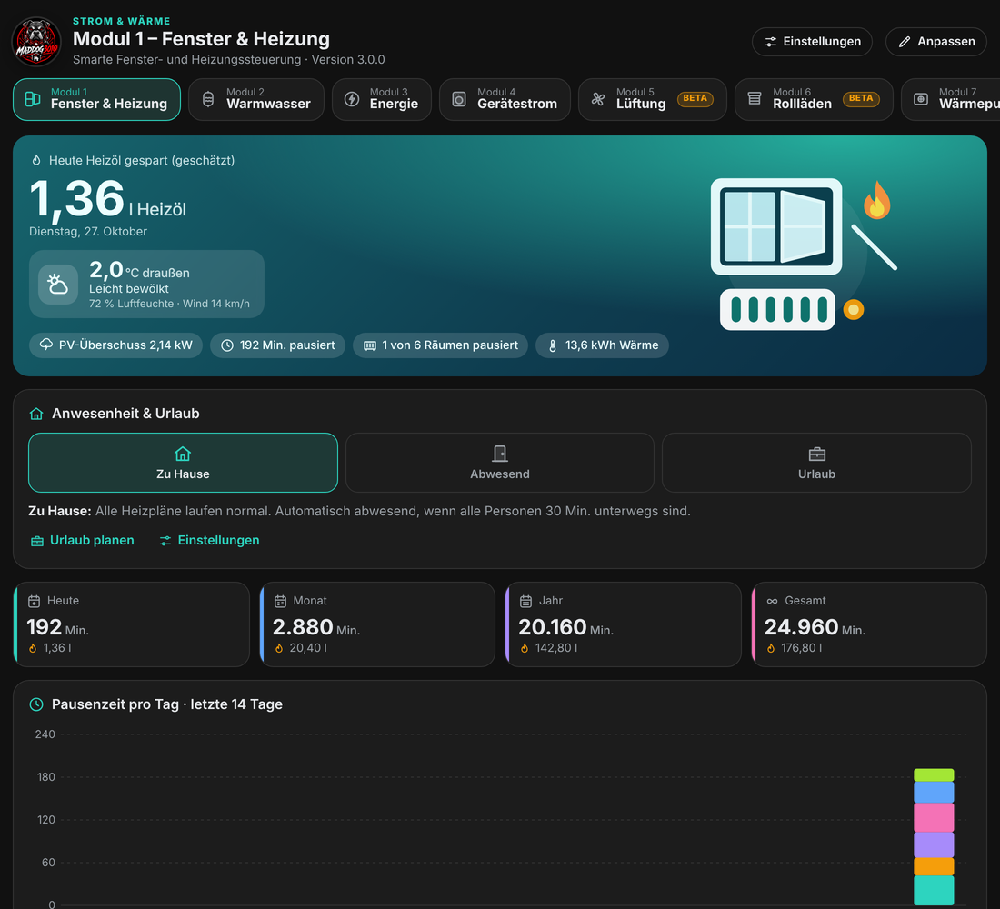

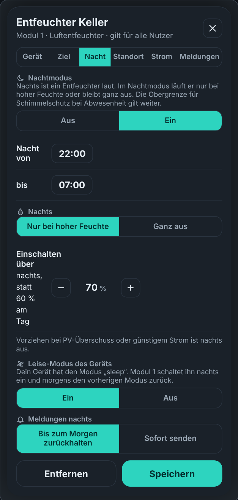 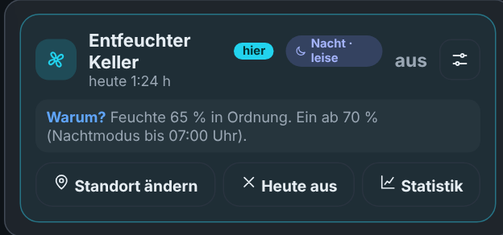

<b>2 · Warmwasser & Zirkulation</b>

 

Zeitplan mit Zieltemperaturen, Zirkulationspumpe, Legionellenschutz und Heizstab bei PV-Überschuss. Die Sicherheitsgrenze (zum Beispiel 65 °C) hat immer Vorrang und ersetzt keinen Verbrühschutz. **Neu:** Karten anpassen wie in Modul 1.

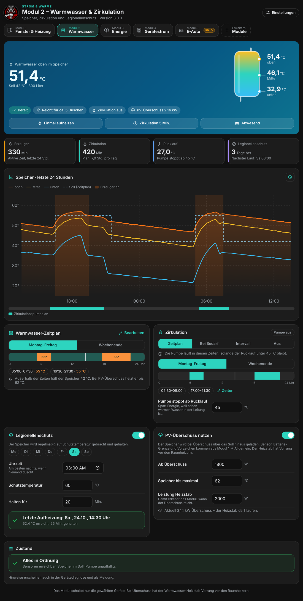

<b>3 · Energie</b>

 

Solar, Netz, Batterie und Hausverbrauch für Tag, Woche, Monat und Jahr, mit ‹ › zum Blättern. Kacheln mit Verlauf und Vergleich zur Vorperiode, Diagramm zum Antippen, Kosten als Treppe bis zur Bilanz, Prüfung der Vorzeichen, optional eine zweite Solaranlage. **Neu:** Karten anpassen wie in Modul 1.

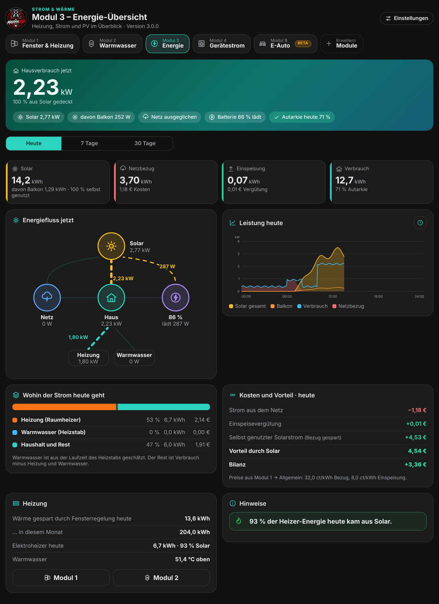

<b>4 · Gerätestrom</b> (neu in 2026.11.2)

 

- **Geräte-Szene im Banner:** die drei wichtigsten Geräte hängen an einer Stromleiste. Laufende Geräte bekommen ein leuchtendes Kabel (gelb Solar, violett Batterie, rot Netz) und ihre Leistung als Plakette, fertige „fertig 12:27“, bereite „ab 11:30 ☀“. Links der Herkunfts-Ring und das **Monatsziel** „€ mit Sonne gespart“.
- **Gerätekarten 2.0:** HD-Bild mit Herkunfts-Ring, Prozentzeile, Zustand „läuft“, „fertig“ oder „bereit“, „noch ~ Min. · fertig ~ Uhr“ ab drei gelernten Läufen, Kosten, Ersparnis, letzter Lauf und Startempfehlung mit **Erinnern**. „Karten wie bisher“ holt die alten Karten zurück.
- **Geräte-Seite** beim Antippen: Zustand, Anteile, **Standby** in W und € im Jahr, **bestes Startfenster** als Bild (Solarprognose als Fläche, Preisband aus Tibber), **Programm-Kurve** des Laufs nach Herkunft gefärbt mit erkannten Abschnitten, **Durchlauf-Protokoll** und **typischer Lauf** aus den letzten 10 Läufen.
- **Startfenster aller Geräte**, **Woher der Strom kam** und **Dein Jahr** („Mit Sonne gewaschen: 19 von 24“, als Bild zum Teilen).
- **Tablet-Modus:** quer eine Geräte-Wand mit sechs großen Kacheln, hoch die Liste. **Bewegung** Aus · Dezent · Voll. Auf dem Handy laufende Geräte oben, alle anderen als ruhige Zeilen.
- **Anpassen:** Karten und Geräte verschieben und ausblenden.

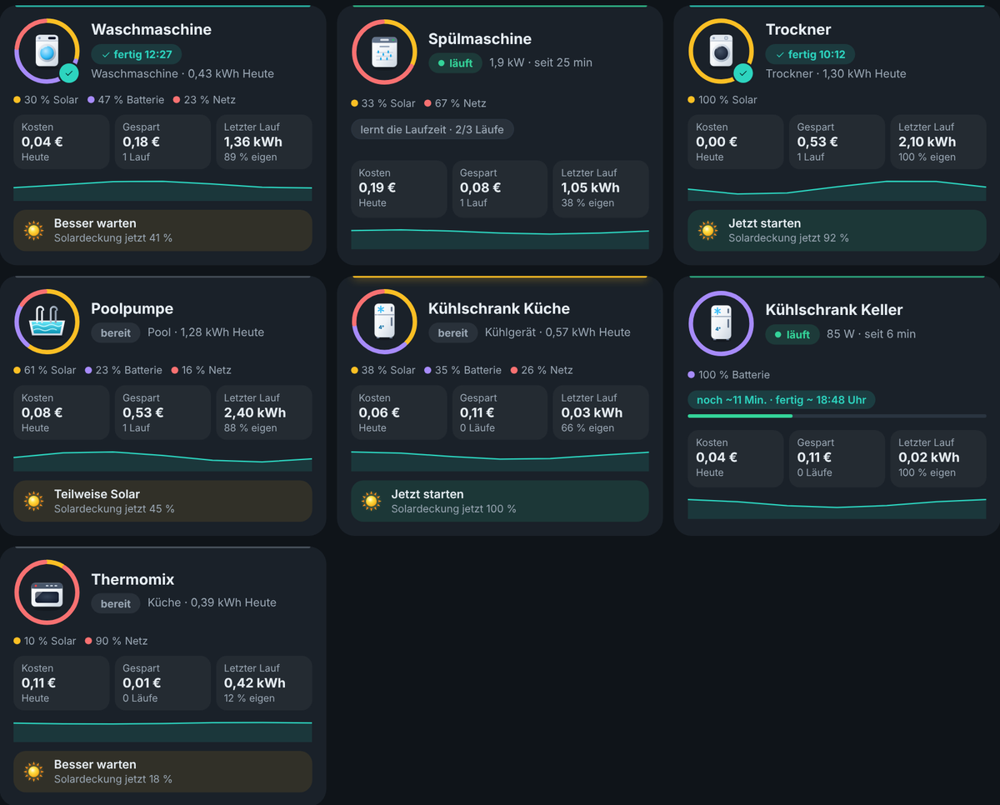 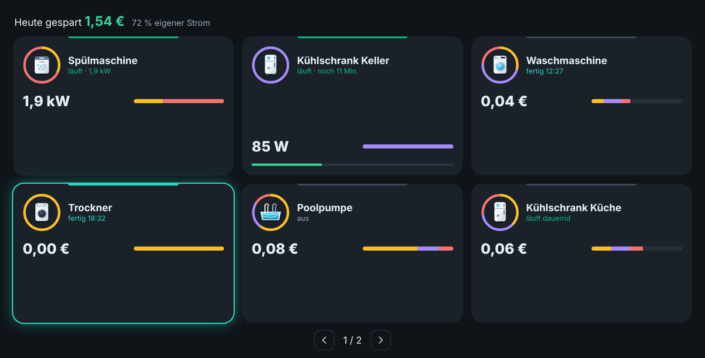

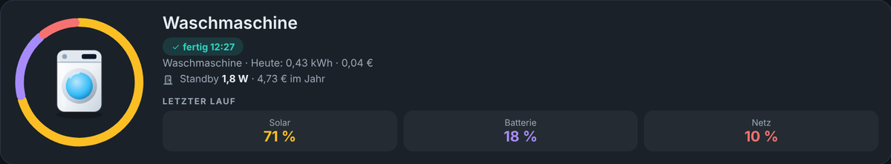

 

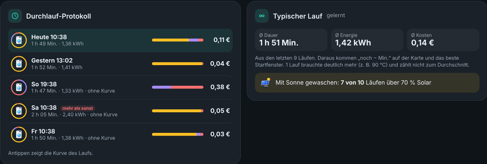 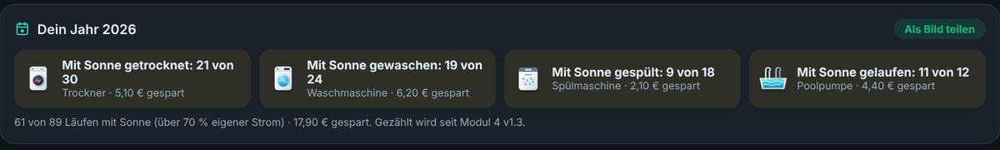

Die Aufteilung ist eine Näherung aus Messwerten im 20-Sekunden-Takt. Die Startzeit kommt aus Modul 16 oder Forecast.Solar, sonst aus dem Mittel der letzten 7 Tage deines PV-Sensors.

<b>8 · Elektroauto & Wallbox</b> (Beta)

 

go-e Charger lokal im Netzwerk. Betriebsarten Aus, Sonne, Sonne + Netz, Voll und Ladeplan mit Abfahrtszeit, Ziel-Ladestand, Strompreis und PV-Prognose. Dazu RFID-Karten je Fahrzeug, Ladestatistik und Hausanschluss-Schutz. **Neu:** Nach einer Phasenumschaltung gilt „fertig“ kurz als Pause, die Ladung läuft weiter. Akkukapazität mit einer Nachkommastelle.

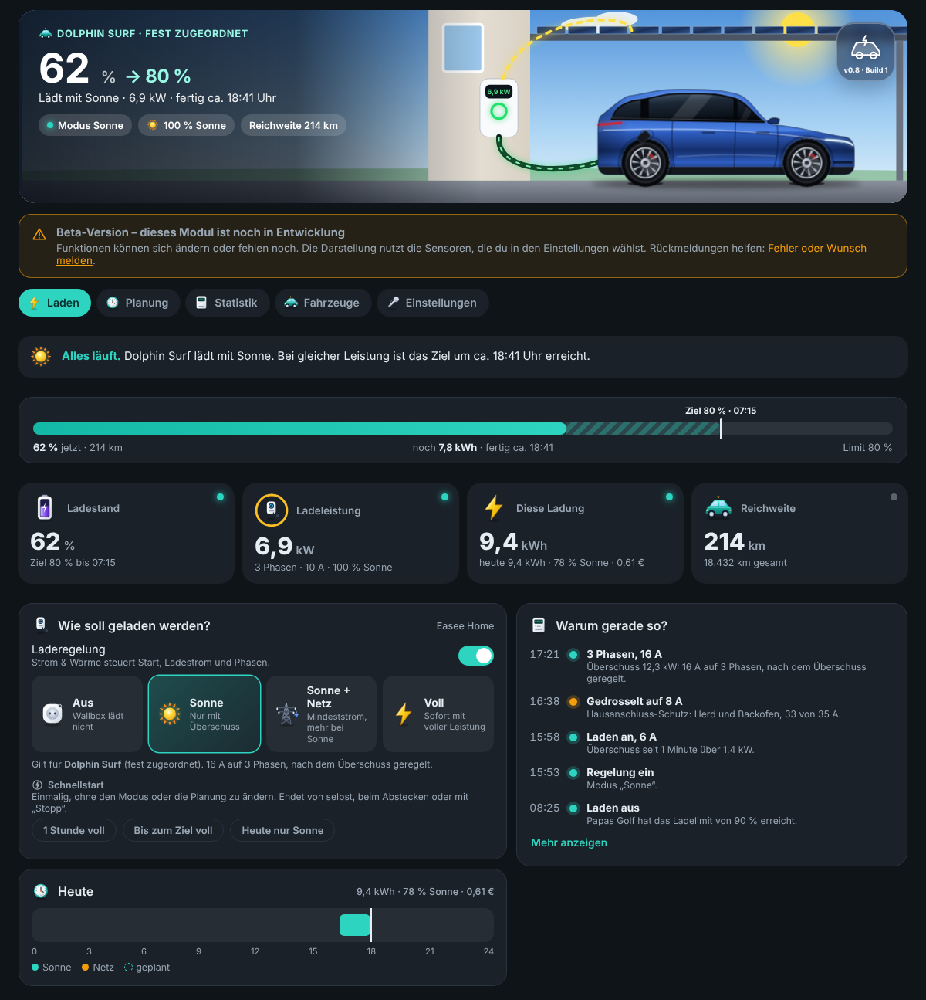

<b>9 · Wetter & Warnungen</b> (Vorabversion)

 

- **Wetter-Szene als Banner:** dasselbe Haus wie auf der Startseite. Sturm, Gewitter, Hagel, Frost und Hitze sind im Bild zu sehen, Rollläden und Markise zeigen, was die Aktionen getan haben.
- **Stufen 1–4 wie beim DWD** für eigene Warnungen: Sturm, Gewitter, Hagel, Starkregen (mm/h), Frost & Glätte, Hitze. Dazu **alle amtlichen Warnungen** von DWD (mit Vorabinformation), NINA und MeteoAlarm.
- **48-Stunden-Zeitleiste**, Warnkacheln mit Bogen gegen die Grenze, Verlauf über 90 Tage.
- **Aktionen** ab Stufe, mit Bedingung (abwesend, tagsüber …), Verzögerung und **Aussperrschutz** für Rollläden an Türen. „Verstanden“, „Alles schließen“ und „Aussetzen“ im Modul und als Knöpfe in der Handy-Meldung.
- **Vorsorge:** Hausakku voll halten, Auto vorladen, Hitzeschutz, Frost-Hinweis. **Alarm auf dem Wandtablet** ab Stufe 3.
- **Für Automationen:** Sensoren „Warnstufe“ (gesamt und je Warnart) und das Ereignis `fenster_heizung_wetter_warnung`.

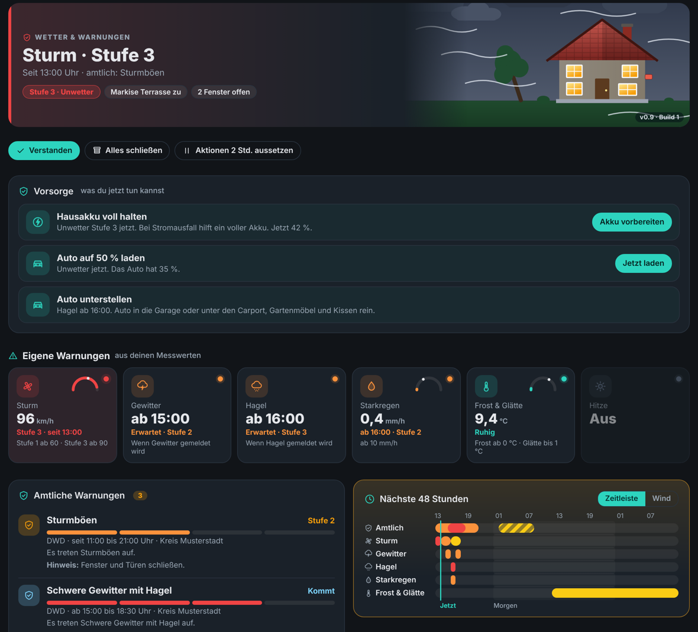

<b>11 · Rauch- & Sicherheitsmelder</b> (Beta)

 

- **Grundriss-Baukasten:** Räume, Wände, Türen, Fenster und Treppen zeichnen, Melder platzieren, mehrere Etagen. Bei Alarm leuchtet der Raum.
- **Wartung:** Einbaudatum, Lebensdauer, Prüfintervall, Batterie-Prognose, Einkaufsliste und Jahresprotokoll.
- **Abfahrt-Prüfung:** zeigt offene Fenster, Türen und Geräte, wenn du das Haus verlässt.

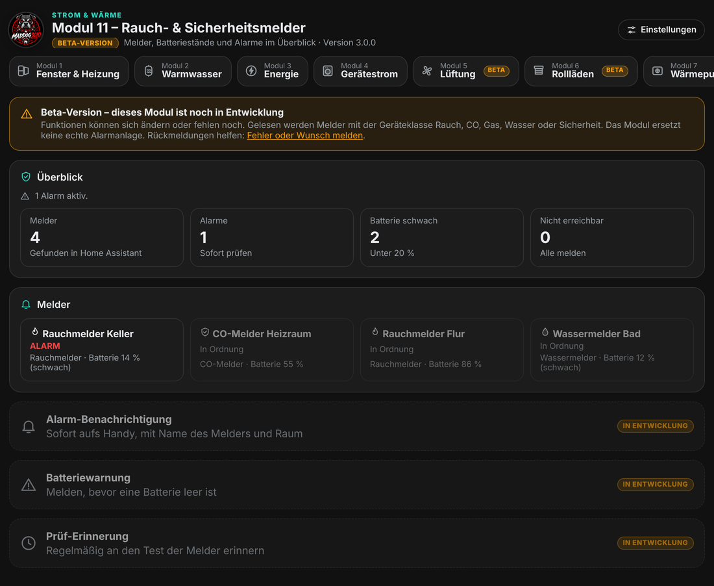

<b>14 · Stromtarif und 16 · Solar-Prognose</b>

 

- **Dynamischer Stromtarif (Beta):** Stundenpreise, Preisverlauf und die günstigsten Zeiten, zum Beispiel aus Tibber.
- **Solar-Prognose (stabil):** heute und morgen als Sonnenbogen, Prognose und Ertrag je Stunde, beste Zeit mit Geräten, korrigierte Prognose, Treffer-Kalender, Anlagen einzeln und fünf Sensoren für Automationen. Quelle: Forecast.Solar, Solcast, Open-Meteo oder ein eigener Sensor. Modul 2, 3, 4 und 8 nutzen sie.

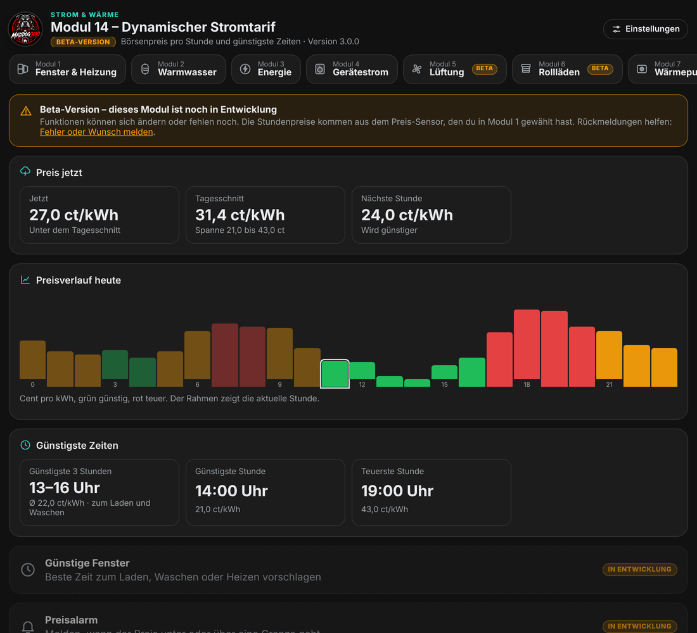 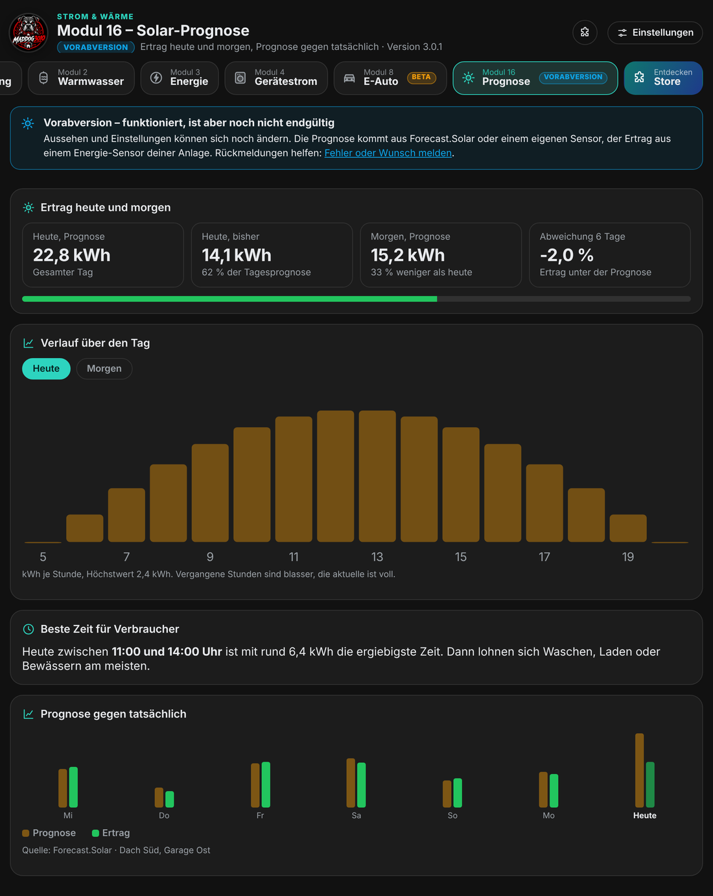

<b>19 · Hausfluss</b> (Stabil 1.0, nur für Sponsoren)

 

Das Haus in der Mitte, ringsum bis zu acht Kacheln für Solar, Netz, Akku, Auto und Verbraucher. **Leuchtlinien** zeigen Richtung und Stärke, der **Herkunfts-Ring** am Haus, woher der Strom gerade kommt (Solar, Akku, Netz). Oben das **Lichtband-Banner**, dazu Themen (Nachtglas, Blaupause, Sternenhimmel, Haus im Garten), Kachelform Rund und eine helle Variante. HD-Bilder mit Zustand, Status-Punkt, Gruppen-Kacheln (z. B. alle Kühlschränke) und Anordnen per Ziehen. Der **Strom-Reiter** zeigt Tag, Woche, Monat und Jahr als Lichtsäulen nach Herkunft, Verbraucher mit Solar-Anteil und die Kosten. Auf dem Handy als Fluss-Spalte oder Kachel-Raster, im Tablet-Modus als Wand-Ansicht mit Ruhebild. **Schnellstart** aus den Haus-Werten, Einrichtungs-Prüfung und „Bild teilen“ als PNG.

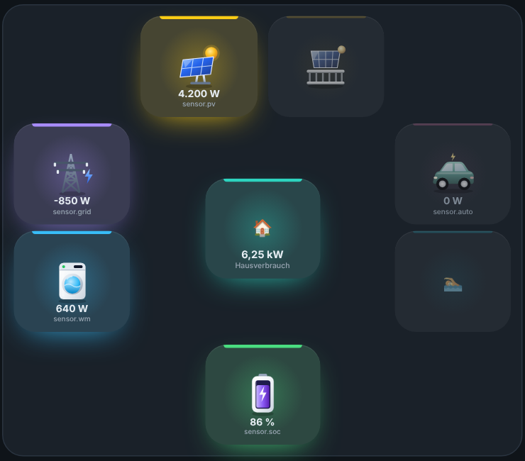

<b>Addons: 17 Müllabfuhr, 18 Licht & Lampen, 21 Saugroboter</b>

 

Addons installierst du unter **Einstellungen → Addons** und kannst sie dort jederzeit pausieren oder wieder deinstallieren, auf Wunsch mit oder ohne deine Daten. Neue Versionen kommen aus dem Addon-Katalog und erscheinen im Reiter **Updates**.

- **Müllabfuhr:** Abholtermine, Tonnen-Ampel, Erinnerung am Vorabend.
- **Licht & Lampen:** Lampen nach Räumen, dimmen, Lichtfarbe, Szenenknöpfe.
- **Saugroboter:** Roboter-Karte, Raum-Kacheln mit Ampel, Karte des Roboters (Roborock), Woche und Wartung.

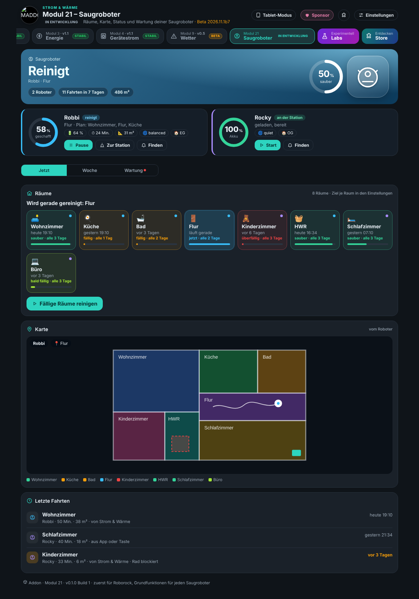

---

## Bedienung

<b>Startseite</b>

 

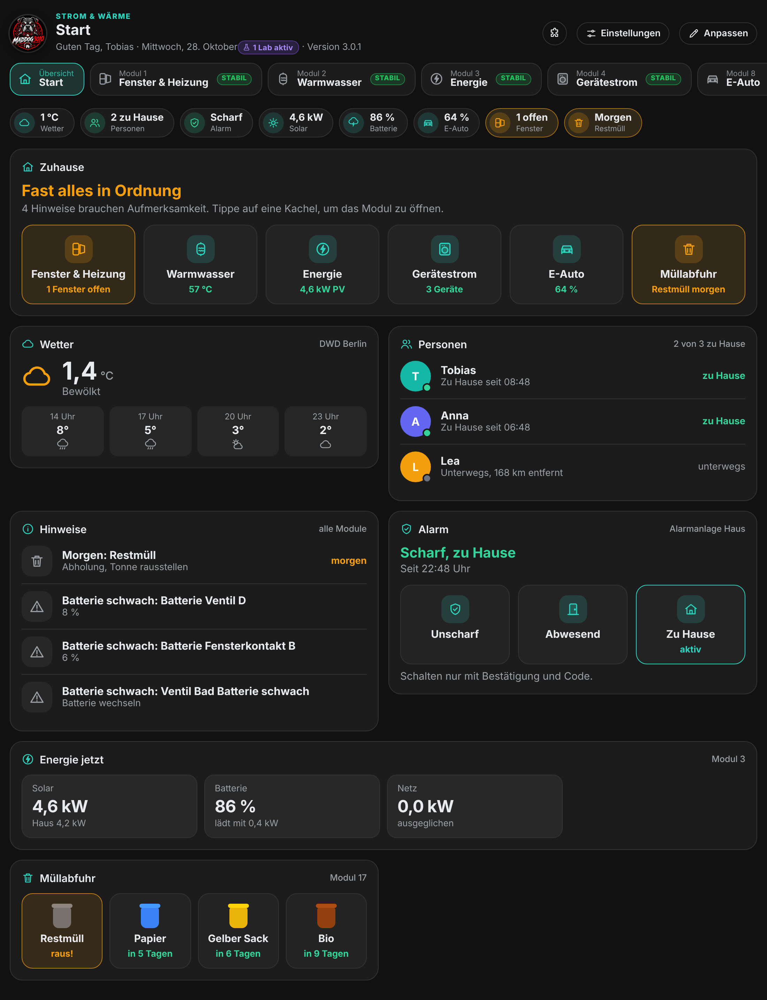

- **Zuhause:** eine Ampel-Kachel je aktivem Modul, ein Tipp öffnet das Modul.
- **Wetter**, **Personen** und **Alarm** (Schalten ist ab Werk aus und wird immer bestätigt).
- **Hinweise:** Fenster zu lange offen, Warmwasser, schwache Batterien, Müllabfuhr, Alarm.
- Mit **Anpassen** verschiebst du Karten oder blendest sie aus. Ein Direktlink wie `?modul=gs` öffnet gleich ein Modul. Die Startseite lässt sich unter **Einstellungen → Darstellung** ein- und ausschalten.

<b>Anpassen in Modul 1 bis 4</b>

 

**Anpassen** im Modulkopf: Karten am Griff verschieben, mit dem Auge ausblenden, **Zurücksetzen** stellt alles wieder her. In Modul 4 lassen sich auch die Geräte sortieren und ausblenden. Kopf und Zeitraum bleiben oben. Die Anordnung gilt für alle Nutzer und steckt in der Sicherung.

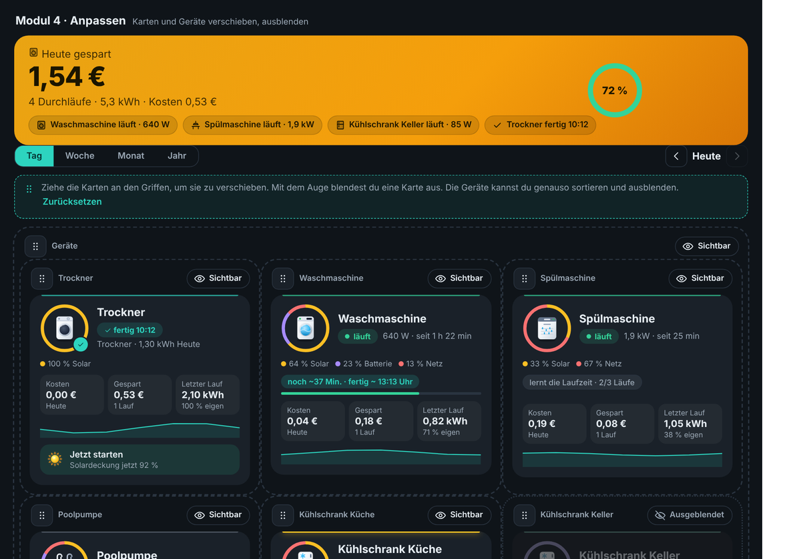

<b>Tablet-Modus</b>

 

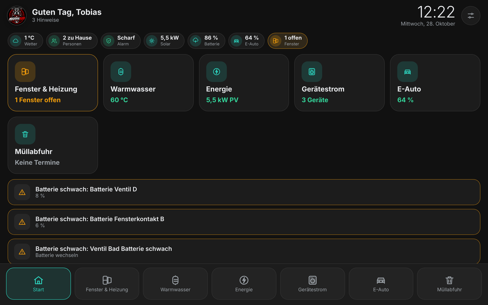

Für Tablets an der Wand: große Knöpfe, Uhr im Kopf, untere Leiste mit den aktiven Modulen. Die Einstellungen gelten nur für das jeweilige Gerät.

- **Einschalten:** Knopf im Kopf (ab 600 px Breite), Einstellung „Automatisch“ oder Direktlink `?tablet=1`, zum Beispiel als Start-URL in Fully Kiosk.
- **PIN:** sechs Ziffern schützen die Einstellungen. Nach fünf falschen Eingaben ist die Eingabe 60 Sekunden gesperrt.
- **Ruhemodus** mit dunkler Uhr, Wetter, Alarm und Personen. Eine Warnung weckt das Tablet auf.
- **Bewegungsmelder:** Bei Bewegung geht das Display an, nach 10 oder 30 Minuten ohne Bewegung wieder aus.
- **Modul 4** zeigt quer die Geräte-Wand mit sechs großen Kacheln.

| | Fully Kiosk (Android) | HA-App Android | HA-App iPad/iPhone |
|---|---|---|---|
| Ruhemodus, Aufwachen per Bewegung | ja | ja | ja |
| Display einschalten bei Bewegung | ja | ja | nein |
| Display ausschalten | ja | teilweise | nein |

<b>Einstellungen, Messwerk und Sensorsuche</b>

 

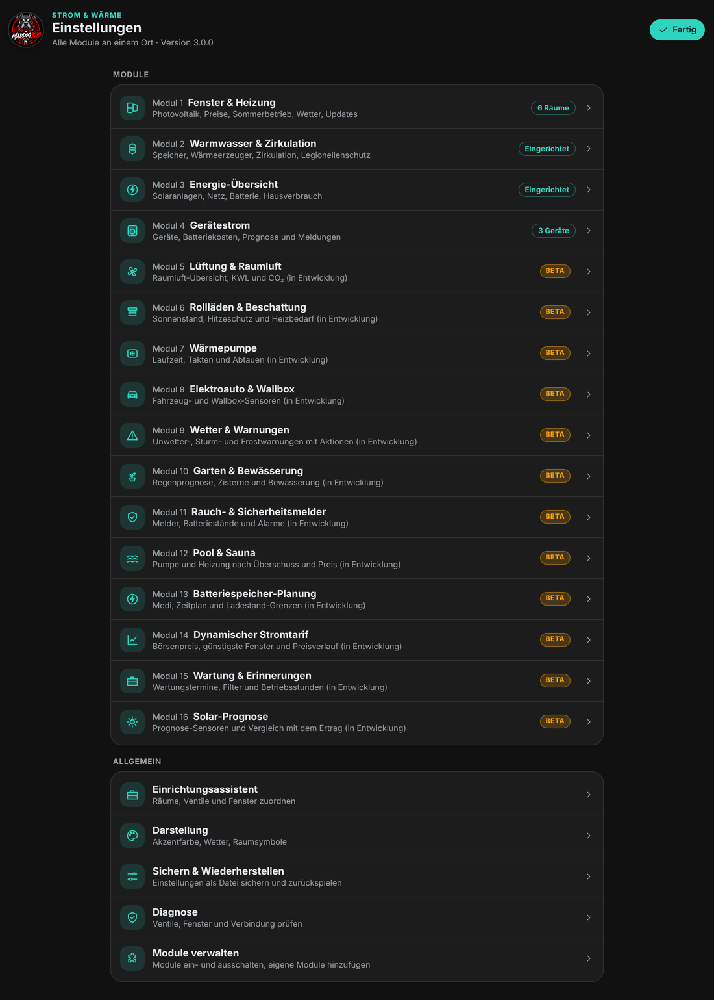 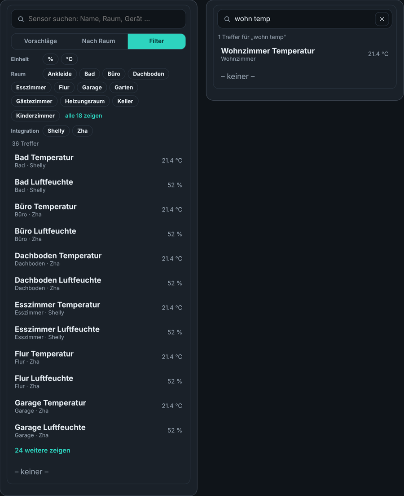

Der Knopf **Einstellungen** öffnet in jedem Modul dieselbe Seite. Ganz oben steht die **Suche**: „Preis“ findet Bezugspreis, Einspeisevergütung und Stundenpreis-Sensor. Ein Tipp springt direkt an die Stelle.

- **Übersicht:** Einrichtungsstand, eine **Prüfung** mit „Beheben“ und die **letzten Änderungen** mit ↶.
- **Messwerk:** jeder Sensor, der irgendwo eingestellt ist, mit Aufgabe, Live-Wert, Zustand und „genutzt in“. Sensoren lassen sich hier direkt zuordnen und tauschen.
- **Haus:** Räume, Personen & Standort, **Tags & Karten** und die gemeinsamen Werte für alle Module (Energiequellen, Preise & Tarif, Wetterquelle).
- **Module**, **Darstellung**, **Dieses Gerät**, **Addons**, **Erweiterungen** (Store, Labs) und **System** (Sichern & Wiederherstellen, Änderungsverlauf, Diagnose, Versionen).
- **Sensorsuche:** in jedem Auswahlfeld mit **Suchfeld** (Name, Entitäts-ID, Raum, Gerät, Hersteller) und drei Reitern: **Vorschläge**, **Nach Raum** und **Filter** mit allen Räumen und Integrationen.

**Änderungsverlauf und Rückgängig:** Jede Änderung wird mit Benutzer und Zeit gemerkt (die letzten 50) und lässt sich einzeln zurücknehmen.

<b>Sichern und Wiederherstellen</b>

 

- **Als Datei:** Räume, Heizpläne, Anwesenheit, Aussehen und die Einstellungen aller Module. Beim Einlesen siehst du zuerst eine Zusammenfassung.
- **Automatisch auf deinen Homeserver:** WebDAV (Nextcloud, Synology, QNAP, FRITZ!NAS), SMB-Freigabe oder Ordner, bei Änderung, täglich oder wöchentlich.
- **Interne Kopien:** Fehlt eine Einstellungsdatei beim Start oder ist sie unlesbar, holt die Integration die letzte Kopie zurück. Das Dashboard speichert erst, wenn die Einstellungen wirklich geladen sind.

---

## Labs

Labs sind neue Funktionen, die schon arbeiten, aber noch nicht überall erprobt sind. Sie sind **ab Werk aus** und lassen sich einzeln einschalten (Kolben-Symbol im Kopf oder Tab „Labs“). **Nur Anzeige** (grün) zeigt etwas an, **Schaltet Geräte** (orange) greift ein und fragt vorher nach.

| Lab | Modul | Art | Was es macht |
|---|---|---|---|
| Bester Lüftungszeitpunkt | 1 | Anzeige | Ob Lüften jetzt lohnt (Feuchte innen und außen) |
| Autarkie-Prognose | 3 | Anzeige | Wie viel des Tagesverbrauchs heute aus Solar kommt |
| Spartipp der Woche | 3 | Anzeige | Gerät mit dem größten Netzbezug und die beste Sonnenzeit |
| Wäsche-Wetter | 9 | Anzeige | Ob Wäsche draußen trocknet |
| Lernfaktor für die Prognose | 16 | Anzeige | Gelernte Abweichung und korrigierte Prognose |
| Start-Bubbles | Start | Anzeige | Bis zu acht runde Kurzinfos auf der Startseite |
| Smart Vorheizen | 1 | Schaltet | Startet den Heizplan früher, wenn der Raum zu kalt ist |
| Duschzeiten lernen | 2 | Schaltet | Heizt vor den typischen Duschzeiten vor |
| Legionellenschutz nach Sonne | 2 | Schaltet | Legt den Schutz auf sonnige Tage |
| Ladeziel nach Kalender | 8 | Schaltet | Hebt das Ladeziel vor langen Terminen an |

---

## Versionen und Updates

Die Integration folgt dem Schema **Jahr.Monat.Release**:

| Version | Bedeutung |
|---|---|
| `2026.11.1` | Erstes Update im November 2026 |
| `2026.11.2` | Zweites Update im November 2026 |
| `2026.12.1` | Erstes Update im Dezember, mit jedem Monat beginnt der Zähler wieder bei 1 |
| `2026.12.1b1` | **Testversion** (Beta) für das kommende Update `2026.12.1` |

Testversionen tragen die Nummer des Updates, das sie vorbereiten: `2026.11.2b1` < `2026.11.2b14` < `2026.11.2`.

### Stabil oder Beta

- **Stabil** (Standard): HACS bietet nur geprüfte Updates an.
- **Beta:** In HACS das Repository **Strom & Wärme** öffnen, über die drei Punkte **Neu herunterladen** wählen, **Beta-Versionen anzeigen** einschalten und die Testversion installieren. Zurück zu Stabil geht es auf demselben Weg.
- **Beta-Freigabe ab 2026.11.2:** Testversionen sind mit **Sponsor Max sofort** und als **Sponsor 3 Tage nach Erscheinen** nutzbar. Vorher zeigt das Panel einer Testversion nur den Weg zurück zur letzten stabilen Version, mit Countdown für Sponsoren. Heizung, Fenster und alle Regeln laufen im Hintergrund weiter. **Stabile Versionen sind für alle frei.**

### Update einspielen

Über HACS aktualisieren, Home Assistant neu starten und die Seite neu laden (Strg+F5, in der App nach unten ziehen). Deine Einstellungen bleiben erhalten.

> **Update auf 2026.11.2:** Modul 4 merkt sich ab dieser Version Laufzeiten, Kurven, Standby und die Jahreszähler. „noch ~ Min.“ erscheint je Gerät nach drei neuen Läufen, Standby nach einigen Stunden. Dein Jahr wird aus den gespeicherten Läufen vorbelegt. Wer die alte Optik möchte: **Einstellungen → Modul 4 → Darstellung → Karten wie bisher** und **Einstellungen → Modul 19 → Alte Symbole behalten**.

---

## Sponsor werden

„Strom & Wärme“ entsteht in meiner Freizeit und bleibt **kostenlos und offen**. Als Dank für ein Sponsoring gibt es Extras – freigeschaltet direkt im Panel mit deinem GitHub-Konto. **Es wird nichts gesperrt, was ohne Sponsoring schon da war.**

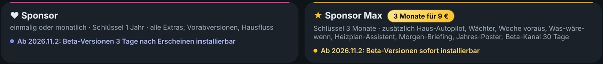

| | ♥ **Sponsor** | ★ **Sponsor Max** |
|---|---|---|
| Preis | **$1 im Monat** oder **$5 einmalig** | **$3 im Monat** oder **$10 einmalig** |
| Laufzeit | monatlich: solange es läuft · einmalig: 1 Jahr | monatlich: solange es läuft · einmalig: 3 Monate, danach bis 1 Jahr wieder „Sponsor“ |
| Sponsor-Lounge, Abzeichen, Farbverläufe, Uhr-Stile | ✓ | ✓ und goldener Stern |
| Modul 19 Hausfluss | ✓ | ✓ |
| Vorabversionen (Labs) früher | 14 Tage | 30 Tage |
| Energie-Coach, Monatsbericht, Wunsch des Monats | ✓ | ✓ und eigene Vorschläge |
| Morgen-Briefing, Jahres-Poster | | ✓ |
| Wächter, Woche voraus, Was wäre wenn … | | ✓ |
| Haus-Autopilot, Heizplan-Assistent | | ✓ |
| Beta-Versionen (ab 2026.11.2) | 3 Tage nach Erscheinen | sofort |

<b>Sponsor-Lounge</b>

 

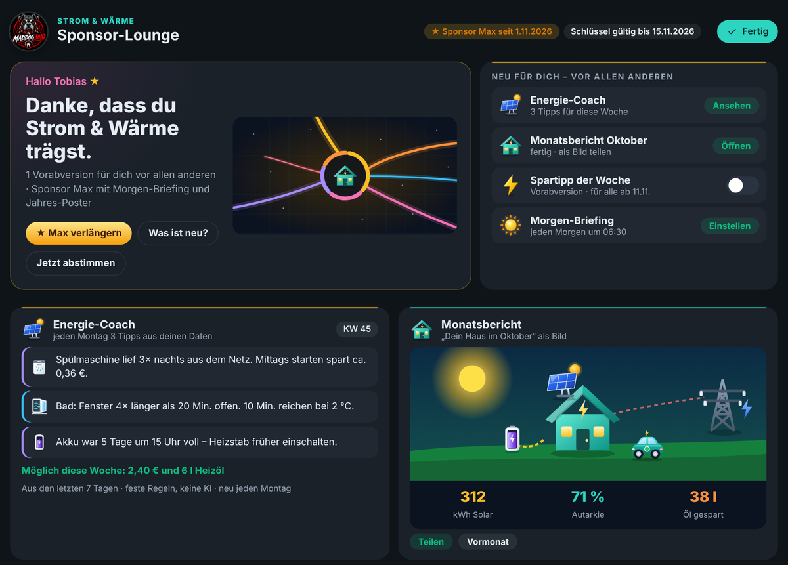

- **Begrüßung** mit „Sponsor seit …“ und Gültigkeit, **Neu für dich** mit den Vorabversionen und dem Datum, ab dem sie für alle kommen.
- **Energie-Coach:** jeden Montag um 6 Uhr bis zu drei Tipps aus den letzten 7 Tagen mit Euro-Betrag, feste Regeln, keine KI.
- **Monatsbericht:** „Dein Haus im Oktober“ mit kWh Solar, Autarkie, gespartem Heizöl und Ersparnis, als Bild teilen oder speichern.
- **Wunsch des Monats:** Abstimmung auf GitHub, die Lounge zählt die 👍 live.
- **Deine Extras** an einer Stelle und **Dein Abzeichen** (Herz, Sonne, Schneeflocke, für Max der goldene Stern).

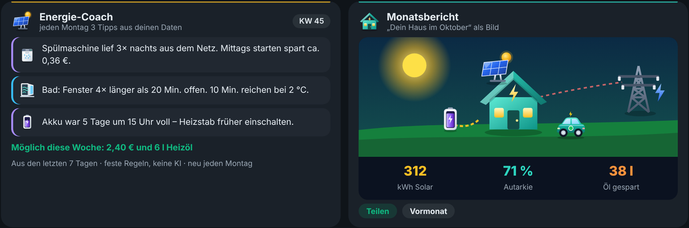

<b>Sponsor Max</b>

 

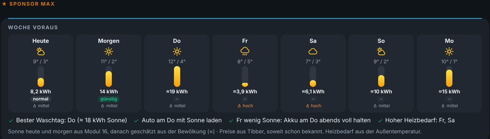

- **Woche voraus:** 7 Tage mit Sonne, Wetter, Preisniveau und Heizbedarf, dazu bester Waschtag, Auto am Sonnentag laden, Akku vor trüben Tagen voll halten.
- **Haus-Autopilot I:** plant alle 15 Minuten die nächsten 24 Stunden für Geräte, Auto und Warmwasser. Stufen „Aus“, „Nur Vorschläge“ und „Mit Bestätigung“ (Ja/Nein in der Lounge oder am Handy), **Not-Aus** nimmt alles zurück. Fenster offen, Abwesend und Urlaub haben Vorrang.
- **Wächter:** vergleicht jedes Gerät mit den letzten 4 gleichen Wochentagen, die PV mit der Prognose, meldet einen stillen Wechselrichter und nachts offene Fenster.
- **Heizplan-Assistent:** Vorschläge zum früheren Absenken oder Aufheizen aus der gelernten Aufheizzeit, mit „Übernehmen“ und „Rückgängig“.
- **Was wäre, wenn …:** größerer Akku oder mehr PV mit den Stundenwerten der letzten 12 Monate durchgerechnet, immer als Schätzung.
- **Morgen-Briefing** aufs Handy, **Jahres-Poster** zum Drucken und der **Beta-Kanal** mit Testversionen sofort.

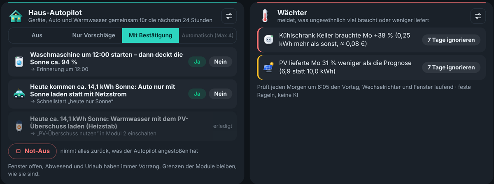

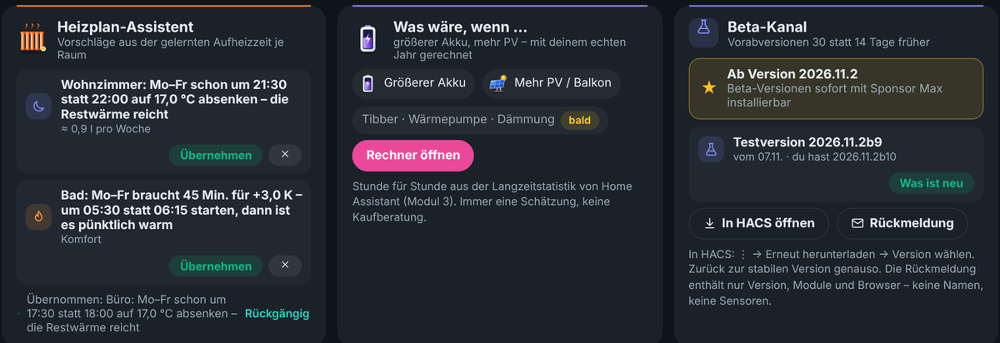

**So wirst du Sponsor:**

1. Auf [GitHub Sponsors](https://github.com/sponsors/Maddog3010) eine Stufe wählen.
2. Im **Sponsor-Bereich** (Herz im Kopf oder **Einstellungen → Sponsor-Lounge**) auf **„Schon Sponsor? Freischalten“** tippen.
3. Den angezeigten Code auf [github.com/login/device](https://github.com/login/device) eingeben und bestätigen. Fertig – die Stufe wird automatisch erkannt und gilt für alle Geräte und Benutzer.

Die Integration fragt GitHub nur, ob und mit welcher Stufe du sponserst (Recht `read:user`, kein Zugriff auf Repos oder Mails). Es gibt keinen eigenen Server. Das Token bleibt in deinem Home Assistant und lässt sich unter GitHub → Settings → Applications jederzeit widerrufen. Geprüft wird einmal am Tag; endet das Sponsoring, gehen nur die Extras aus.

Lieber ohne GitHub-Anmeldung? Dann gibt es weiter einen **Sponsor-Schlüssel**: kurze E-Mail mit GitHub-Namen und Stufe an [00.verkauf_kompass@icloud.com](mailto:00.verkauf_kompass@icloud.com), den Schlüssel im Sponsor-Bereich unter „Ich habe einen Schlüssel“ einfügen. Er wird lokal geprüft (Ed25519).

---

## Wichtige Hinweise

- Die Integration schaltet **Thermostate, Elektroheizer, Heizstäbe, Pumpen, Luftentfeuchter und auf Wunsch die Wallbox**. Prüfe nach der Einrichtung, ob alles wie gewünscht reagiert. Die Nutzung erfolgt auf eigene Verantwortung.
- Die Warmwasser-Regelung ersetzt keinen Verbrühschutz und keine Sicherheitseinrichtung deiner Anlage.
- Module in den Stufen In Entwicklung, Beta und Vorabversion, Labs und Testversionen können sich ändern.
- Energie- und Kostenwerte, Ersparnis, Prognosen und Rechner sind **Schätzungen**.
- Der Bericht, der Energie-Coach und der Rechner brauchen Verlaufsdaten im Recorder bzw. die Langzeitstatistik.

## Häufige Fragen

**Kostet „Strom & Wärme“ etwas?**
Nein. Ein Sponsoring ist freiwillig. Was frei ist, bleibt frei.

**Mir gefällt die neue Optik nicht. Kann ich zurück?**
Ja. **Einstellungen → Modul 4 → Darstellung → Karten wie bisher**, die Geräte-Szene lässt sich dort ebenfalls abschalten. In Modul 19 holt **Alte Symbole behalten** die bisherigen Symbole zurück.

**Warum steht bei einem Gerät „lernt die Laufzeit“?**
Modul 4 braucht drei Läufe, um die Restzeit zu schätzen. Danach erscheint „noch ~ Min.“.

**Brauche ich die Beta-Versionen?**
Nein. Für den Alltag reicht die stabile Version, und die ist für alle frei.

**Ich habe eine Testversion installiert und sehe nur „Testversionen sind für Sponsoren“.**
Testversionen sind mit Sponsor Max sofort und als Sponsor 3 Tage nach Erscheinen frei. Über **Zurück zu …** kommst du in HACS zur letzten stabilen Version. Deine Einstellungen bleiben, die Regelung läuft weiter.

**Gehen meine Einstellungen bei einem Update verloren?**
Nein. Sie bleiben erhalten, dazu gibt es interne Kopien und auf Wunsch eine Sicherung auf deinem Homeserver.

**Meine Messräume sind weg. Was tun?**
Modul 1 zeigt einen Hinweis mit **Zurückholen**, solange die Messräume noch in der automatischen Sicherung stehen.

**Wo stelle ich Strompreis, Netz-Sensor oder Außentemperatur ein?**
An einer Stelle für alle Module: **Einstellungen → Haus** (Energiequellen, Preise & Tarif, Wetterquelle).

**Werden Daten an einen Server geschickt?**
Nur an die Dienste, die du selbst einrichtest (Wetter, Strompreis, Tibber). Für den Update-Hinweis, die Abstimmung und die Sponsor-Sperrliste fragt die Integration GitHub. Ist eine Testversion installiert und GitHub nicht erreichbar, holt sie die Uhrzeit vom Versionsdienst von Home Assistant (version.home-assistant.io).

**Wo melde ich Fehler und Wünsche?**
Als [Issue auf GitHub](https://github.com/Maddog3010/ha-fenster-heizung/issues), am besten mit Version und dem Ausschnitt aus der Gerätediagnose („Kopieren“).

## Für Entwickler

- Die technische Kennung bleibt `fenster_heizung`, nur der Anzeigename ist „Strom & Wärme“.
- `panel.js` wird aus `frontend-src/parts` gebaut: `python3 frontend-src/build.py` (mit `--check` nur prüfen). Dabei entsteht `02b-releases.js` aus `CHANGELOG.md`.
- **Neue Version veröffentlichen:** Eintrag `## [2026.12.1] - JJJJ-MM-TT` in `CHANGELOG.md`, `version` in `manifest.json` setzen, `build.py` ausführen, auf GitHub ein Release mit demselben Tag ohne `v` anlegen (Testversion: **Set as a pre-release**).
- **Modulversionen** stehen in `MV` in `02-konstanten.js` (`v`, Build `b`, Datum, Paket, Änderungsliste). Neue Funktion: Version +0.1, Build 1. Fehlerbehebung: Build +1.
- Schreibende WebSocket-Befehle sind Administratoren vorbehalten. WebSocket-Felder heißen nie `id` (`dev`, `entry`, `ref` stattdessen).
- **Sponsor Max:** `coach.py` (Energie-Coach, Monatsbericht), `waechter.py` (Wächter, Woche voraus), `autopilot.py` (Haus-Autopilot, Heizplan-Assistent), im Dashboard `12k-sponsor-s3.js` und `12o-max.js`.
- **Modul 4:** `geraete.py` (Läufe mit Kurve, Standby, Jahreszähler, PV je Stunde), `geraete_calc.py` (bestes Startfenster, Preis-Gleichstand), im Dashboard `11-modul4-geraetestrom-elektroauto.js`, `11b-geraete-seite.js`, `11c-geraete-szene.js`, Grafik-Bibliothek `05d-grafik.js`.
- **Addons (API 1):** `addon_manager.py`, `addon_api.py`, `addon_repo.py` (Katalog aus `Maddog3010/strom-waerme-addons`, Ed25519-signiert, SHA-256 je ZIP).

---

Made with ❤ by <b>MADDOG3010</b> · „Strom &amp; Wärme“ ist ein privates Projekt und steht in keiner Verbindung zu Home Assistant oder Nabu Casa.

