

  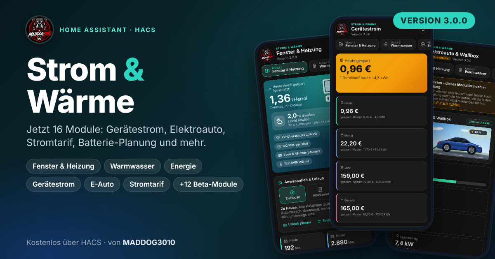

# Strom & Wärme

**Eine Integration für Home Assistant, die Heizung, Fenster, Warmwasser und Solarstrom zusammenbringt.** Sie pausiert Heizkörper, wenn ein Fenster offen ist, heizt nach Plan, nutzt PV-Überschuss für Elektroheizer und Warmwasser und zeigt alles in einem eigenen Dashboard in der Seitenleiste.

Das Dashboard besteht aus drei Modulen:

| Modul | Was es macht |
|---|---|
| **1 – Fenster & Heizung** | Pausiert Thermostate bei offenem Fenster, Heizplan pro Raum, Anwesenheit und Urlaub, Tagesberichte, Elektroheizer mit PV-Überschuss, Schimmel- und Lüftungshinweise, Gerätediagnose |
| **2 – Warmwasser & Zirkulation** | Speichertemperaturen, Zeitplan für Erzeuger, Zirkulationspumpe nach Zeit, Bedarf oder Intervall, Legionellenschutz, Heizstab bei PV-Überschuss |
| **3 – Energie** | Solar, Netz, Batterie und Hausverbrauch auf einer Seite: Energiefluss, Tages-, 7- und 30-Tage-Auswertung, Kosten und Autarkie, mit zweiter Solaranlage (zum Beispiel Balkonkraftwerk) |

  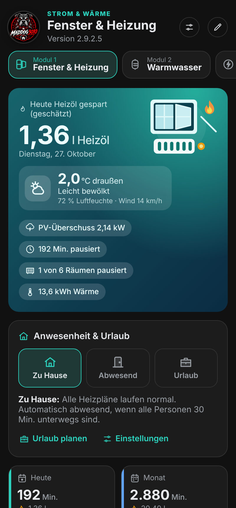
  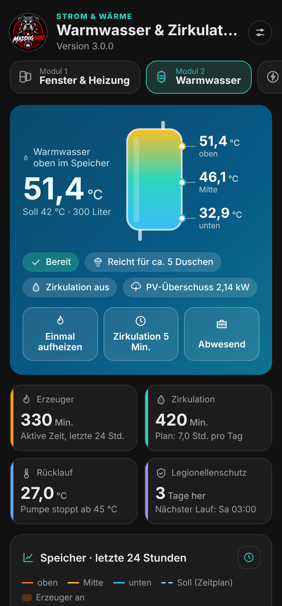
  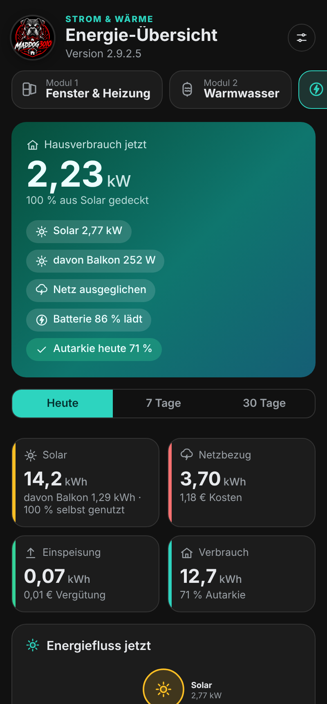

## Inhalt
- [Schnellstart](#schnellstart)
- [Modul 1: Fenster & Heizung](#modul-1-fenster--heizung)
- [Modul 2: Warmwasser & Zirkulation](#modul-2-warmwasser--zirkulation)
- [Modul 3: Energie](#modul-3-energie)
- [Allgemeines](#allgemeines)
- [Entitäten](#entitäten)
- [Hinweise für Entwickler](#hinweise-für-entwickler)
- [Wichtige Hinweise](#wichtige-hinweise)
- [Unterstützen](#unterstützen)

## Schnellstart
**Voraussetzungen:** Home Assistant 2024.11 oder neuer und [HACS](https://hacs.xyz).

1. HACS → drei Punkte → **Benutzerdefinierte Repositories**
2. Die Adresse dieses Repositories eintragen, Kategorie **Integration**
3. „Strom & Wärme“ installieren und Home Assistant **neu starten**
4. **Einstellungen → Geräte & Dienste → Integration hinzufügen → „Strom & Wärme“**: pro Raum ein Eintrag, mit Fenstersensoren und Thermostaten
5. In der Seitenleiste „Strom & Wärme“ öffnen. Der **Einrichtungsassistent** führt in acht Schritten durch Räume, Fenstermeldung, Heizung, Luftfeuchte, PV und Meldungen. Jeder Schritt außer dem ersten lässt sich überspringen.

Module 2 und 3 schalten Administratoren über **„+ Module“** ein und richten sie über das Zahnrad ein. Nach jedem Update Home Assistant neu starten und die Seite einmal neu laden (Strg+F5).

## Modul 1: Fenster & Heizung

### Fensterregelung
Öffnet jemand ein Fenster, schaltet die Integration die Thermostate des Raums nach einer einstellbaren Verzögerung aus oder senkt sie ab. Nach dem Schließen läuft alles wie vorher weiter.

- Fenstersensoren und Thermostate frei wählbar, Sperrzeit (zum Beispiel nachts) und Außentemperatur-Bedingung
- Eigener Heizungs-Sensor wählbar: steht er auf „Heizung aus“, wird nicht geregelt
- Erinnerung bei zu langem Lüften per Benachrichtigung, mit eigenem Titel und Text (`{raum}`, `{minuten}`, `{fenster}`)
- Der Knopf **„Warum?“** erklärt pro Raum, was gerade passiert und weshalb

### Dashboard
Das Dashboard füllt sich automatisch mit allen Räumen: Kopfkarte mit der heute gesparten Menge, Außentemperatur und Wetter, Kennzahlen für Heute, Monat, Jahr und Gesamt, ein Balkendiagramm der letzten 14 Tage und eine Karte pro Raum. Umschaltbar zwischen **Detail** und **Kompakt**, hell und dunkel nach dem Design von Home Assistant, passend für Handy, Tablet und Desktop.

<b>Anpassen, Gruppen, Fotos und Wetter</b>

- **Anpassen** (nur Administratoren): Bereiche und Raumkarten lassen sich verschieben, Räume bekommen eines von 16 Symbolen, eine Farbe und ein Foto. Das gilt für alle Nutzer.
- **Gruppen** (zum Beispiel Erdgeschoss und Obergeschoss): eigene Kopfzeile mit Zusammenfassung und gemeinsamem Schalter für die Fensterregelung. Höchstens 12 Gruppen.
- **Meine Ansicht:** Räume und Bereiche nur für dich im Browser ein- und ausblenden oder neu ordnen.
- **Darstellung:** Akzentfarbe, Hintergründe der Kopfkarte (zum Beispiel nach Tageszeit oder Wetter) und die Außentemperatur-Quelle.

 

### Heizplan
Pro Raum ein Plan aus Schaltpunkten (Tage, Uhrzeit, Temperatur) mit Wochenansicht. Ausgeschaltete Thermostate schaltet der Plan je nach Einstellung ein („Nein“, „Heizen“, „Automatik“). Eine manuelle Änderung bleibt bis zum nächsten Schaltpunkt bestehen. Bei offenem Fenster greift der Plan nicht, danach gilt die Temperatur, die dann dran ist. Der Schalter „Heizplan aktiv“ und der Sensor „Heizplan Solltemperatur“ lassen sich in Automationen verwenden.

 

### Bericht pro Raum
Der Knopf „Bericht“ zeigt einen Tagesbericht mit Temperaturverlauf, Zieltemperatur, Pausenzeiten, Fensterereignissen und eingesparter Energie. Ganz oben steht die **gelernte Aufheizzeit**: die Integration erkennt Aufheizphasen und merkt sich die Minuten pro Kelvin, getrennt nach Frost, kühl und mild. Die Daten stammen aus dem Verlauf von Home Assistant, für volle 7 Tage muss der Recorder so lange aufbewahren (Standard: 10 Tage).

 

### Anwesenheit und Urlaub
Eine Karte stellt alle Räume gemeinsam um: **Zu Hause**, **Abwesend** oder **Urlaub**. Urlaub lässt sich mit Datum und Vorheizen am Rückkehrtag planen. Automatisch abwesend wird der Haushalt, wenn alle gewählten Personen länger unterwegs sind.

### Elektroheizer mit PV-Überschuss
Pro Raum kann ein elektrischer Heizer (Heizlüfter, Infrarot, Klima-Heizgerät) eingerichtet werden. Er heizt nur, wenn genug PV-Überschuss da ist, auf Wunsch in mehreren Leistungsstufen.

<b>Einrichtung und Regelung im Detail</b>

**Einrichtung**
1. Unter **Allgemein → PV-Überschuss für Elektroheizer** den Sensor für die Netzeinspeisung wählen (Watt oder kW) und das Vorzeichen passend einstellen.
2. Dort Reserve, Einschaltverzögerung, Mindestlaufzeit, optional den Batterie-Ladestand sowie Strompreis und Einspeisevergütung einstellen. Der Strompreis lässt sich als Festpreis oder aus einer Entität lesen, etwa einem dynamischen Tarif.
3. In den Raumeinstellungen unter **Elektroheizer** den Heizer einschalten und das Gerät wählen.

**So wird geregelt**
- Verfügbarer Überschuss = Einspeisung plus die Leistung der laufenden Heizer. Die Heizer verdrängen sich also nicht selbst.
- Ein Heizer läuft auf der höchsten Stufe, deren Leistung plus Reserve in den freien Überschuss passt. Bei mehreren Heizern gilt die Priorität: 1 wird zuerst versorgt.
- Hochschalten erst, wenn die höhere Stufe die eingestellte Verzögerung lang möglich war. Zurückschalten nach etwa einer Minute. Ausschalten frühestens nach der Mindestlaufzeit.
- Sofort aus: Fenster auf, Raum warm genug, außerhalb des erlaubten Zeitfensters, Schalter „Elektroheizer aktiv“ aus, Batterie unter der Schwelle.
- Fällt der Sensor aus, gilt der Überschuss als 0. Ist das Gerät nicht erreichbar, wird nichts geschaltet.
- Bei einem `climate`-Gerät ordnest du jeder Stufe eine Voreinstellung zu (zum Beispiel H1, H2, H3). Die Thermostate des Raums werden auf Wunsch abgestellt, solange der Heizer läuft.
- Der Bericht pro Heizer zeigt Laufzeit, Energie, Solaranteil und den Vorteil in Euro. Die Energie wird aus der Nennleistung der Stufe berechnet, nicht gemessen.

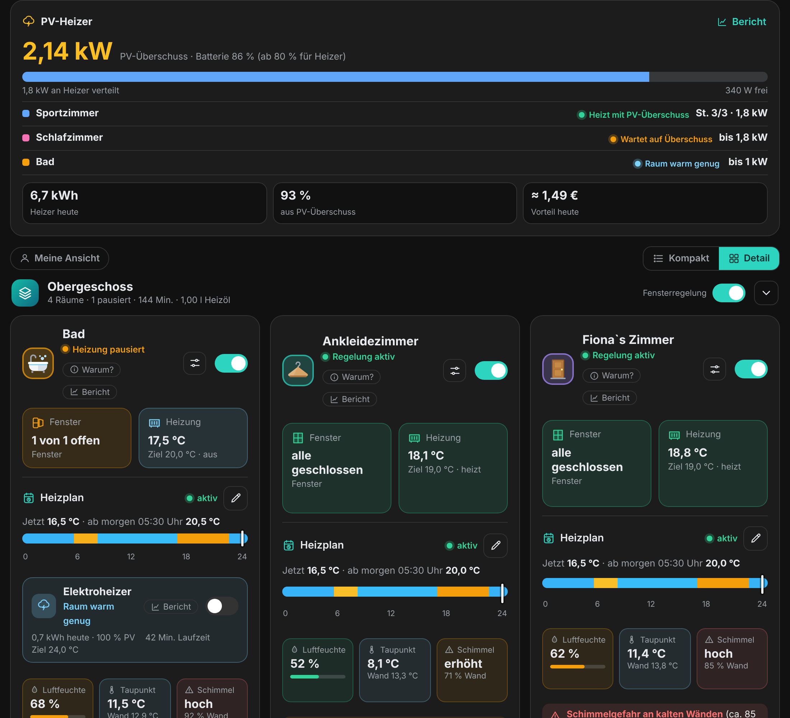 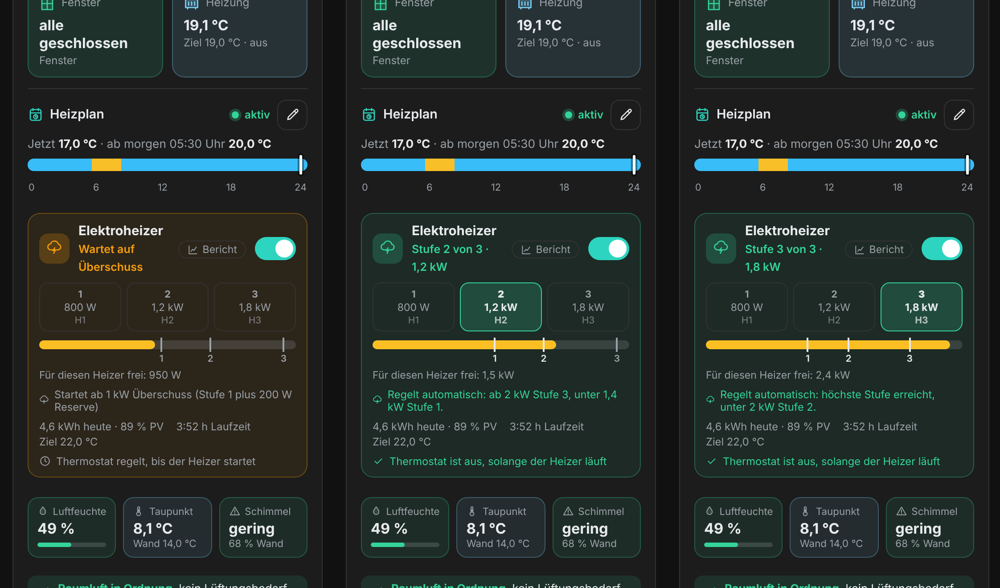

### Raumluft: Lüften und Schimmel
Mit einem Luftfeuchte-Sensor zeigt die Raumkarte Luftfeuchte, Taupunkt und Schimmelrisiko mit einer Empfehlung zum Stoßlüften samt Countdown. Auch ohne Sensor erscheinen „Gelüftet vor X Std.“, die geschätzte Wandtemperatur und die kritische Feuchte. Das Schimmelrisiko ist eine Schätzung, kein Messwert.

### Wetter-Anpassung und Sommermodus
- **Wetterabhängige Absenkung** (standardmäßig aus): Bei Sonne oder milder Luft sinkt die Zieltemperatur des Heizplans, bei Frost steigt sie.
- **Sommermodus:** Aus, automatisch oder immer an. Bei „Automatisch“ ruhen die Heizpläne ab einer einstellbaren mittleren Außentemperatur. Fenstermeldung und Erinnerungen bleiben aktiv.

### Brennstoff und Ersparnis
Die Integration schätzt die durch Pausen gesparte Heizenergie und rechnet sie in die Menge deines Brennstoffs um. Die Ersparnis ist eine grobe Schätzung, die echte liegt etwas darunter.

| Brennstoff | Einheit | Standard: kWh pro Einheit |
|---|---|---|
| Erdgas | m³ | 10 |
| Heizöl | l | 10 |
| Flüssiggas | l | 6,6 |
| Pellets | kg | 4,8 |
| Wärmepumpe / Strom | kWh | 1 (mit JAZ/COP, Standard 3,5) |

## Modul 2: Warmwasser & Zirkulation
Zeigt den Speicher, steuert Erzeuger, Heizstab und Zirkulationspumpe nach Zeitplan und führt den Legionellenschutz aus. **Das Modul schaltet nur Geräte, die du auswählst.** Fehlt eines, sagt die Seite das an der passenden Stelle.

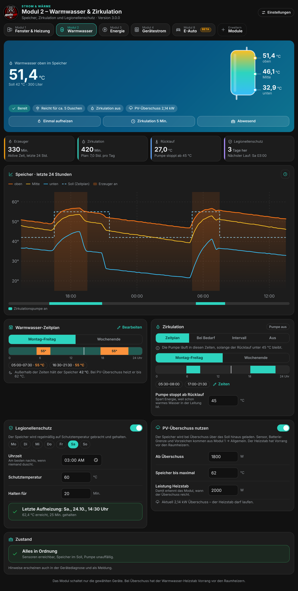

**Einrichten** (Zahnrad oben rechts): Speichergröße, Soll- und Absenktemperatur, bis zu drei Temperatursensoren (oben, Mitte, unten), den Wärmeerzeuger (Schalter, `water_heater` oder `climate`), optional einen Heizstab für PV-Überschuss, die Zirkulationspumpe, einen Rücklaufsensor und einen Auslöser für „Bei Bedarf“. Ein Speichersensor genügt für den Start.

- **Übersicht:** Temperaturen, Status (Bereit, Heizt auf, Unter Soll, Zu heiß, Abwesend), eine Schätzung, für wie viele Duschen das Wasser reicht, Kacheln für Laufzeiten, Rücklauf und letzten Legionellenschutz, dazu ein Verlauf der letzten 24 Stunden.
- **Zeitplan:** Soll-Temperatur pro Zeitfenster, getrennt für Montag bis Freitag und das Wochenende. Der Erzeuger schaltet ein, wenn der Speicher oben 3 K unter Soll liegt, und aus, sobald das Soll erreicht ist. **Ab 65 °C schaltet das Modul Erzeuger und Heizstab immer ab** (Verbrühschutz).
- **Zirkulation:** nach Zeitplan, bei Bedarf (Taster, Bewegungsmelder oder Durchflusssensor), im Intervall oder aus. Eine Rücklauf-Grenze stoppt die Pumpe, wenn das Wasser in der Leitung schon warm ist.
- **Schnellknöpfe:** „Einmal aufheizen“ (auf die Schutztemperatur, höchstens 3 Stunden), „Zirkulation 5 Min.“ und „Abwesend“ (Absenktemperatur, Pumpe aus).
- **Legionellenschutz:** einmal pro Woche auf die Schutztemperatur (Standard 60 °C) und 20 Minuten halten, gemessen am kältesten Sensor. Er läuft nur mit gewähltem Erzeuger oder Heizstab. Schafft der Speicher es in sechs Stunden nicht, bricht der Lauf ab und das Fehlerprotokoll bekommt eine Warnung.
- **PV-Überschuss:** Mit einem Heizstab-Schalter lädt das Modul den Speicher bei Überschuss bis zur eingestellten Höchsttemperatur (Standard 62 °C). **Der Warmwasser-Heizstab hat Vorrang vor den Raumheizern.**

## Modul 3: Energie
Heizung, Strom und PV auf einer Seite. Das Modul **liest nur Sensoren und schaltet nichts**.

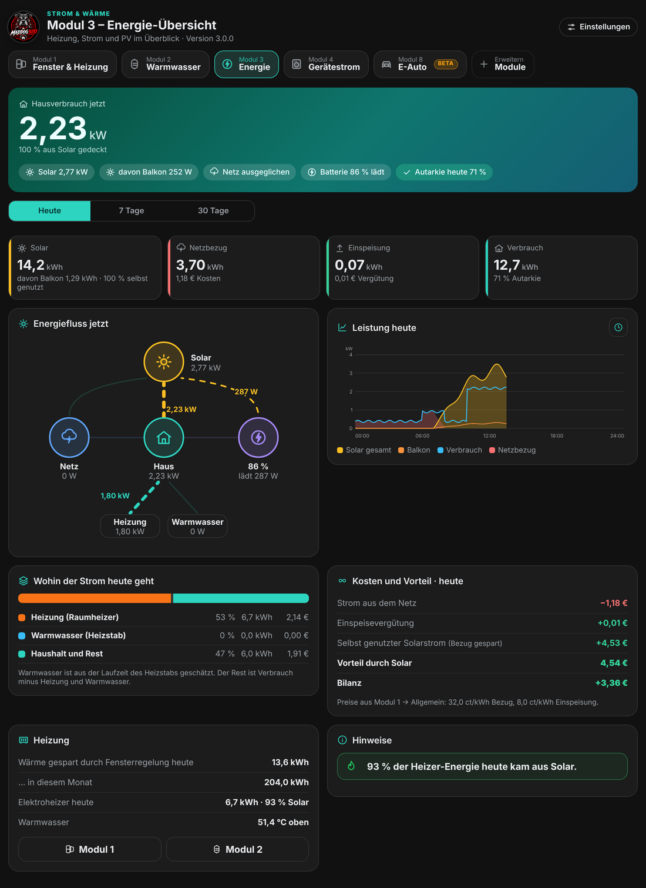

- **Kopfkarte:** Hausverbrauch jetzt, Anteil aus Solar, Chips für Solar, Netz und Batterie
- **Zeitraum:** Heute, 7 Tage, 30 Tage
- **Kacheln:** Solar (mit Eigenverbrauch), Netzbezug (Kosten), Einspeisung (Vergütung), Verbrauch (Autarkie)
- **Energiefluss:** Grafik mit Solar, Netz, Haus, Batterie, Heizung und Warmwasser
- **Verlauf:** Leistungskurve für heute, Balken pro Tag für 7 und 30 Tage
- **Verteilung, Kosten und Vorteil, Heizung** und **Hinweise** (zum Beispiel hoher Netzbezug oder Solarüberschuss, der ins Netz geht)

<b>Einrichten und zweite Solaranlage</b>

- **Pflicht:** Leistungssensoren (Watt oder kW) für Solar und Netz. Das Netz kann wie in Modul 1 gewählt sein. Hausverbrauch und Batterie sind optional; fehlt der Hausverbrauch, wird er berechnet. Meldet der Solar-Sensor „nicht verfügbar“ (Wechselrichter nachts), zählt das als 0 W.
- **Zweite Solaranlage** (zum Beispiel Balkonkraftwerk): zweiter Leistungssensor und optional zweiter Ertragszähler. Beide Anlagen werden addiert. Du kannst beide benennen. Die Kopfkarte und die Solar-Kachel zeigen den Anteil der zweiten Anlage, der Tagesverlauf eine dünne Linie. Liefert eine Anlage seit 10 Minuten unter 5 W, während die andere mindestens 400 W liefert, erscheint der Hinweis „… liefert nichts“.
- **Batterie:** ein Sensor mit Vorzeichen (Laden oder Entladen positiv) oder zwei Sensoren (einer für „lädt“, einer für „entlädt“, jeweils positiv).
- **7 und 30 Tage:** Am genauesten sind Energiezähler (Wh, kWh, MWh, Langzeitstatistik mit `state_class: total_increasing`). Leistungssensoren gehen auch, dann wird aus Stunden-Mittelwerten gerechnet. Leer lassen: es wird aus Solar und Netz oben gerechnet.
- Die Einstellungen werden im Backend gespeichert und mit gesichert. Strompreis und Einspeisevergütung kommen aus Modul 1 → Allgemein.

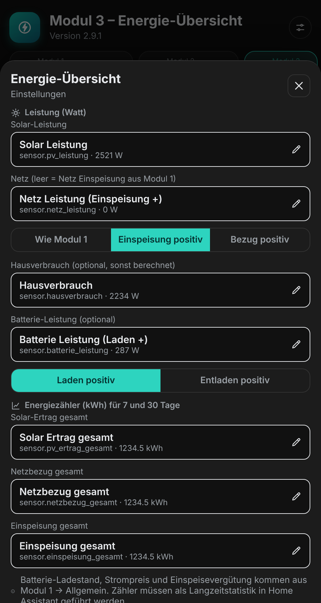

## Allgemeines

### Entitäten auswählen
Überall im Dashboard ersetzt eine Suchauswahl die einfachen Listen. Sie zeigt Name, Entity-ID und aktuellen Wert, passende Entitäten stehen oben mit „Passt“.

### Gerätediagnose
Unter **Allgemein → Diagnose öffnen** siehst du, ob alle Geräte der Regelung melden: Status, zuletzt gemeldet, Ventile (Batterie und ob sie Befehle übernehmen), Fenstersensoren und ein Protokoll fehlgeschlagener Schaltvorgänge. Auf Wunsch kommt eine Benachrichtigung bei Problemen, höchstens einmal in 24 Stunden je Problem.

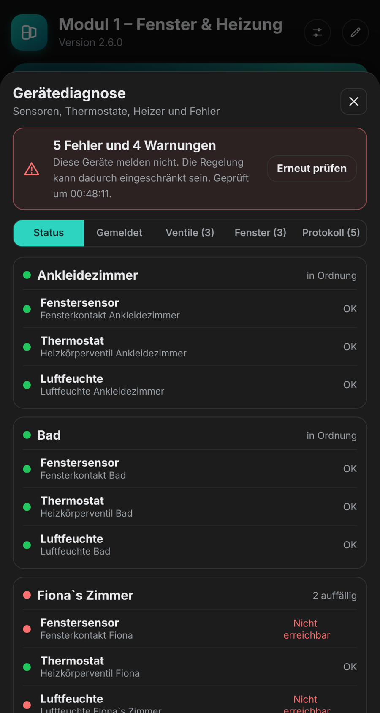 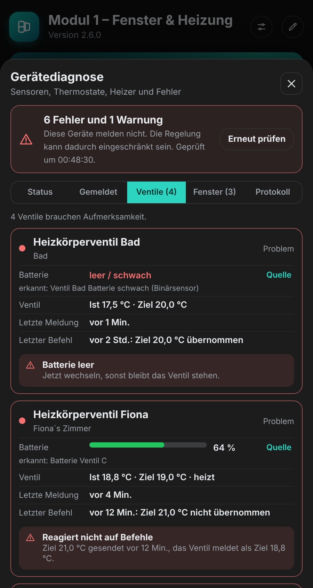

### Sichern und Wiederherstellen
Unter **Allgemein → Sichern & Wiederherstellen** speicherst du eine JSON-Datei mit Räumen, Heizplänen, Anwesenheit, Aussehen, allgemeinen Einstellungen und den Einstellungen von Modul 2 und 3. Beim Einlesen siehst du zuerst eine Zusammenfassung, erst „Wiederherstellen“ ersetzt die aktuellen Einstellungen.

### Update-Hinweis
Administratoren sehen oben ein Banner, wenn auf GitHub eine neuere Version veröffentlicht wurde. Maßgeblich ist die höchste Version unter allen Releases und Tags, auch mit vier Teilen (zum Beispiel `2.9.2.5`). Die Prüfung fragt höchstens einmal pro Stunde ab und lässt sich unter **Allgemein → Updates** ausschalten.

## Entitäten
Pro Raum:

| Entität | Beschreibung |
|---|---|
| Schalter „Fensterregelung aktiv“ | Regelung ein/aus |
| Schalter „Heizplan aktiv“ | Heizplan ein/aus |
| Schalter „Elektroheizer aktiv“ | nur mit eingeschaltetem Elektroheizer: Heizer erlauben oder pausieren |
| Sensor „Heizung pausiert“ (heute, Monat, Jahr, gesamt) | Minuten; Attribute: `gespart_menge`, `einheit`, `brennstoff`, `gespartes_gas_kwh`, bei Erdgas zusätzlich `gespartes_gas_m3` |
| Sensor „Betriebszustand“ | Regelung aktiv, Heizung pausiert, Heizung aus (nur Fenstermeldung) oder Regelung deaktiviert; Attribute u. a. `zuletzt_gelueftet`, `luftfeuchte_sensor`, `heizer` |
| Sensor „Heizplan Solltemperatur“ | aktuelle Vorgabe des Plans, nächste Änderung als Attribut; dazu `sommermodus` und `wetter_anpassung` |

## Hinweise für Entwickler

<b>WebSocket-Befehle und Änderungen an der Schnittstelle</b>

- Die technische Kennung der Integration bleibt `fenster_heizung` (Ordner, Entitäten, Speicher). Nur der Anzeigename ist „Strom & Wärme“.
- Raumeinstellungen im Dashboard: `fenster_heizung/get_options` und `fenster_heizung/set_options` (nur Administratoren). Layout (Farben, Fotos, Symbole, Wetteranzeige): `fenster_heizung/set_layout`. Allgemeines und Sicherung: `get_general`, `set_general`, `get_update`, `get_learning`, `restore`. Diagnose: `get_diag`, `clear_diag`. Module: `get_modules`, `set_modules`, `set_wasser`, `wasser_cmd`. Das Backend prüft alle Werte, Änderungen sind nur für Administratoren erlaubt.
- Version 2.9.2.3: `energy` kennt zusätzlich `ent.pv2`, `ent.pve2` (zweite Solaranlage) sowie die Anzeigenamen `pvn` und `pv2n`.
- Version 2.9.2.1: `energy` kennt zusätzlich `ent.bchg`, `ent.bdis` und `bmode` (`one` oder `two`). Versions-Tags dürfen vier Teile haben.
- Version 2.9.1: `set_modules` nimmt `on.en` und `energy` (`ent` mit `pv`, `grid`, `house`, `bat`, `pve`, `imp`, `exp`, `sign`, `bsign`) an.
- Neue Raumeinstellungen (`humidity_sensor`, `air_hint`, `air_every`, `weather_adj`) erscheinen nur im Dashboard und bleiben beim Speichern im HA-Optionsdialog erhalten.
- Der Bericht braucht Verlaufsdaten im Recorder.

**Neue Version veröffentlichen:** `version` in `custom_components/fenster_heizung/manifest.json` erhöhen, auf GitHub ein Release mit passendem Tag (zum Beispiel `v2.9.2.5`) erstellen und kurze Aufzählungspunkte in die Beschreibung schreiben. Sie erscheinen im Update-Hinweis des Dashboards. HACS zeigt das Update an.

## Wichtige Hinweise
- Die Integration schaltet **Heizungsthermostate, Elektroheizer, Heizstäbe und Pumpen**. Prüfe nach der Einrichtung, ob alles wie gewünscht reagiert, und beobachte die ersten Tage. Die Nutzung erfolgt auf eigene Verantwortung.
- Die Regelung von Warmwasser und Heizstab ersetzt keinen Verbrühschutz und keine Sicherheitseinrichtungen der Anlage. Beachte die Vorgaben deines Herstellers.
- Energie- und Kostenwerte, die Ersparnis und die Dusch-Schätzung sind **Schätzungen**. Die Energie der Elektroheizer wird aus der Nennleistung berechnet, nicht gemessen.
- Sensoren müssen in Home Assistant aktuelle Werte liefern. Ohne Messwerte bleibt die Regelung zurückhaltend: Fällt der PV-Sensor aus, gilt der Überschuss als 0.
- „Strom & Wärme“ ist ein privates Projekt und steht in keiner Verbindung zu Home Assistant oder Nabu Casa.

## Unterstützen
Gefällt dir die Integration? Über [GitHub Sponsors](https://github.com/sponsors/Maddog3010) kannst du die Weiterentwicklung unterstützen. Danke!

Fehler und Wünsche gern als [Issue auf GitHub](https://github.com/Maddog3010/ha-fenster-heizung/issues) melden. Hilfreich sind die Version, eine kurze Beschreibung und der Ausschnitt aus dem Protokoll der Gerätediagnose („Kopieren“).

## Änderungen
Alle Versionen siehe [CHANGELOG.md](CHANGELOG.md).

---

Made with ❤ by <b>MADDOG3010</b>

