

  

# Strom & Wärme

**Ein Dashboard für Heizung, Strom und Haus in Home Assistant.**
„Strom & Wärme“ pausiert Heizkörper bei offenem Fenster, heizt nach Plan, nutzt PV-Überschuss für Elektroheizer, Warmwasser und das Auto, zeigt, woher der Strom deiner Geräte kommt, und warnt vor Unwetter und Rauch. Alles steht in einer eigenen Seite in der Seitenleiste, 16 Module, die du einzeln ein- und ausschaltest.

## Neu in 3.0.2.9
- **Vier Labs, die Geräte schalten:** *Smart Vorheizen* (Heizplan startet früher), *Duschzeiten lernen* (Warmwasser vor gelernten Zapfzeiten vorheizen), *Legionellenschutz nach Sonne* (Lauf auf den sonnigeren Tag verschieben) und *Ladeziel nach Kalender* (Ziel-Ladestand der Wallbox). Sie sind ab Werk aus, tragen die Kennzeichnung „Schaltet Geräte“ und fragen vor dem Einschalten nach. [Mehr zu Labs](#labs-experimentelle-funktionen)
- Davor: Labs mit den ersten Anzeige-Funktionen, Modul 16 „Solar-Prognose“, Kennzeichnung der Module in vier Stufen, Store für Integrationen, Herstellerprofile für Thermostate, Module 9 und 11, überarbeitetes Modul 8, neue Optik für Modul 1 bis 4.

Alle Änderungen stehen im [Changelog](CHANGELOG.md).

## Inhalt
- [Die Module auf einen Blick](#die-module-auf-einen-blick)
- [Schnellstart](#schnellstart)
- [Einstellungen, Module und Store](#einstellungen-module-und-store)
- [Labs: experimentelle Funktionen](#labs-experimentelle-funktionen)
- [Modul 1: Fenster & Heizung](#modul-1-fenster--heizung)
- [Modul 2: Warmwasser & Zirkulation](#modul-2-warmwasser--zirkulation)
- [Modul 3: Energie](#modul-3-energie)
- [Modul 4: Gerätestrom](#modul-4-gerätestrom)
- [Module 5 bis 16](#module-5-bis-16)
- [Allgemeines](#allgemeines)
- [Entitäten](#entitäten)
- [Hinweise für Entwickler](#hinweise-für-entwickler)
- [Wichtige Hinweise](#wichtige-hinweise)
- [Unterstützen](#unterstützen)

## Die Module auf einen Blick

Jedes Modul trägt im Kopfteil (am Desktop zusätzlich am Tab) eine Stufe:

| Stufe | Bedeutung |
|---|---|
| 🟢 **Stabil** | Fertig und im Alltag erprobt. |
| 🟠 **Beta** | Funktioniert, wird gerade getestet. |
| 🔵 **Vorabversion** | Arbeitet schon mit echten Daten, ist aber noch nicht endgültig. Aussehen und Einstellungen können sich ändern. |
| ⚪ **In Entwicklung** | Beispielseite mit Beispielwerten, das Modul steuert noch nichts. |

| Nr. | Modul | Stufe | Was es macht |
|---|---|---|---|
| 1 | **Fenster & Heizung** | Stabil | Thermostate bei offenem Fenster pausieren, Heizpläne, Anwesenheit und Urlaub, Berichte, Elektroheizer mit PV-Überschuss, Schimmel- und Lüftungshinweise |
| 2 | **Warmwasser & Zirkulation** | Stabil | Speicher, Zeitplan, Zirkulationspumpe, Legionellenschutz, Heizstab bei PV-Überschuss |
| 3 | **Energie** | Stabil | Solar, Netz, Batterie und Hausverbrauch, Kosten und Autarkie, zweite Solaranlage |
| 4 | **Gerätestrom** | Stabil | Pro Gerät Solar-, Batterie- und Netzanteil, Kosten, Ersparnis, Startempfehlung |
| 5 | Lüftung & Raumluft | In Entwicklung | Luftfeuchte und Lüftungshinweise je Raum, später KWL und CO₂ |
| 6 | Rollläden & Beschattung | In Entwicklung | Sonnenstand und Außenwerte, später Rollladensteuerung |
| 7 | Wärmepumpe | In Entwicklung | Außenbedingungen, später Laufzeit, Takten und Abtauen |
| 8 | Elektroauto & Wallbox | Beta | Auto mit Wallbox, go-e Charger regeln (Sonne, Sonne + Netz, Voll, Ladeplan), Planung nach Strompreis und PV-Prognose, Ladestatistik |
| 9 | Wetter & Warnungen | Beta | Sturm, Gewitter, Frost, Hitze und Starkregen mit Vorwarnung, amtliche Warnungen, Aktionen, Meldungen aufs Handy |
| 10 | Garten & Bewässerung | In Entwicklung | Regen, PV-Überschuss und Zisterne |
| 11 | Rauch- & Sicherheitsmelder | Vorabversion | Melder, Batteriestände und Alarme im Überblick, mit Meldung aufs Handy |
| 12 | Pool & Sauna | In Entwicklung | Überschuss, Strompreis und Außentemperatur |
| 13 | Batteriespeicher-Planung | In Entwicklung | Betriebsarten, Ladestand-Grenzen, Zeitplan (Vorschau) |
| 14 | Dynamischer Stromtarif | Beta | Stundenpreise, Preisverlauf, günstigste Zeiten |
| 15 | Wartung & Erinnerungen | In Entwicklung | Termine und Betriebsstunden (Vorschau mit Beispielen) |
| 16 | Solar-Prognose | Vorabversion | Prognose heute und morgen, Stundenverlauf, Prognose gegen tatsächlichen Ertrag |

  
  
  
  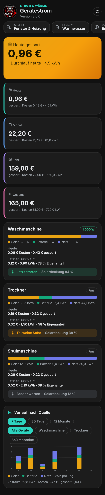

## Schnellstart
**Voraussetzungen:** Home Assistant 2024.11 oder neuer und [HACS](https://hacs.xyz).

1. HACS → drei Punkte → **Benutzerdefinierte Repositories**
2. Die Adresse dieses Repositories eintragen, Kategorie **Integration**
3. „Strom & Wärme“ installieren und Home Assistant **neu starten**
4. **Einstellungen → Geräte & Dienste → Integration hinzufügen → „Strom & Wärme“**: pro Raum ein Eintrag, mit Fenstersensoren und Thermostaten
5. In der Seitenleiste „Strom & Wärme“ öffnen. Der **Einrichtungsassistent** führt in acht Schritten durch Räume, Fenstermeldung, Heizung, Luftfeuchte, PV und Meldungen. Jeder Schritt außer dem ersten lässt sich überspringen.

Die Module 2 bis 4 sind ab Werk an, alle weiteren Module aus. Eingeschaltet und eingerichtet wird unter **Einstellungen**.

**Update:** über HACS aktualisieren, Home Assistant neu starten, Seite neu laden (Strg+F5). Deine Einstellungen bleiben erhalten. Von 2.x kommend: Gerätestrom ist jetzt Teil dieser Integration, die separate Integration „geraetestrom“ wird nicht mehr gebraucht.

## Einstellungen, Module und Store

 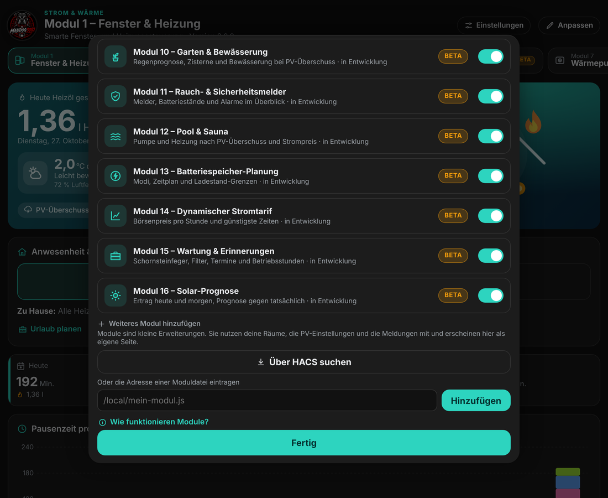

Der Knopf **Einstellungen** oben rechts öffnet in jedem Modul dieselbe Seite:

- **Übersicht** mit aktiven Modulen, Räumen, Personen und Version
- **Allgemein:** Einrichtungsassistent, Store & Integrationen, Labs, Personen & Standort, Darstellung
- **Meine Module:** nur eingeschaltete Module, mit Stufe und Status
- **Weitere Module:** ausgeschaltete Module als kleine Felder, ein Tipp schaltet ein
- **System:** Sichern & Wiederherstellen, Diagnose, Module verwalten

Unter **Module verwalten** schaltest du jedes Modul ein oder aus (Modul 1 ist immer an). Die Einstellung gilt für alle Nutzer. Eigene Module lassen sich über eine Dateiadresse hinzufügen.

### Store (Integrationen)
Der Store zeigt Dienste, die zu deinen Modulen passen (go-e, Tibber, Wetter und Warnungen, Melder, Thermostate), erkennt, was in Home Assistant schon läuft, und führt durch die Einrichtung. Er hat Suche, Kategorien, Detailseiten mit „Was du bekommst“ und „So geht es“ sowie einen Zähler für fehlende Dienste.

Du öffnest ihn über das **Store-Symbol im Kopf**, den **Tab „Store“** in der Modul-Leiste oder Einstellungen → Allgemein. Symbol und Tab lassen sich über den Knopf „Anzeige“ auf der Store-Seite einzeln ausblenden.

## Labs: experimentelle Funktionen
Labs sind neue Funktionen, die schon arbeiten, aber noch nicht überall erprobt sind. Sie sind **ab Werk aus**. Du schaltest sie einzeln ein, sie erscheinen im passenden Modul und sind nach dem Ausschalten dort wieder weg.

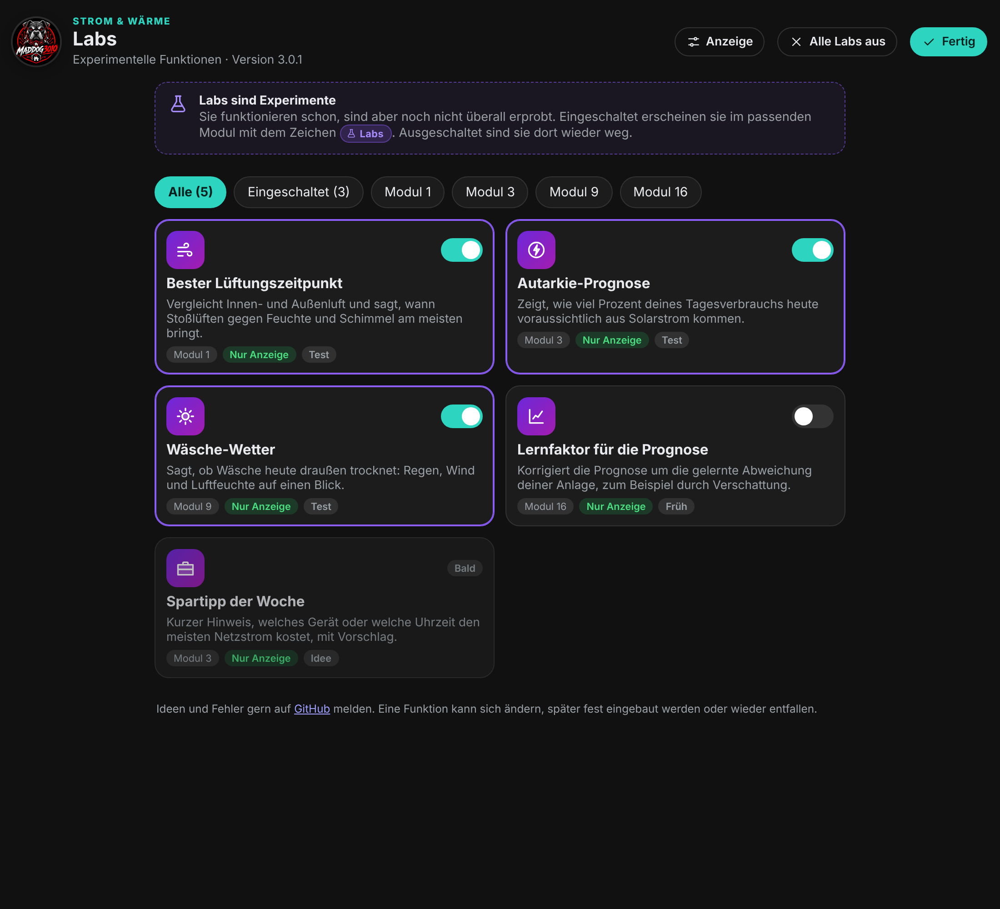 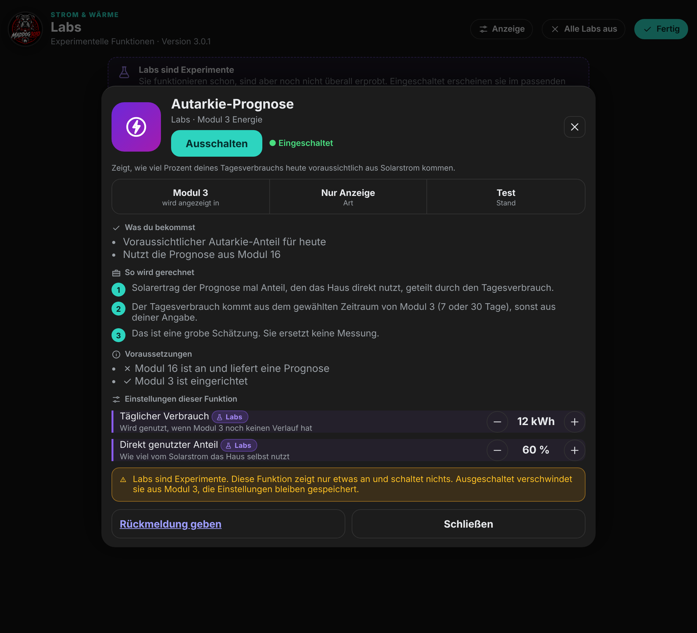

- **Labs-Seite:** Karten mit Schalter, Stand (Idee, Früh, Test) und Modul. Filter nach Modul, nach Art („Nur Anzeige“, „Schaltet Geräte“) oder „Eingeschaltet“, dazu „Alle Labs aus“ als Notausschalter. Ein Tipp auf die Karte öffnet wie im Store eine Infoseite mit „Was du bekommst“, „So wird gerechnet“, Voraussetzungen (erfüllt oder fehlt) und den Einstellungen der Funktion.
- **Zugang:** Kolben-Symbol im Kopf (mit Zähler eingeschalteter Labs), Tab „Labs“ in der Modul-Leiste und Einstellungen → Allgemein → „Labs“. Symbol und Tab blendest du über den Knopf „Anzeige“ auf der Labs-Seite einzeln aus, die Seite bleibt über die Einstellungen immer erreichbar. Die Auswahl gilt für alle Nutzer, nur Administratoren schalten um.
- **Zwei Arten:** *Nur Anzeige* (grün) zeigt etwas an. *Schaltet Geräte* (orange) greift ein. Vor dem Einschalten einer solchen Funktion erscheint ein Bestätigungsfenster.
- **Kennzeichnung:** Im Modul sitzt die Funktion als Karte mit gestricheltem violettem Rand, dem Zeichen „Labs“ und ihrer Art. Einstellungsfelder von Labs haben einen violetten Streifen und dasselbe Zeichen. Im Kopf des Moduls steht „n Labs aktiv“.
- **Ausschalten:** Karte und Felder verschwinden aus dem Modul, die eingestellten Werte bleiben gespeichert. Eine ausgeschaltete Funktion schaltet nichts mehr.

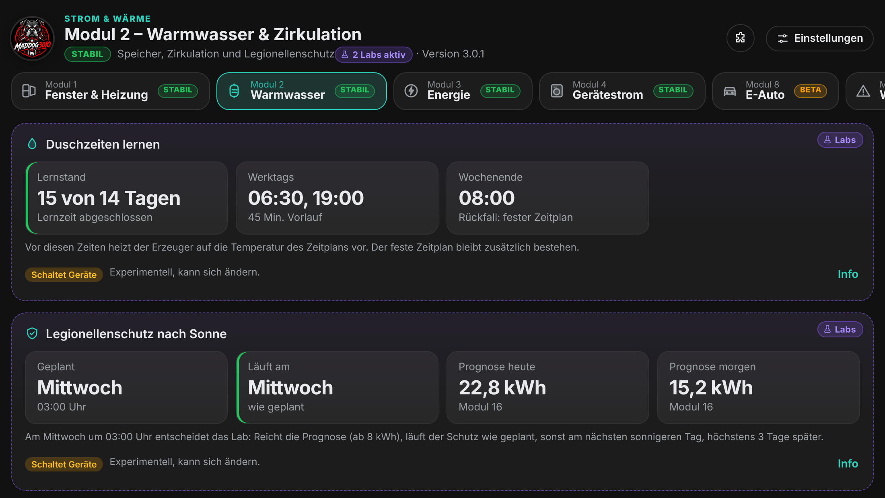

### Labs, die nur anzeigen
| Lab | Modul | Stand | Was es zeigt |
|---|---|---|---|
| **Bester Lüftungszeitpunkt** | 1 | Test | Pro Raum, ob Lüften jetzt lohnt: Vergleich der absoluten Feuchte innen und außen, Schwelle einstellbar (Standard 0,5 g/m³). Braucht Raumsensoren mit Luftfeuchte und Außenwerte. |
| **Autarkie-Prognose** | 3 | Test | Wie viel Prozent des Tagesverbrauchs heute voraussichtlich aus Solar kommen. Nutzt die Prognose aus Modul 16 und den Verbrauch aus Modul 3 (7 oder 30 Tage), sonst deine Angabe. Grobe Schätzung. |
| **Wäsche-Wetter** | 9 | Test | Ampel, ob Wäsche draußen trocknet, mit Luftfeuchte, Wind und Niederschlag aus der Wetter-Entität. Mindest-Wind einstellbar. |
| **Lernfaktor für die Prognose** | 16 | Früh | Gelernte Abweichung der Anlage aus Prognose gegen Ertrag (mindestens 3 Tage, begrenzt auf 0,5 bis 1,5) und die korrigierte Prognose für heute. Andere Module nutzen weiter die Originalprognose. |
| *Spartipp der Woche* | 3 | Idee | Angekündigt, noch nicht einschaltbar. |

### Labs, die Geräte schalten
Diese Funktionen laufen im Backend von Home Assistant, auch bei geschlossenem Dashboard. **Fenster auf, Abwesend und Urlaub, die Sicherheitsgrenzen der Module (zum Beispiel 65 °C im Warmwasserspeicher) und die Hausanschluss-Regeln haben immer Vorrang.** Fehlt ein Messwert, verhält sich die Funktion zurückhaltend und ändert nichts. Beobachte die ersten Tage, ob alles wie gewünscht reagiert.

| Lab | Modul | Stand | Was es schaltet |
|---|---|---|---|
| **Smart Vorheizen** | 1 | Test | Startet den Heizplan eines Raums früher, wenn der Raum zum Schaltpunkt kälter ist als das neue Ziel. Der Vorlauf kommt aus der gelernten Aufheizzeit (Kelvin pro Stunde) und der gewünschten Erwärmung, höchstens um den eingestellten Wert (Standard 3 K, höchstens 90 Min.). Ohne gelernte Aufheizzeit passiert nichts. |
| **Duschzeiten lernen** | 2 | Früh | Erkennt Warmwasser-Entnahmen aus dem Abkühlen des Speichers und lernt typische Zeiten für Werktage und Wochenende. Nach dem Lernzeitraum (Standard 14 Tage) heizt der Erzeuger den eingestellten Vorlauf (Standard 45 Min.) vor diesen Zeiten auf die Temperatur des Zeitplans. Der feste Zeitplan bleibt zusätzlich bestehen. |
| **Legionellenschutz nach Sonne** | 2 | Test | Entscheidet am geplanten Tag zur Laufzeit: Reicht die Prognose aus Modul 16 (Standard ab 8 kWh), läuft der Schutz wie geplant, sonst am nächsten Tag mit besserer Prognose, höchstens um die eingestellten Tage (Standard 3). Ist der Schutz überfällig (mehr als 9 Tage), läuft er sofort. |
| **Ladeziel nach Kalender** | 8 | Früh | Hebt den Ziel-Ladestand des Ladeplans an (Standard 90 %), wenn im gewählten Kalender in den nächsten 36 Stunden ein langer Termin (Standard ab 2 Stunden) beginnt. Es wird nur das Ziel geändert, nicht der Ladevorgang. Das Ziel wirkt, wenn der Ladeplan in Modul 8 an ist. |

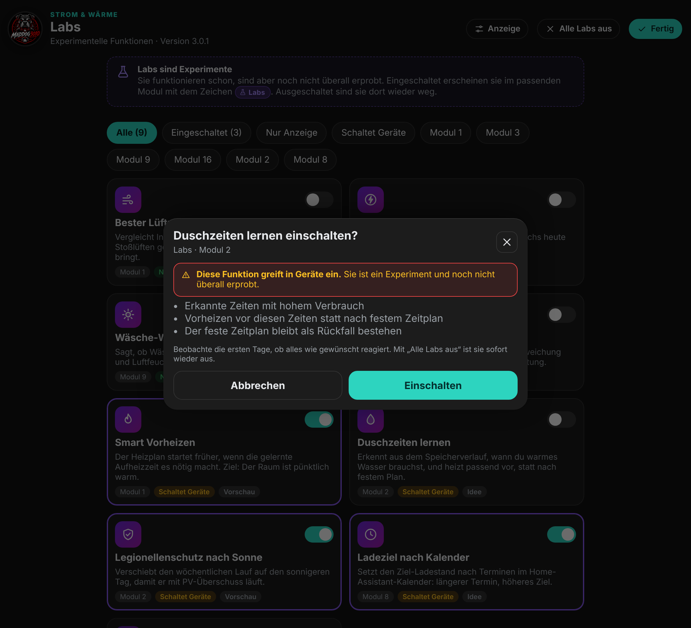

Labs können sich ändern, später fest eingebaut werden oder wieder entfallen. Ideen und Fehler gern als [Issue auf GitHub](https://github.com/Maddog3010/ha-fenster-heizung/issues). Im Protokoll der Gerätediagnose steht, wann ein Lab etwas geändert hat.

## Modul 1: Fenster & Heizung

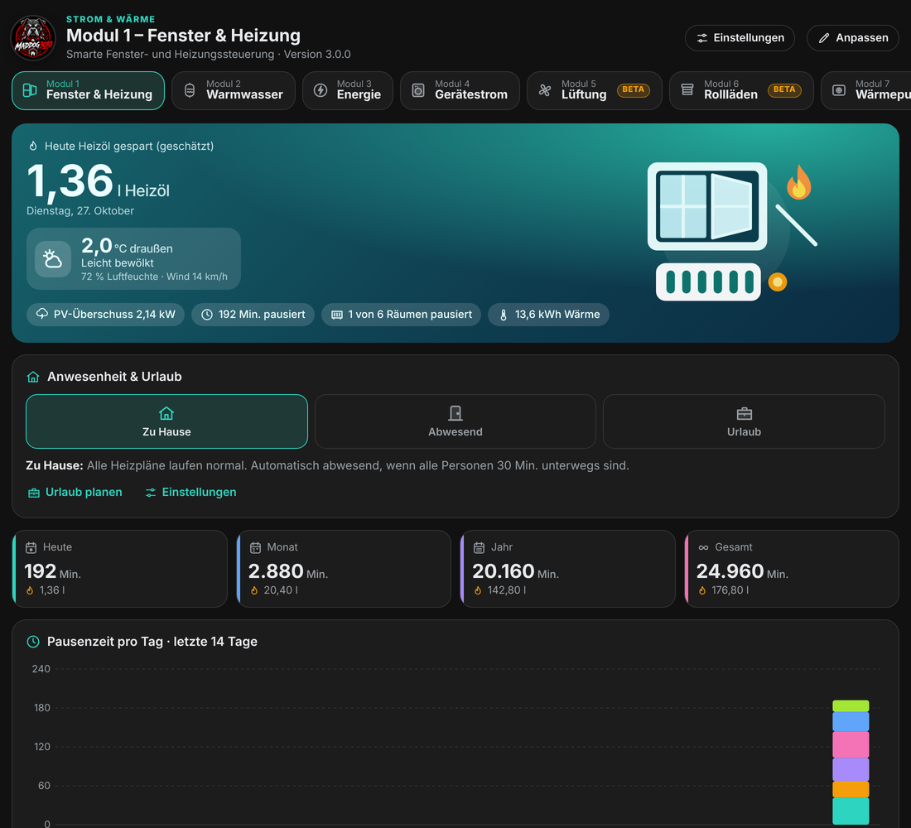

### Fensterregelung
Öffnet jemand ein Fenster, schaltet die Integration die Thermostate des Raums nach einer einstellbaren Verzögerung aus oder senkt sie ab. Nach dem Schließen läuft alles wie vorher weiter.

- Fenstersensoren und Thermostate frei wählbar, Sperrzeit (zum Beispiel nachts) und Außentemperatur-Bedingung
- Eigener Heizungs-Sensor wählbar: steht er auf „Heizung aus“, wird nicht geregelt
- Erinnerung bei zu langem Lüften per Benachrichtigung, mit eigenem Titel und Text (`{raum}`, `{minuten}`, `{fenster}`)
- Der Knopf **„Warum?“** erklärt pro Raum, was gerade passiert und weshalb

### Herstellerprofile für Thermostate
Thermostate von tado°, Homematic IP, AVM FRITZ!DECT, Shelly TRV, Aqara E1 und Danfoss Ally werden automatisch erkannt. Im Store (Kategorie „Heizung“) und in den Raumeinstellungen stehen die Besonderheiten je Hersteller.

- Geräte ohne echtes Aus (Homematic IP, Shelly TRV, Danfoss Ally) gehen bei „Thermostat aus“ auf die kleinste Temperatur des Geräts.
- Zeitplan-Geräte (tado°, Homematic IP, FRITZ!) schalten nach dem Lüften wieder auf Automatik, statt die alte Temperatur als manuelle Übersteuerung zu setzen.
- Alle anderen Geräte verhalten sich wie bisher. Die Hinweise stammen aus Herstellerangaben und Community-Erfahrungen, bitte am eigenen Gerät prüfen.

### Dashboard
Das Dashboard füllt sich automatisch mit allen Räumen: Kopfkarte mit der heute gesparten Menge, Außentemperatur und Wetter, Kennzahlen für Heute, Monat, Jahr und Gesamt, ein Balkendiagramm der letzten 14 Tage und eine Karte pro Raum. Umschaltbar zwischen **Detail** und **Kompakt**, hell und dunkel nach dem Design von Home Assistant, passend für Handy, Tablet und Desktop.

<b>Anpassen, Gruppen, Fotos und Darstellung</b>

- **Anpassen** (nur Administratoren): Bereiche und Raumkarten verschieben, Räume bekommen eines von 16 Symbolen, eine Farbe und ein Foto. Das gilt für alle Nutzer.
- **Gruppen** (zum Beispiel Erdgeschoss und Obergeschoss): eigene Kopfzeile mit Zusammenfassung und gemeinsamem Schalter für die Fensterregelung. Höchstens 12 Gruppen.
- **Meine Ansicht:** Räume und Bereiche nur für dich im Browser ein- und ausblenden oder neu ordnen.
- **Darstellung:** Akzentfarbe, Hintergründe der Kopfkarte (zum Beispiel nach Tageszeit oder Wetter) und die Außentemperatur-Quelle.

 

### Heizplan
Pro Raum ein Plan aus Schaltpunkten (Tage, Uhrzeit, Temperatur) mit Wochenansicht. Ausgeschaltete Thermostate schaltet der Plan je nach Einstellung ein („Nein“, „Heizen“, „Automatik“). Eine manuelle Änderung bleibt bis zum nächsten Schaltpunkt bestehen. Bei offenem Fenster greift der Plan nicht, danach gilt die Temperatur, die dann dran ist. Der Schalter „Heizplan aktiv“ und der Sensor „Heizplan Solltemperatur“ lassen sich in Automationen verwenden.

 

### Bericht pro Raum
Der Knopf „Bericht“ zeigt einen Tagesbericht mit Temperaturverlauf, Zieltemperatur, Pausenzeiten, Fensterereignissen und eingesparter Energie. Ganz oben steht die **gelernte Aufheizzeit**: die Integration erkennt Aufheizphasen und merkt sich die Minuten pro Kelvin, getrennt nach Frost, kühl und mild. Die Daten stammen aus dem Verlauf von Home Assistant, für volle 7 Tage muss der Recorder so lange aufbewahren (Standard: 10 Tage).

 

### Anwesenheit und Urlaub
Eine Karte stellt alle Räume gemeinsam um: **Zu Hause**, **Abwesend** oder **Urlaub**. Urlaub lässt sich mit Datum und Vorheizen am Rückkehrtag planen. Automatisch abwesend wird der Haushalt, wenn alle gewählten Personen länger unterwegs sind.

**Personen & Standort** (Einstellungen → Allgemein) legt fest, woher der Standort jeder Person kommt und wo dein Zuhause liegt.

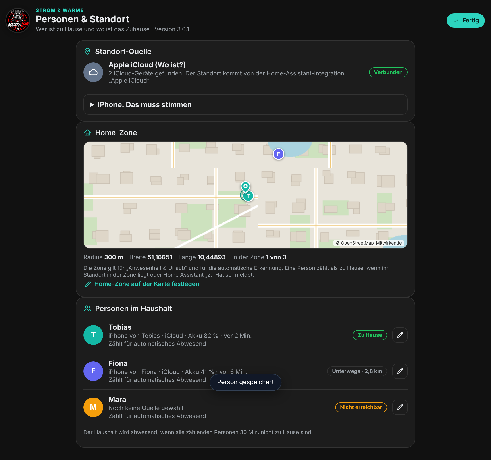

- **Standort über Apple iCloud:** Die Integration nutzt die Geräte der Home-Assistant-Integration „Apple iCloud“ ([Einrichtung](https://www.home-assistant.io/integrations/icloud)). Home Assistant Cloud und die Companion-App sind dafür nicht nötig.
- **Einstellungen pro Person:** Name, mehrere Standortquellen, optional ein WLAN- oder Router-Gerät als zweite Quelle, ob die Person für das automatische Abwesend zählt, und eine Genauigkeitsgrenze (Standard 100 m). Zu ungenaue Positionen werden ignoriert.
- **Home-Zone per Karte:** Karte (OpenStreetMap) verschieben und zoomen, Radius von 30 bis 1000 m. Die Zone ist unabhängig von der Zone in Home Assistant.

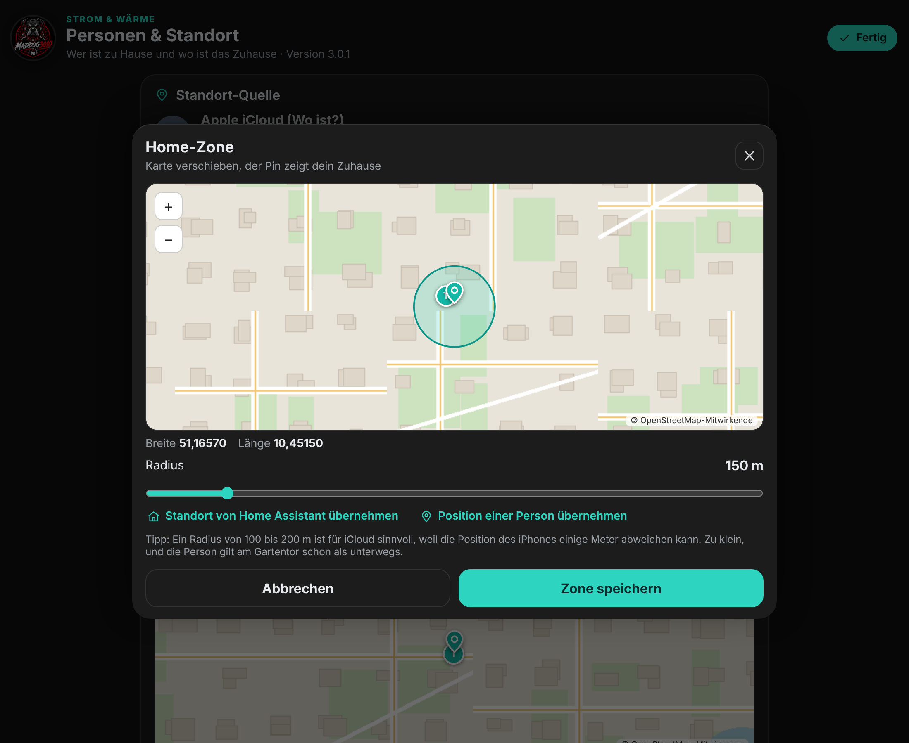

Eine Person gilt als **zu Hause**, wenn Home Assistant „zu Hause“ meldet, eine Quelle „zu Hause“ meldet, eine ausreichend genaue Position in der Zone liegt oder die WLAN-Quelle „zu Hause“ meldet. Gespeichert werden nur die Einstellungen, **kein Standortverlauf**.

*Am iPhone beachten:* „Wo ist?“ und Ortungsdienste an, Anmeldung mit Apple-Passwort und Zwei-Faktor-Code (gelegentlich erneut nötig), eigene Apple-ID je Person, iCloud aktualisiert nicht sekundengenau. Darum die Zone nicht kleiner als etwa 100 bis 200 m wählen und bei Bedarf zusätzlich WLAN nutzen.

### Elektroheizer mit PV-Überschuss
Pro Raum kann ein elektrischer Heizer (Heizlüfter, Infrarot, Klima-Heizgerät) eingerichtet werden. Er heizt nur, wenn genug PV-Überschuss da ist, auf Wunsch in mehreren Leistungsstufen.

<b>Einrichtung und Regelung im Detail</b>

**Einrichtung**
1. Unter **Allgemein → PV-Überschuss für Elektroheizer** den Sensor für die Netzeinspeisung wählen (Watt oder kW) und das Vorzeichen passend einstellen.
2. Dort Reserve, Einschaltverzögerung, Mindestlaufzeit, optional den Batterie-Ladestand sowie Strompreis und Einspeisevergütung einstellen. Der Strompreis lässt sich als Festpreis oder aus einer Entität lesen, etwa einem dynamischen Tarif.
3. In den Raumeinstellungen unter **Elektroheizer** den Heizer einschalten und das Gerät wählen.

**So wird geregelt**
- Verfügbarer Überschuss = Einspeisung plus die Leistung der laufenden Heizer. Die Heizer verdrängen sich also nicht selbst.
- Ein Heizer läuft auf der höchsten Stufe, deren Leistung plus Reserve in den freien Überschuss passt. Bei mehreren Heizern gilt die Priorität: 1 wird zuerst versorgt.
- Hochschalten erst, wenn die höhere Stufe die eingestellte Verzögerung lang möglich war. Zurückschalten nach etwa einer Minute. Ausschalten frühestens nach der Mindestlaufzeit.
- Sofort aus: Fenster auf, Raum warm genug, außerhalb des erlaubten Zeitfensters, Schalter „Elektroheizer aktiv“ aus, Batterie unter der Schwelle.
- Fällt der Sensor aus, gilt der Überschuss als 0. Ist das Gerät nicht erreichbar, wird nichts geschaltet.
- Bei einem `climate`-Gerät ordnest du jeder Stufe eine Voreinstellung zu (zum Beispiel H1, H2, H3). Die Thermostate des Raums werden auf Wunsch abgestellt, solange der Heizer läuft.
- Der Bericht pro Heizer zeigt Laufzeit, Energie, Solaranteil und den Vorteil in Euro. Die Energie wird aus der Nennleistung der Stufe berechnet, nicht gemessen.

 

### Raumluft: Lüften und Schimmel
Mit einem Luftfeuchte-Sensor zeigt die Raumkarte Luftfeuchte, Taupunkt und Schimmelrisiko mit einer Empfehlung zum Stoßlüften samt Countdown. Auch ohne Sensor erscheinen „Gelüftet vor X Std.“, die geschätzte Wandtemperatur und die kritische Feuchte. Das Schimmelrisiko ist eine Schätzung, kein Messwert.

### Wetter-Anpassung und Sommermodus
Die Einstellungen dazu öffnest du über **Einstellungen → Modul 1**: vier aufklappbare Bereiche (Sommermodus, Wetterabhängige Absenkung, PV-Überschuss für Elektroheizer, Strompreis und Einspeisevergütung), jeweils mit Kurzstatus in der Zeile.

- **Wetterabhängige Absenkung** (standardmäßig aus): Bei Sonne oder milder Luft sinkt die Zieltemperatur des Heizplans, bei Frost steigt sie.
- **Sommermodus:** Aus, automatisch oder immer an. Bei „Automatisch“ ruhen die Heizpläne ab einer einstellbaren mittleren Außentemperatur. Fenstermeldung und Erinnerungen bleiben aktiv.

### Brennstoff und Ersparnis
Die Integration schätzt die durch Pausen gesparte Heizenergie und rechnet sie in die Menge deines Brennstoffs um. Die Ersparnis ist eine grobe Schätzung, die echte liegt etwas darunter.

| Brennstoff | Einheit | Standard: kWh pro Einheit |
|---|---|---|
| Erdgas | m³ | 10 |
| Heizöl | l | 10 |
| Flüssiggas | l | 6,6 |
| Pellets | kg | 4,8 |
| Wärmepumpe / Strom | kWh | 1 (mit JAZ/COP, Standard 3,5) |

## Modul 2: Warmwasser & Zirkulation
Zeigt den Speicher, steuert Erzeuger, Heizstab und Zirkulationspumpe nach Zeitplan und führt den Legionellenschutz aus. **Das Modul schaltet nur Geräte, die du auswählst.** Fehlt eines, sagt die Seite das an der passenden Stelle.

**Einrichten** (Zahnrad oben rechts): Speichergröße, Soll- und Absenktemperatur, bis zu drei Temperatursensoren (oben, Mitte, unten), den Wärmeerzeuger (Schalter, `water_heater` oder `climate`), optional einen Heizstab für PV-Überschuss, die Zirkulationspumpe, einen Rücklaufsensor und einen Auslöser für „Bei Bedarf“. Ein Speichersensor genügt für den Start.

- **Übersicht:** Temperaturen, Status (Bereit, Heizt auf, Unter Soll, Zu heiß, Abwesend), eine Schätzung, für wie viele Duschen das Wasser reicht, Kacheln für Laufzeiten, Rücklauf und letzten Legionellenschutz, dazu ein Verlauf der letzten 24 Stunden.
- **Zeitplan:** Soll-Temperatur pro Zeitfenster, getrennt für Montag bis Freitag und das Wochenende. Der Erzeuger schaltet ein, wenn der Speicher oben 3 K unter Soll liegt, und aus, sobald das Soll erreicht ist. **Ab 65 °C schaltet das Modul Erzeuger und Heizstab immer ab** (Verbrühschutz).
- **Zirkulation:** nach Zeitplan, bei Bedarf (Taster, Bewegungsmelder oder Durchflusssensor), im Intervall oder aus. Eine Rücklauf-Grenze stoppt die Pumpe, wenn das Wasser in der Leitung schon warm ist.
- **Schnellknöpfe:** „Einmal aufheizen“ (auf die Schutztemperatur, höchstens 3 Stunden), „Zirkulation 5 Min.“ und „Abwesend“ (Absenktemperatur, Pumpe aus).
- **Legionellenschutz:** einmal pro Woche auf die Schutztemperatur (Standard 60 °C) und 20 Minuten halten, gemessen am kältesten Sensor. Er läuft nur mit gewähltem Erzeuger oder Heizstab. Schafft der Speicher es in sechs Stunden nicht, bricht der Lauf ab und das Fehlerprotokoll bekommt eine Warnung.
- **PV-Überschuss:** Mit einem Heizstab-Schalter lädt das Modul den Speicher bei Überschuss bis zur eingestellten Höchsttemperatur (Standard 62 °C). **Der Warmwasser-Heizstab hat Vorrang vor den Raumheizern.**

## Modul 3: Energie
Heizung, Strom und PV auf einer Seite. Das Modul **liest nur Sensoren und schaltet nichts**.

- **Kopfkarte:** Hausverbrauch jetzt, Anteil aus Solar, Chips für Solar, Netz und Batterie
- **Zeitraum:** Heute, 7 Tage, 30 Tage
- **Kacheln:** Solar (mit Eigenverbrauch), Netzbezug (Kosten), Einspeisung (Vergütung), Verbrauch (Autarkie)
- **Energiefluss:** Grafik mit Solar, Netz, Haus, Batterie, Heizung und Warmwasser
- **Verlauf:** Leistungskurve für heute, Balken pro Tag für 7 und 30 Tage
- **Verteilung, Kosten und Vorteil, Heizung** und **Hinweise** (zum Beispiel hoher Netzbezug oder Solarüberschuss, der ins Netz geht)

<b>Einrichten und zweite Solaranlage</b>

- **Pflicht:** Leistungssensoren (Watt oder kW) für Solar und Netz. Das Netz kann wie in Modul 1 gewählt sein. Hausverbrauch und Batterie sind optional; fehlt der Hausverbrauch, wird er berechnet. Meldet der Solar-Sensor „nicht verfügbar“ (Wechselrichter nachts), zählt das als 0 W.
- **Zweite Solaranlage** (zum Beispiel Balkonkraftwerk): zweiter Leistungssensor und optional zweiter Ertragszähler. Beide Anlagen werden addiert, du kannst beide benennen. Liefert eine Anlage seit 10 Minuten unter 5 W, während die andere mindestens 400 W liefert, erscheint der Hinweis „… liefert nichts“.
- **Batterie:** ein Sensor mit Vorzeichen (Laden oder Entladen positiv) oder zwei Sensoren (einer für „lädt“, einer für „entlädt“, jeweils positiv).
- **7 und 30 Tage:** Am genauesten sind Energiezähler (Wh, kWh, MWh, Langzeitstatistik mit `state_class: total_increasing`). Leistungssensoren gehen auch, dann wird aus Stunden-Mittelwerten gerechnet.
- Die Einstellungen werden im Backend gespeichert und mit gesichert. Strompreis und Einspeisevergütung kommen aus Modul 1 → Allgemein.

## Modul 4: Gerätestrom
Zeigt für jedes Gerät, **woher der Strom kam** (Solar, Batterie oder Netz), was der Lauf kostete und was du durch eigenen Strom gespart hast. Das Modul **liest nur Sensoren und schaltet nichts**.

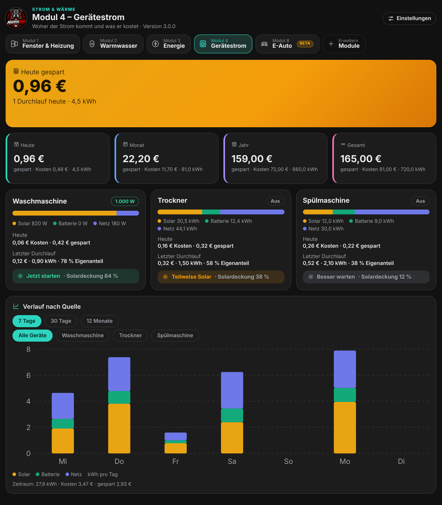

**Einrichten** (Einstellungen → Modul 4): bis zu 8 Geräte mit je einem **Leistungssensor**, einer **Schwelle** (ab wie vielen Watt ein Lauf gilt) und einer **Endzeit** (so viele Minuten unter der Schwelle beenden den Lauf). Dazu optional Batteriekosten (ct/kWh), ein Prognose-Sensor und Benachrichtigungsdienste.

- **Quellen:** Die Aufteilung nutzt die Sensoren aus **Modul 3** und die Preise aus **Modul 1 → Allgemein**. Solar fürs Haus = Erzeugung minus Batterie-Laden minus Einspeisung. Die Geräteleistung wird anteilig auf Solar, Batterie und Netz verteilt.
- **Kosten und Ersparnis:** Netzstrom kostet den Strompreis. Solarstrom spart Strompreis minus Einspeisevergütung. Batteriestrom spart Strompreis minus Batteriekosten.
- **Karten:** pro Gerät Leistung nach Quelle, Heute, letzter Durchlauf und eine Empfehlung: **Jetzt starten** (ab 70 % Solardeckung), **Teilweise Solar** (ab 30 %) oder **Besser warten**.
- **Verlauf:** gestapelte Balken nach Quelle für 7 Tage, 30 Tage und 12 Monate, auf Wunsch je Gerät. Die Daten bleiben bis zu 800 Tage gespeichert.
- **Ende eines Laufs:** Das Ereignis `geraetestrom_run_finished` wird ausgelöst, und gewählte `notify`-Dienste melden zum Beispiel „Waschmaschine fertig: 0,90 kWh · 0,12 € · 78 % eigener Strom (gespart: 0,42 €)“.

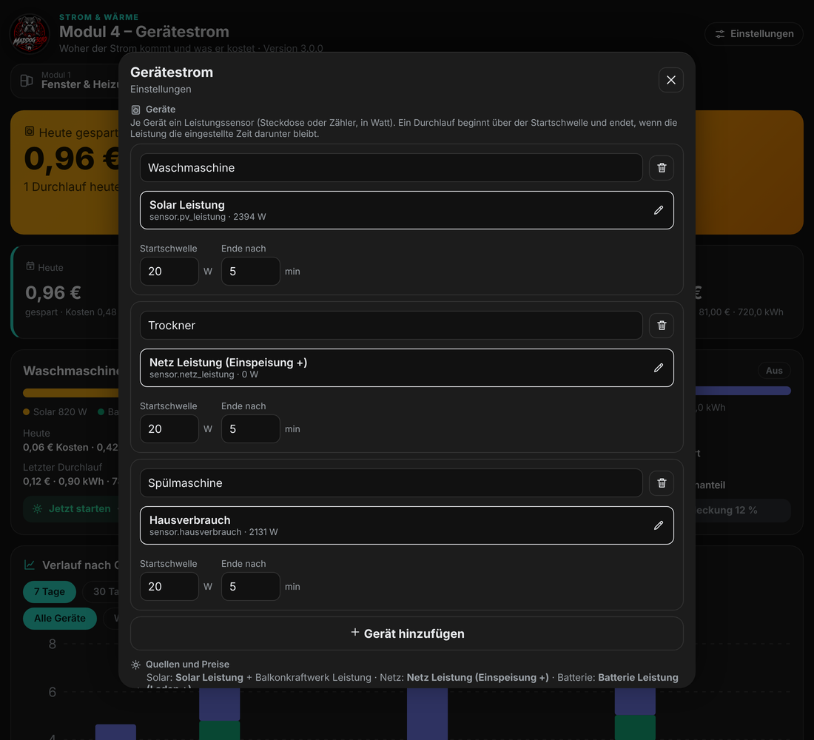

*Hinweis:* Zähler der alten Integration werden nicht übernommen, die Auswertung beginnt neu.

## Module 5 bis 16
Diese Module sind noch nicht stabil. Die Stufe steht jeweils im Kopfteil der Seite und in der Tabelle oben. Alle sind **standardmäßig aus** und werden unter **Einstellungen → Module verwalten** eingeschaltet. Module in der Stufe „In Entwicklung“ zeigen Beispielwerte und steuern nichts. Rückmeldungen gern als [Issue auf GitHub](https://github.com/Maddog3010/ha-fenster-heizung/issues).

### Modul 5, 6, 7 (In Entwicklung)
| Modul | Zeigt heute | Geplant |
|---|---|---|
| **5 Lüftung & Raumluft** | Pro Raum Luftfeuchte, Taupunkt und Lüftungshinweise aus den Räumen von Modul 1 | KWL steuern, CO₂-Werte auswerten |
| **6 Rollläden & Beschattung** | Sonnenhöhe und Himmelsrichtung, Außentemperatur und Luftfeuchte | Rollläden nach Zeitplan und Sonnenstand, Hitzeschutz im Sommer, Sonnenwärme im Winter nutzen |
| **7 Wärmepumpe** | Außenbedingungen, ob Abtauen wahrscheinlicher wird (unter etwa 7 °C) | Laufzeit und Takten erkennen, Vorlauf, Rücklauf und COP, Abtauzyklen zählen |

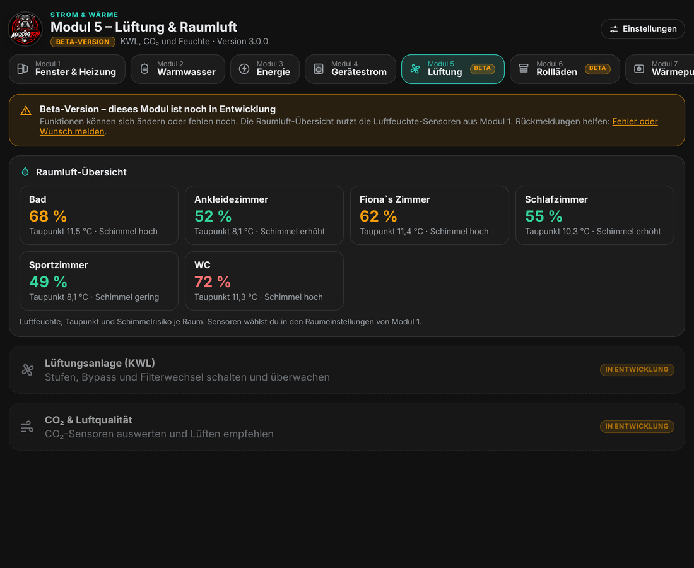 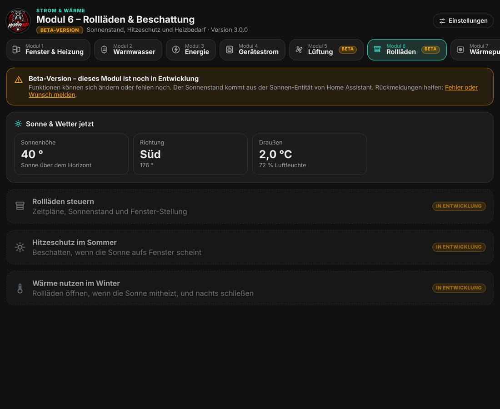 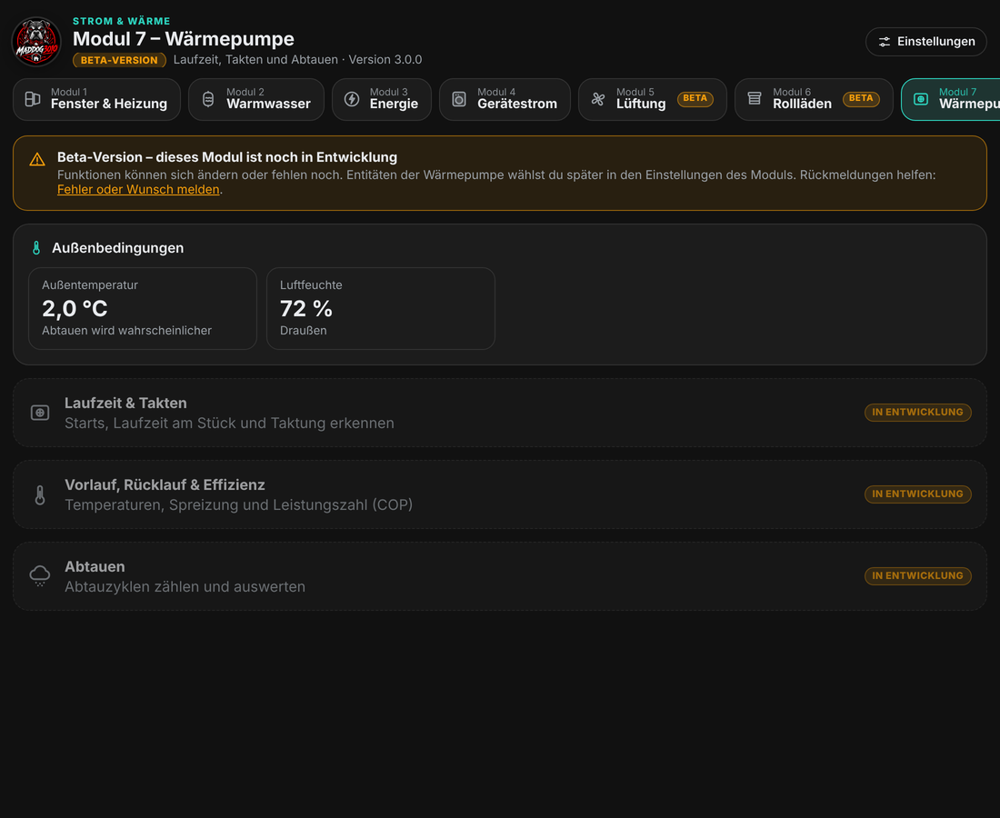

### Modul 8: Elektroauto & Wallbox (Beta)

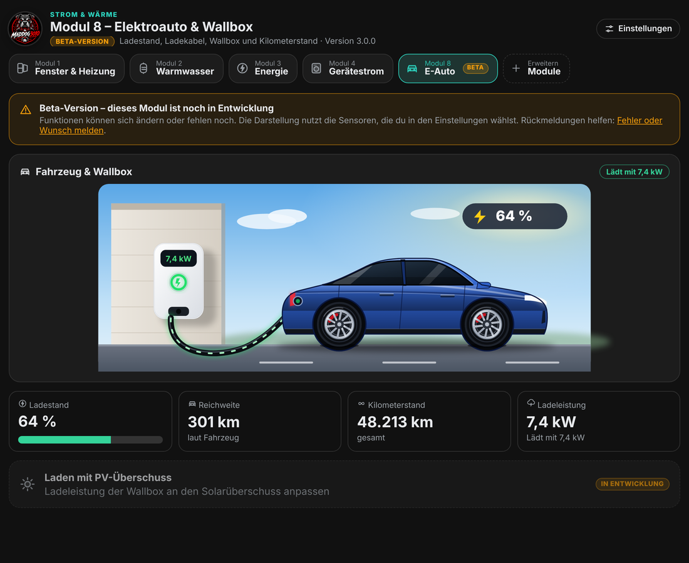

Das Modul zeigt dein Auto mit Wallbox und regelt den **go-e Charger** (Gemini und andere Geräte mit lokaler API v2) direkt über das lokale Netzwerk, ohne Cloud. Die Regelung ist standardmäßig **aus**. Register: **Laden**, **Planung**, **Ladestatistik**, **Einstellungen**, dazu eine Statusleiste über allen Registern.

- **Auto:** Marke (Mercedes-Benz, Audi, VW, BYD, BMW oder Andere), Modellname, Karosserie, eine von sechs Farben. Die Grafik ist eine eigene Zeichnung, es werden keine Markenlogos und keine Nachbildungen echter Modelle verwendet. Kabel erscheint nur bei steckendem Stecker, beim Laden läuft eine Animation. Kacheln für Ladestand, Reichweite, Kilometerstand und Ladeleistung. Alle Sensoren sind optional.
- **Verbindung:** Einstellungen → Allgemein → Integrationen (IP-Adresse, „Verbindung testen“). In der go-e-App muss unter Einstellungen → Verbindung → API-Einstellungen die lokale HTTP-API an sein.
- **Modi:** **Aus**, **Sonne** (nur mit Überschuss), **Sonne + Netz** (immer Mindeststrom, mehr bei Überschuss) und **Voll**. Ladestrom 6 bis 16 A, automatische Umschaltung 1 und 3 Phasen (höchstens alle 10 Minuten), Ladelimit in Prozent, Regelung alle 10 Sekunden.
- **Erster Test:** Erst Modus „Voll“ mit 6 A ausprobieren und in der go-e-App beobachten, danach „Sonne“.

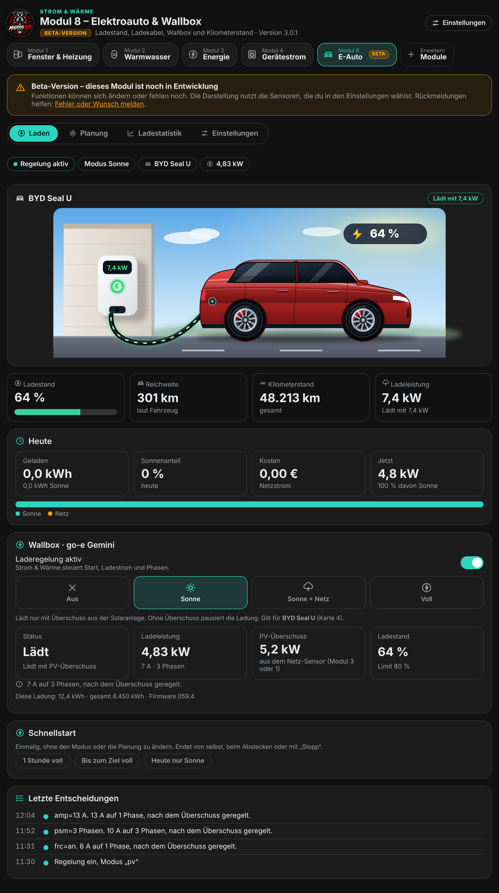

<b>Fahrzeuge, Karten und Sicherheit</b>

- **Fahrzeuge & Karten (wie bei evcc):** Das Fahrzeug wird an der RFID-Karte erkannt. Im Block **„Karten zuordnen“** hat jede Karte eine Zeile mit allen Fahrzeugen als Chips. Ein Fahrzeug kann beliebig viele Karten haben, eine Karte gehört zu genau einem Fahrzeug. Karten ohne Fahrzeug gelten als Gast. Pro Fahrzeug stellst du Modus und Ladelimit ein.
- **„Nur mit erkannter Karte regeln“:** Ohne Karte verändert Strom & Wärme nichts an der Wallbox. Die eigentliche Sperre kommt von der Kartenpflicht in der go-e-App.
- **„Nach dem Abstecken zurücksetzen“:** Wallbox auf „neutral“, Erkennung vergessen, gilt nur für eine Ladung.
- **Überschuss:** Einspeisung am Netzanschluss (Netz-Sensor aus Modul 3 oder 1) plus die Leistung der Wallbox selbst.
- **Hausbatterie zuerst** (mit Mindest-Ladestand) und **Netzstrom nur bei günstigem Preis** (Preis-Sensor aus Modul 1).
- **Sicherheit:** Nur Adressen im lokalen Netz sind erlaubt. Stellst du die Wallbox in der go-e-App von Hand um, pausiert die Regelung 30 Minuten. Fehlt der Überschuss-Wert, wird im Modus „Sonne“ nicht geladen. Ist die Wallbox nicht erreichbar, bleibt sie im letzten Zustand. Die letzten Entscheidungen stehen mit Begründung in der Liste.
- **Hausanschluss-Schutz** (standardmäßig aus): Du gibst den Höchststrom pro Phase an. Die Wallbox wird gedrosselt oder pausiert, wenn Haus und Wallbox zusammen die Grenze überschreiten würden, nie das Haus.
- **Benachrichtigungen** (`notify.*`): Ladung gestartet, Ziel erreicht, Ladeplan reicht nicht, Wallbox nicht erreichbar, Auto steckt lange ohne Ladung. Jede Meldung kommt pro Ladung nur einmal.

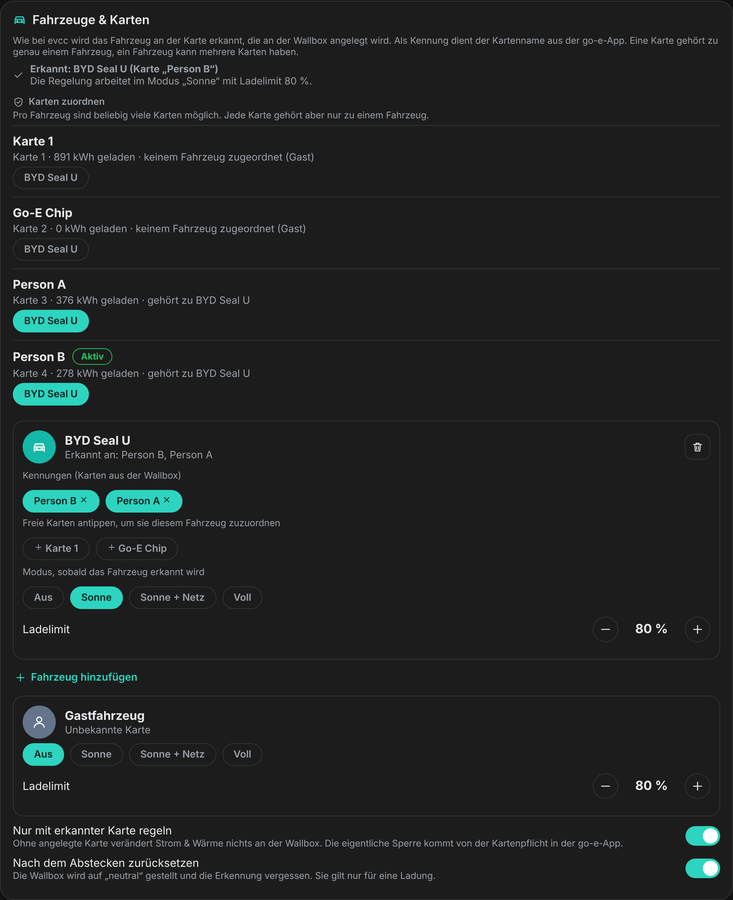

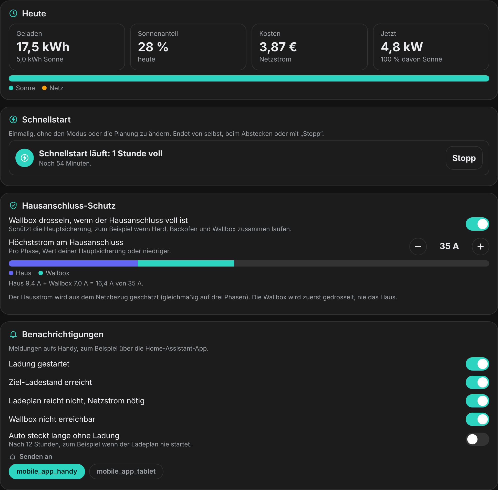

<b>Laden, Schnellstart und Ladeplan</b>

- **Heute:** Geladene Energie, Sonnenanteil, Kosten und aktuelle Leistung mit Anteil Sonne und Netz.
- **Schnellstart:** Einmalig **1 Stunde voll**, **Bis zum Ziel voll** oder **Heute nur Sonne** (bis Mitternacht). Er ändert weder Modus noch Planung und endet von selbst, beim Abstecken oder mit „Stopp“.
- **Ladeplan:** Ziel-Ladestand bis zu einer Uhrzeit (täglich, Mo–Fr oder Wochenende). Reicht die Sonne nicht, startet die Wallbox spätestens zur berechneten Zeit mit Netzstrom. Braucht den Ladestand-Sensor des Fahrzeugs und die Akkukapazität.
- **Abfahrtszeit pro Fahrzeug** (Register „Planung“): eigenes Ziel, eigene Uhrzeit und eigene Tage je Fahrzeug. Ohne eigene Abfahrt und bei Gästen gilt der allgemeine Ladeplan.
- **Einstellungen:** Einrichtungs-Check oben (Wallbox, Ladestand-Sensor, Netz-Sensor, Fahrzeug, Karten, optional Preis und PV-Prognose), darunter sechs aufklappbare Bereiche. Ein orangefarbenes „!“ markiert Bereiche, die Aufmerksamkeit brauchen.

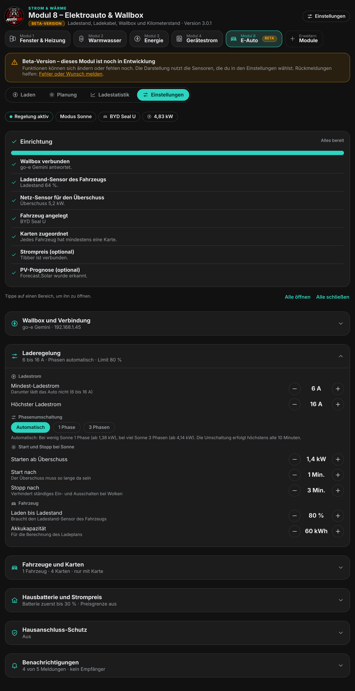

<b>Planung nach Strompreis und Sonne, Tibber und Forecast.Solar</b>

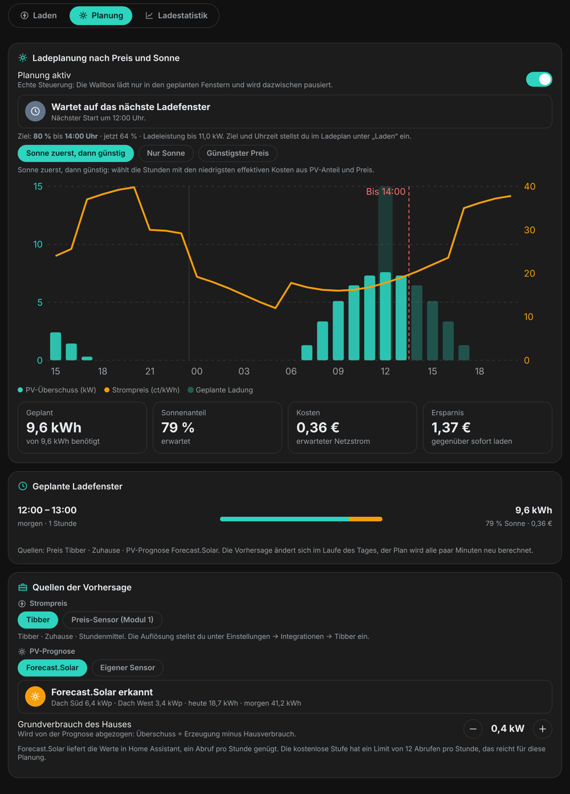

- Das Diagramm zeigt die nächsten rund 30 Stunden: PV-Überschuss (türkis), Strompreis (orange), geplante Ladung und die Uhrzeit, bis zu der das Auto geladen sein soll.
- **Strategien:** „Sonne zuerst, dann günstig“, „Nur Sonne“ und „Günstigster Preis“.
- **Schalter „Planung aktiv“:** Aus = nur Anzeige. An = **echte Steuerung**: Die Wallbox lädt nur in den geplanten Fenstern und wird dazwischen pausiert. Die Laderegelung muss an sein, der Ladestand des Fahrzeugs muss bekannt sein. Reicht die Sonne nicht, startet die Ladung spätestens zur berechneten Zeit mit Netzstrom.
- **Strompreis:** von **Tibber** oder aus einem Preis-Sensor (Modul 1).
- **Tibber:** Unter Einstellungen → Allgemein → Integrationen → Stromtarife verbindest du Tibber mit deinem persönlichen Zugriffstoken (developer.tibber.com), ohne zusätzliche Integration. Es werden nur Strompreise von heute und morgen abgerufen. Der Token wird nur in Home Assistant gespeichert und nur an api.tibber.com gesendet. Preisauflösung: Stundenmittel (empfohlen), Viertelstunden oder Preisstufen.
- **PV-Prognose:** von **Forecast.Solar**. Die Integration wird erkannt (mehrere Dachflächen werden addiert) und über `forecast_solar.get_forecast` gelesen. Vom Hausverbrauch wird ein einstellbarer **Grundverbrauch** (Vorgabe 0,4 kW) abgezogen.

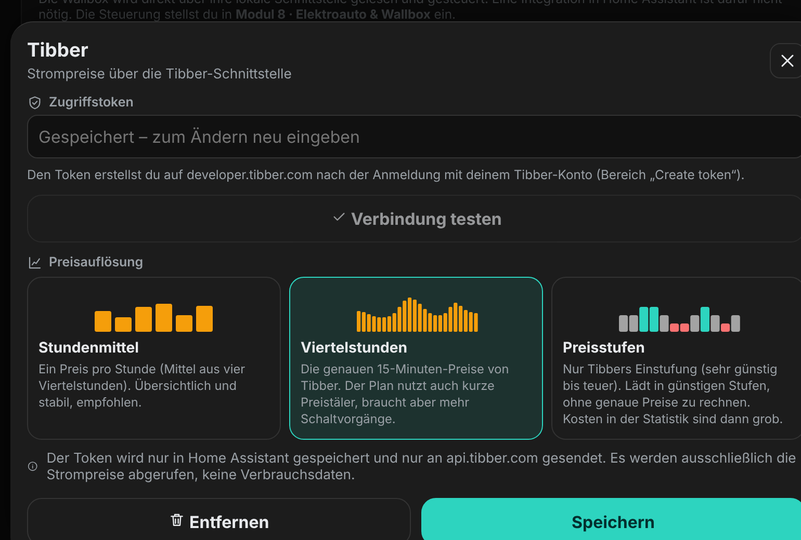

<b>Ladestatistik</b>

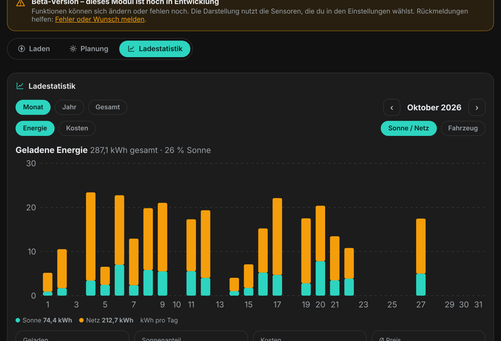

- Balkendiagramm pro Tag, Monat oder Jahr, wahlweise **Energie** oder **Kosten**, aufgeteilt nach **Sonne / Netz** oder nach **Fahrzeug**. Dazu Kacheln mit Geladen, Sonnenanteil, Kosten, Ø Preis, Ersparnis, **Ø Verbrauch** (kWh pro 100 km, braucht den Kilometerstand-Sensor) und **CO₂ gespart** (Sonne statt Netz-Mix, 0,38 kg je kWh) sowie die letzten Ladevorgänge. Der Knopf **CSV** lädt die Daten für Excel herunter.
- **So wird gerechnet:** Alle 10 Sekunden wird die Ladeleistung aufgeteilt. Als Sonne zählt der Anteil, der aus dem Überschuss am Netzanschluss gedeckt wird (auch die Hausbatterie), der Rest kommt aus dem Netz. Die Kosten sind der Netzanteil mal dem Preis zum Zeitpunkt des Ladens (ohne Preis 0 €). Gespeichert wird pro Tag, Fahrzeug und Ladevorgang bis zu 800 Tage, kein Positionsverlauf. Gezählt wird auch bei ausgeschalteter Regelung.

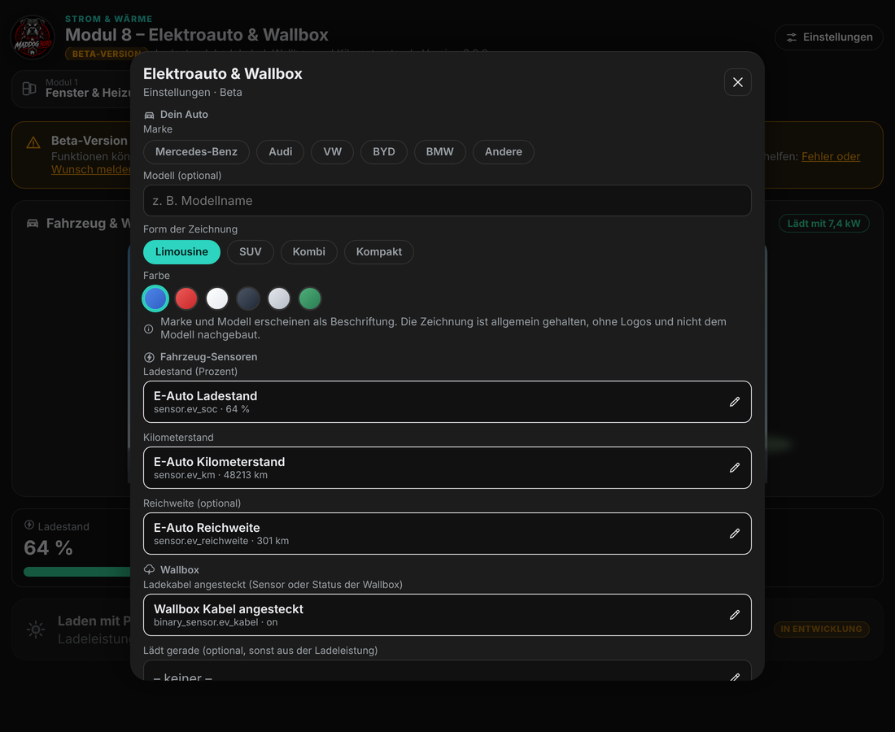

### Modul 9: Wetter & Warnungen (Beta)

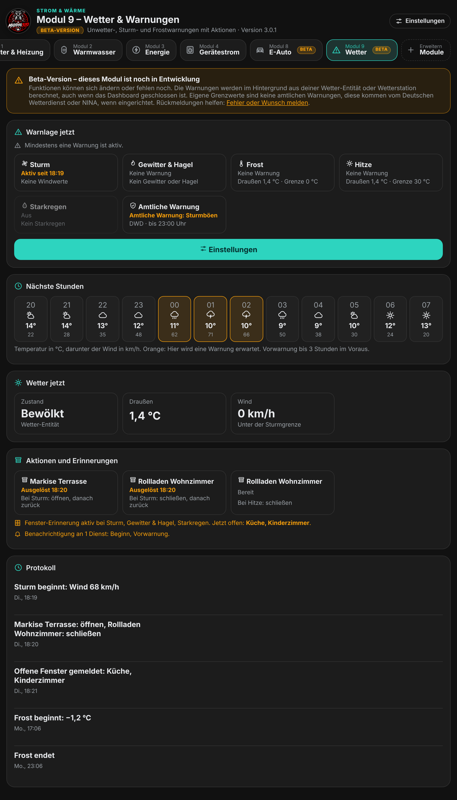

Das Modul läuft im Hintergrund von Home Assistant, auch wenn das Dashboard geschlossen ist. Eigene Grenzwerte sind keine amtlichen Warnungen, deshalb kann zusätzlich eine amtliche Warnung angezeigt werden.

- **Warnlage:** Fünf eigene Warnungen, einzeln schaltbar: **Sturm** (30 bis 120 km/h, Standard 60), **Gewitter und Hagel**, **Frost** (−10 bis 5 °C), **Hitze** (20 bis 45 °C, standardmäßig aus) und **Starkregen** (standardmäßig aus). Eine Warnung beginnt nach zwei Messungen in Folge und endet erst, wenn der Wert zehn Minuten lang deutlich unter der Grenze liegt.
- **Wind:** aus einer eigenen Wetterstation (m/s, mph, Knoten werden umgerechnet) oder aus der Wetter-Entität, dort auch die Böen.
- **Vorwarnung:** aus der Stundenvorhersage der Wetter-Entität bis zu 12 Stunden im Voraus. Nicht jeder Wetterdienst liefert sie, dann entfällt sie.
- **Amtliche Warnung:** Ist **DWD**, **NINA** oder **MeteoAlarm** eingerichtet, erscheint die höchste aktuelle Warnung als eigene Kachel und wird gemeldet.
- **Aktionen:** Rollläden und Markisen, Schalter, Skripte und Szenen laufen einmal beim Beginn einer Warnung. Optional „Danach zurück“: 15 Minuten nach Ende wird der vorige Zustand wiederhergestellt.
- **Fenster-Erinnerung:** meldet bei den gewählten Warnungen offene Fenster aus Modul 1, einmal pro Fenster und Warnung.
- **Benachrichtigung** über `notify.*`-Dienste, mit „Test senden“, dazu ein **Protokoll** der letzten Ereignisse.

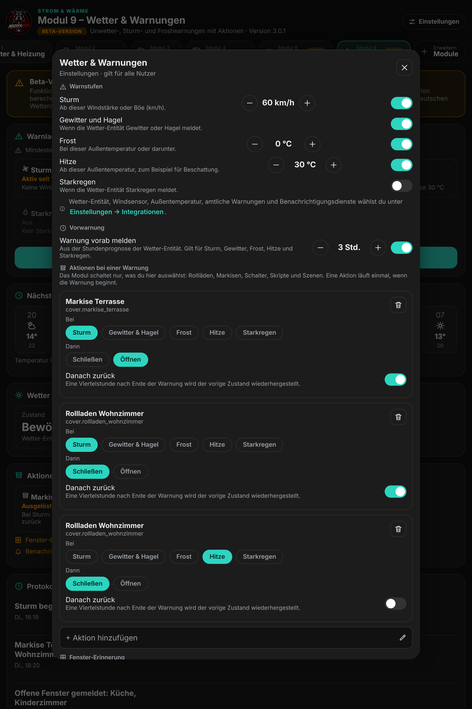

**Quellen und Zuordnung** stellst du unter **Einstellungen → Modul 9** im Abschnitt „Datenquellen“ ein, die passenden Dienste mit Status stehen im **Store** (Kategorie „Wetter“): DWD, NINA, MeteoAlarm, Met.no, OpenWeatherMap, Open-Meteo, AccuWeather, Pirate Weather, Tomorrow.io sowie die Wetterstationen Ecowitt, Netatmo und WeatherFlow Tempest. Was eingerichtet ist, wird automatisch erkannt. Bei mehreren Quellen wählst du Wetter, Wind, Außentemperatur und amtliche Warnung selbst.

*Beta-Hinweis:* Vorhersage und Erkennung von DWD, NINA und MeteoAlarm sind noch nicht auf allen Systemen geprüft.

### Modul 10: Garten & Bewässerung (In Entwicklung)

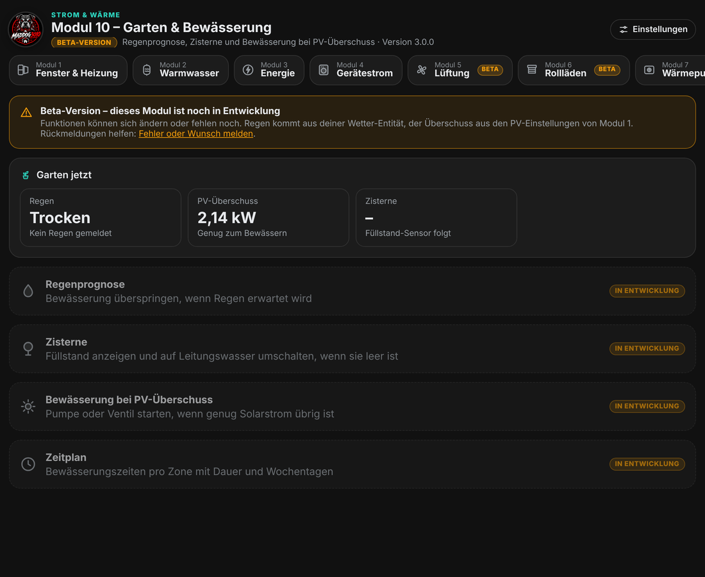

Zeigt, ob es regnet, den aktuellen PV-Überschuss und einen Platz für den Zisternen-Füllstand. **Geplant:** Regenprognose, Zisterne mit Umschalten auf Leitungswasser, Bewässerung bei PV-Überschuss, Zeitplan pro Zone.

### Modul 11: Rauch- & Sicherheitsmelder (Vorabversion)

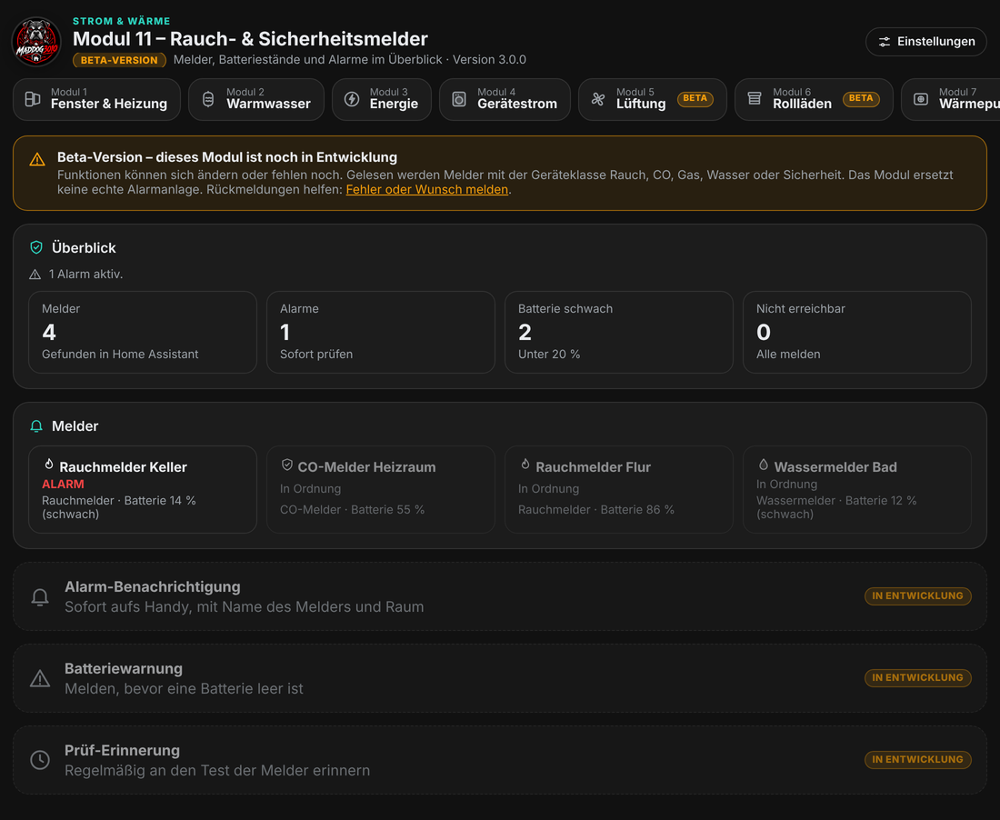

Findet automatisch alle `binary_sensor` mit der Geräteklasse **Rauch, CO, Gas, Wasser, Hitze oder Sicherheit**, mit Raum, Batteriestand und Testknopf. Alles läuft im Hintergrund, auch bei geschlossenem Dashboard.

- **Alarm:** sofortige Meldung aufs Handy, deine Aktionen laufen einmal (Licht, Schalter, Ventil, Rollladen, Skript, Szene), auf Wunsch Erinnerungen (alle 10 Minuten) und eine Meldung bei Ende.
- **Batterie** (Standard unter 20 %), **Erreichbarkeit** (Standard nach 60 Minuten) und **Prüf-Erinnerung** (alle 1, 3, 6 oder 12 Monate, Knopf „Geprüft“), jeweils mit Sperrzeit gegen Dauermeldungen.
- **X-Sense:** Es gibt keine offizielle Home-Assistant-Integration. Mit einer inoffiziellen Community-Integration per HACS (zum Beispiel [Jarnsen/ha-xsense-component_test](https://github.com/Jarnsen/ha-xsense-component_test)) werden die Melder automatisch erkannt. Das läuft über die Cloud und kann nach Home-Assistant-Updates ausfallen. Die Melder alarmieren auch ohne Home Assistant weiter. Die Anleitung steht im Store.

**Wichtig:** Das Modul ersetzt keine Alarmanlage und keinen Rauchmelder mit eigener Sirene.

### Modul 12, 13, 15 (In Entwicklung)
| Modul | Zeigt heute | Geplant |
|---|---|---|
| **12 Pool & Sauna** | PV-Überschuss und Strompreis aus Modul 1, Außentemperatur | Poolpumpe nach Sonne, Pool-Heizung, Sauna nach Wunschzeit, Kosten und Solaranteil |
| **13 Batteriespeicher-Planung** | Ladestand und Untergrenze, Überschuss, vier Betriebsarten (PV laden, Halten, Haus aus Batterie, Netzladen). Der Zeitplan-Balken ist ein Beispiel, es wird nichts an der Batterie geschaltet. | Ladestand-Grenzen je Betriebsart, Zeitplan nach Uhrzeit und Wochentag, Netzladen nach Preis (mit Modul 14) |
| **15 Wartung & Erinnerungen** | Beispieltermine (Schornsteinfeger, Lüftungsfilter, Heizungswartung) mit Restzeit, Betriebsstunden mit Fortschritt | Eigene Termine mit „Erledigt“-Knopf, Erinnerung aufs Handy, Betriebsstunden aus Sensoren |

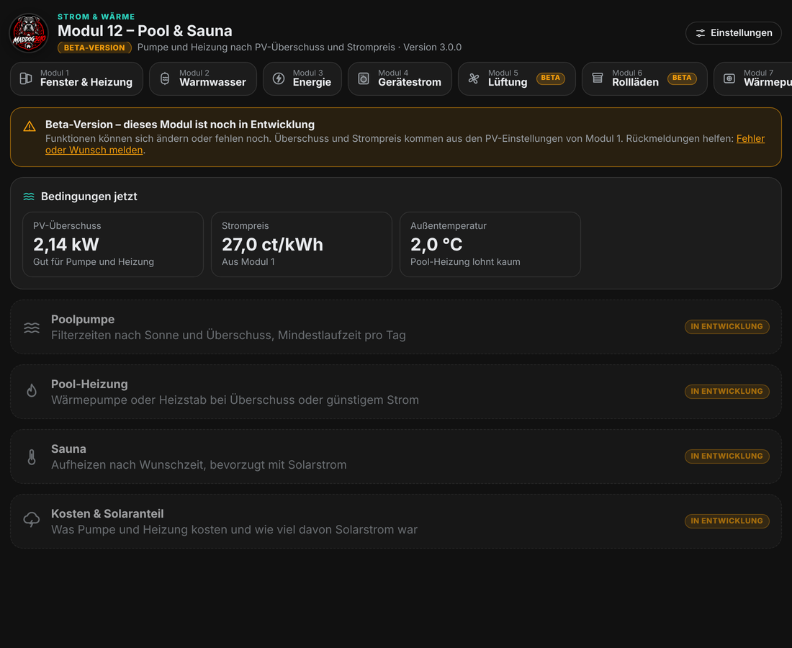 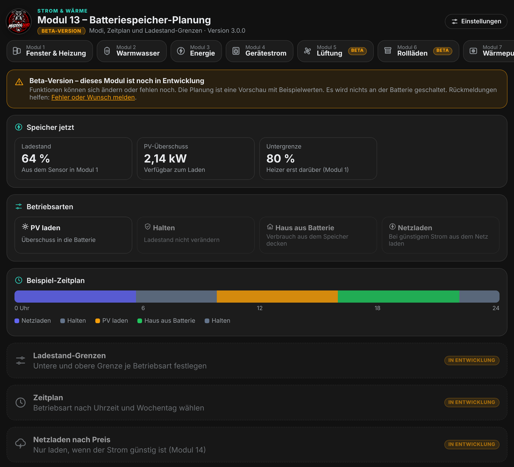 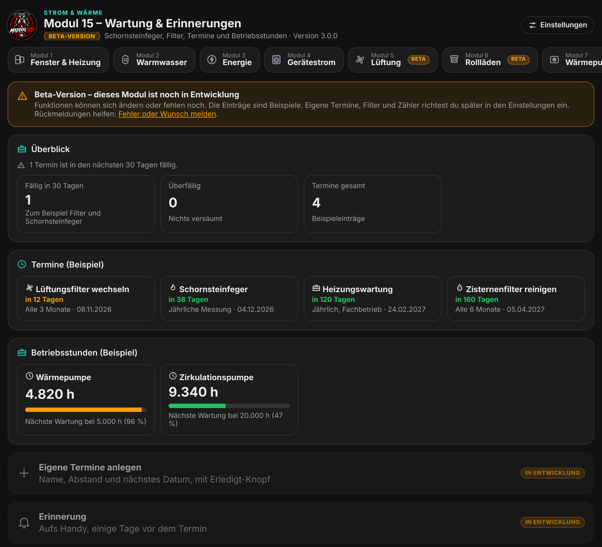

### Modul 14: Dynamischer Stromtarif (Beta)

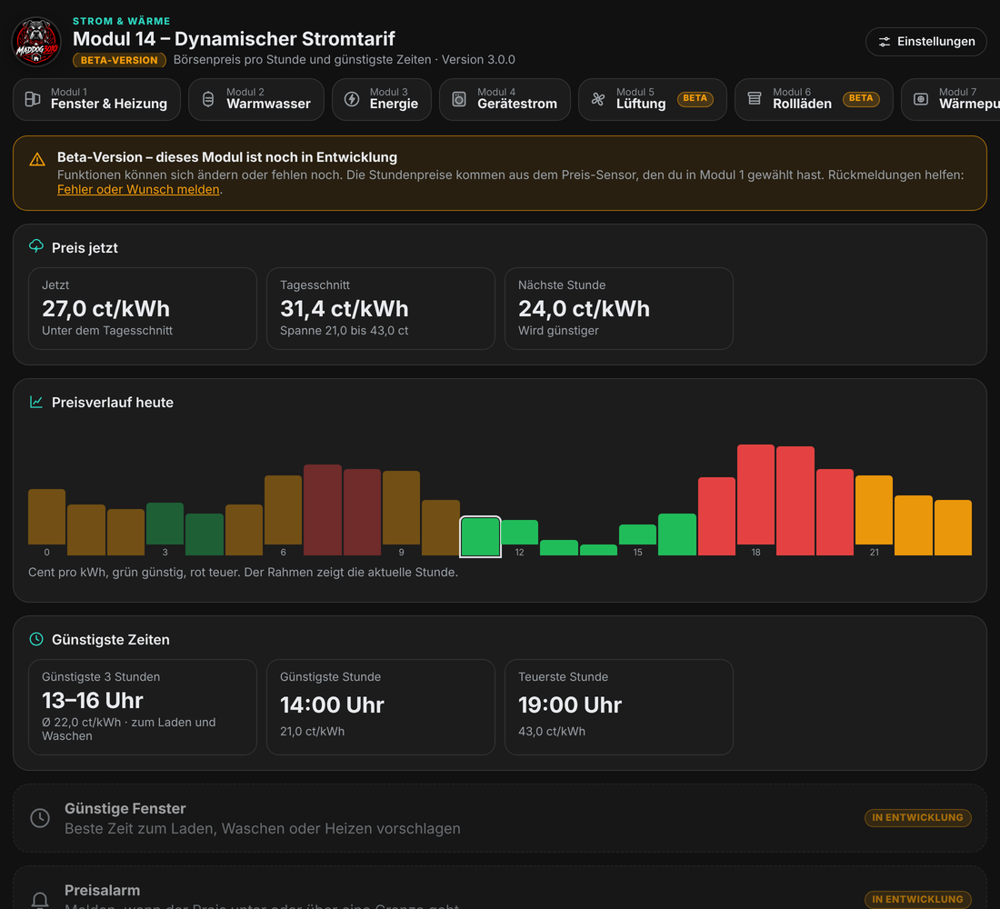

Liest die **Stundenpreise** aus dem Preis-Sensor, den du in Modul 1 unter „Strompreis“ gewählt hast. Der Sensor muss die Preisliste für heute als Attribut `raw_today`, `prices_today`, `today` oder `prices` liefern (24 Stunden- oder 96 Viertelstunden-Werte, in Euro oder Cent). Die Seite zeigt Preis jetzt, Tagesschnitt, nächste Stunde, einen **Preisverlauf** (grün günstig, rot teuer) und die **günstigsten drei Stunden** zum Laden und Waschen. **Geplant:** Vorschläge für günstige Fenster, Preisalarm, Preise für morgen.

### Modul 16: Solar-Prognose (Vorabversion)

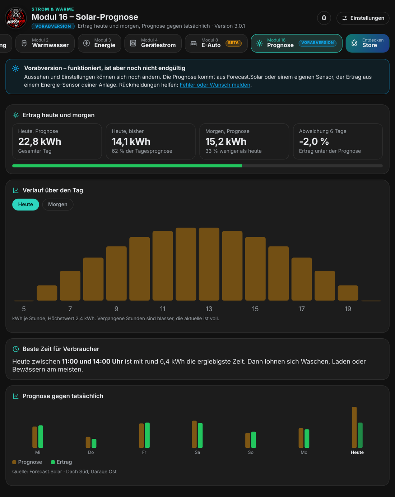

Zeigt den erwarteten Ertrag für heute und morgen, den bisherigen Ertrag des Tages, einen Stundenverlauf (Heute oder Morgen), die ergiebigste Zeit für Verbraucher und einen Vergleich von Prognose gegen tatsächlichen Ertrag der letzten Tage mit der Abweichung in Prozent. Das Modul läuft im Hintergrund und schaltet nichts.

- **Quelle:** Forecast.Solar (mehrere Anlagen werden addiert) oder ein eigener Sensor mit dem Attribut `wh_period` (Wh je Stunde).
- **Ertrag:** ein Energie-Sensor, entweder nur für den Tag oder als Gesamtzähler. Der Sensor aus Modul 3 lässt sich mit einem Klick übernehmen.
- **Ehrlicher Vergleich:** Die Prognose des Tages wird morgens festgehalten, der Verlauf bleibt 60 Tage gespeichert.
- **Beste Zeit:** das ergiebigste Dreistundenfenster (ab 16 Uhr für den nächsten Tag).

Einrichtung: Einstellungen → Modul 16.

## Allgemeines

### Entitäten auswählen
Überall im Dashboard ersetzt eine Suchauswahl die einfachen Listen. Sie zeigt Name, Entity-ID und aktuellen Wert, passende Entitäten stehen oben mit „Passt“.

### Gerätediagnose
Unter **System → Diagnose** siehst du, ob alle Geräte der Regelung melden: Status, zuletzt gemeldet, Ventile (Batterie und ob sie Befehle übernehmen), Fenstersensoren und ein Protokoll fehlgeschlagener Schaltvorgänge. Auf Wunsch kommt eine Benachrichtigung bei Problemen, höchstens einmal in 24 Stunden je Problem.

 

### Sichern und Wiederherstellen
Unter **System → Sichern & Wiederherstellen** speicherst du eine JSON-Datei mit Räumen, Heizplänen, Anwesenheit (mit Home-Zone und Personen), Aussehen, allgemeinen Einstellungen und den Einstellungen der Module 2 bis 4 und 8. Beim Einlesen siehst du zuerst eine Zusammenfassung, erst „Wiederherstellen“ ersetzt die aktuellen Einstellungen.

### Update-Hinweis
Administratoren sehen oben ein Banner, wenn auf GitHub eine neuere Version veröffentlicht wurde. Maßgeblich ist die höchste Version unter allen Releases und Tags, auch mit vier Teilen (zum Beispiel `3.0.2.9`). Die Prüfung fragt höchstens einmal pro Stunde ab und lässt sich unter **Allgemein → Updates** ausschalten.

## Entitäten
Pro Raum:

| Entität | Beschreibung |
|---|---|
| Schalter „Fensterregelung aktiv“ | Regelung ein/aus |
| Schalter „Heizplan aktiv“ | Heizplan ein/aus |
| Schalter „Elektroheizer aktiv“ | nur mit eingeschaltetem Elektroheizer: Heizer erlauben oder pausieren |
| Sensor „Heizung pausiert“ (heute, Monat, Jahr, gesamt) | Minuten; Attribute: `gespart_menge`, `einheit`, `brennstoff`, `gespartes_gas_kwh`, bei Erdgas zusätzlich `gespartes_gas_m3` |
| Sensor „Betriebszustand“ | Regelung aktiv, Heizung pausiert, Heizung aus (nur Fenstermeldung) oder Regelung deaktiviert; Attribute u. a. `zuletzt_gelueftet`, `luftfeuchte_sensor`, `heizer` |
| Sensor „Heizplan Solltemperatur“ | aktuelle Vorgabe des Plans, nächste Änderung als Attribut; dazu `sommermodus` und `wetter_anpassung` |

## Hinweise für Entwickler

<b>WebSocket-Befehle und Änderungen an der Schnittstelle</b>

- Die technische Kennung der Integration bleibt `fenster_heizung` (Ordner, Entitäten, Speicher). Nur der Anzeigename ist „Strom & Wärme“.
- Das Dashboard (`panel.js`) wird aus den Quelldateien in `frontend-src/parts` gebaut: `python3 frontend-src/build.py` (mit `--check` prüfen, ob die Datei aktuell ist).
- Raumeinstellungen: `fenster_heizung/get_options`, `set_options` (nur Administratoren). Layout (Farben, Fotos, Symbole, Wetteranzeige, `store` mit `icon` und `tab`, `labs` mit `on`, `icon`, `tab` und `cfg`): `set_layout`. Allgemeines und Sicherung: `get_general`, `set_general`, `get_update`, `get_learning`, `restore`. Diagnose: `get_diag`, `clear_diag`. Module: `get_modules`, `set_modules`, `set_wasser`, `wasser_cmd`. Das Backend prüft alle Werte, Änderungen sind nur für Administratoren erlaubt.
- **Labs:** `labs_get` (Lernstand der Duschzeiten, Stand des Legionellenschutzes, Kalendertermin). Ein- und Ausschalten und Werte laufen über `set_layout` (`labs`).
- **Modul 16:** `sp_get` (Prognose, Stundenwerte, Verlauf, Abweichung) und `sp_set` (`cfg` mit `src` = `forecast` oder `sensor`, `fc_sensor`, `act`, `mode` = `day` oder `total`, nur Administratoren).
- **Modul 11:** `sf_get`, `sf_set`, `sf_test`, `sf_tested`, `sf_press`.
- **Modul 9:** `wx_get` (Einstellungen, Warnlage, Vorhersage, offene Fenster, Protokoll), `wx_set` (`cfg`, nur Administratoren), `wx_test` (Testmeldung, gibt `sent` zurück).
- **Modul 8 (Wallbox):** `wb_get`, `wb_set` (`cfg` mit `ip`, `enabled`, `mode` = off/pv/minpv/now, `minA`, `maxA`, `ph`, `startW`, `onMin`, `offMin`, `limit`, `plan`, `planSoc`, `planTime`, `planDays`, `cap`, `batOn`, `batSoc`, `priceOn`, `priceMax`, `lock`, `reset`, `vehicles`, `guard`, `notify`, `planOn`, `planStrat`, `planSrc`, `pvSrc`, `baseW`), `wb_test`, `wb_quick` (`kind` = `h1`, `goal`, `sun` oder leer zum Stoppen), `wb_stats`, `wb_forecast`. Tibber: `tb_get`, `tb_test`, `tb_set` (`token`, `home`, `res` = `h`, `q`, `lvl`).
- `set_presence` kennt zusätzlich `zone` (`lat`, `lon`, `r` in Metern, 30 bis 1000) und `people` (je `person.*`: `label`, `trackers`, `wifi`, `count`, `acc`).
- Modul 4: `gs_get` liefert die Auswertung, Ereignis `geraetestrom_run_finished` mit `device`, `kwh`, `cost`, `saved`, `share`. Modul 3: `energy` mit `ent` (`pv`, `grid`, `house`, `bat`, `pve`, `imp`, `exp`, `pv2`, `pve2`, `bchg`, `bdis`), `sign`, `bsign`, `bmode`.
- Die Module 5, 6, 7, 10, 12, 13, 15 speichern im Backend nur den Schalter `on.<kürzel>` (Standard `false`).
- Der Bericht braucht Verlaufsdaten im Recorder.

**Neue Version veröffentlichen:** `version` in `custom_components/fenster_heizung/manifest.json` erhöhen, auf GitHub ein Release mit passendem Tag (zum Beispiel `v3.0.2.9`) erstellen und kurze Aufzählungspunkte in die Beschreibung schreiben. Sie erscheinen im Update-Hinweis des Dashboards. HACS zeigt das Update an.

## Wichtige Hinweise
- Die Integration schaltet **Heizungsthermostate, Elektroheizer, Heizstäbe, Pumpen und auf Wunsch die Wallbox**. Prüfe nach der Einrichtung, ob alles wie gewünscht reagiert, und beobachte die ersten Tage. Die Nutzung erfolgt auf eigene Verantwortung.
- Die Regelung von Warmwasser und Heizstab ersetzt keinen Verbrühschutz und keine Sicherheitseinrichtungen der Anlage. Beachte die Vorgaben deines Herstellers.
- Module der Stufen Beta, Vorabversion und In Entwicklung können sich ändern. Labs sind Experimente und können sich ändern oder entfallen. Labs der Art „Schaltet Geräte“ greifen in Heizung, Warmwasser und Wallbox ein: nach dem Einschalten die ersten Tage beobachten.
- Energie- und Kostenwerte, die Ersparnis, die Dusch-Schätzung und Prognosen sind **Schätzungen**. Die Energie der Elektroheizer wird aus der Nennleistung berechnet, nicht gemessen. Gerätestrom rechnet aus Messwerten im 20-Sekunden-Takt, die Aufteilung auf Solar, Batterie und Netz ist eine Näherung.
- Sensoren müssen in Home Assistant aktuelle Werte liefern. Ohne Messwerte bleibt die Regelung zurückhaltend: Fällt der PV-Sensor aus, gilt der Überschuss als 0.
- „Strom & Wärme“ ist ein privates Projekt und steht in keiner Verbindung zu Home Assistant oder Nabu Casa.

## Unterstützen
Gefällt dir die Integration? Über [GitHub Sponsors](https://github.com/sponsors/Maddog3010) kannst du die Weiterentwicklung unterstützen. Danke!

Fehler und Wünsche gern als [Issue auf GitHub](https://github.com/Maddog3010/ha-fenster-heizung/issues) melden. Hilfreich sind die Version, eine kurze Beschreibung und der Ausschnitt aus dem Protokoll der Gerätediagnose („Kopieren“).

## Änderungen
Alle Versionen siehe [CHANGELOG.md](CHANGELOG.md).

---

Made with ❤ by <b>MADDOG3010</b>

