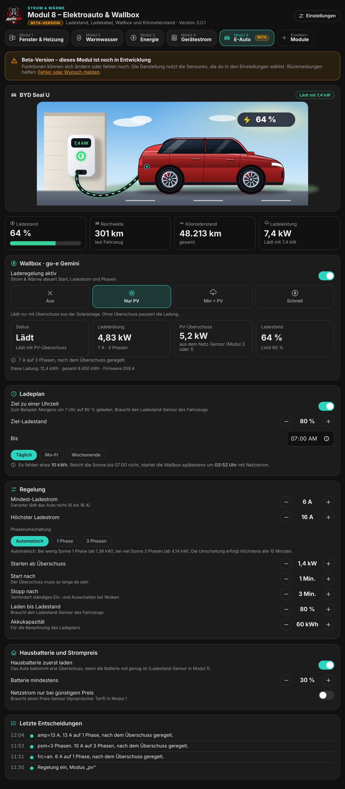

  

# Strom & Wärme

**Eine Integration für Home Assistant, die Heizung, Fenster, Warmwasser, Solarstrom und Geräte zusammenbringt.** Sie pausiert Heizkörper, wenn ein Fenster offen ist, heizt nach Plan, nutzt PV-Überschuss für Elektroheizer und Warmwasser, zeigt, woher der Strom deiner Geräte kommt, und stellt alles in einem eigenen Dashboard in der Seitenleiste dar.

> ### 🔌 Neu in Version 3.0.1: Laderegelung für den go-e Charger
> Unter **Einstellungen → Allgemein → Integrationen** verbindest du den go-e Charger direkt über das lokale Netzwerk, auf Wunsch auch Tibber für die Strompreise. In **Modul 8** regelst du dann das Laden nach PV-Überschuss (Sonne, Sonne + Netz, Voll, Ladeplan), planst es nach Strompreis und PV-Prognose und siehst die **Ladestatistik** mit Sonnenanteil und Kosten. Die Regelung ist standardmäßig aus.
>
> ### 📍 Personen & Standort (ebenfalls 3.0.1)
> Neue Seite unter **Einstellungen → Allgemein → Personen & Standort**: Standort der Personen über **Apple iCloud**, eigene **Home-Zone auf der Karte** und Einstellungen pro Person. „Anwesenheit & Urlaub“ nutzt beides. Mehr dazu im Abschnitt [Anwesenheit und Urlaub](#anwesenheit-und-urlaub).
>
> ### 🎉 Version 3.0.0
> Das Dashboard hat jetzt **16 Module**. Neu ist **Modul 4: Gerätestrom** (fertig, kein Beta). Dazu kommen **zwölf Beta-Module** (5 bis 16) mit eigenen Seiten für Lüftung, Rollläden, Wärmepumpe, Elektroauto, Wetter, Garten, Sicherheitsmelder, Pool und Sauna, Batteriespeicher, Stromtarif, Wartung und Solar-Prognose.
> **Alle Beta-Module sind standardmäßig aus.** Du schaltest sie unter **Einstellungen → Module verwalten** ein, wenn du sie ausprobieren willst. Alle Änderungen stehen im [Changelog](CHANGELOG.md).
>
> **Update von 2.x:** über HACS aktualisieren, Home Assistant neu starten, Seite neu laden (Strg+F5). Deine Einstellungen bleiben erhalten. Gerätestrom ist jetzt Teil dieser Integration, die separate Integration „geraetestrom“ wird nicht mehr gebraucht.

## Die Module auf einen Blick

| Nr. | Modul | Stand | Was es macht |
|---|---|---|---|
| 1 | **Fenster & Heizung** | fertig | Thermostate bei offenem Fenster pausieren, Heizpläne, Anwesenheit und Urlaub, Berichte, Elektroheizer mit PV-Überschuss, Schimmel- und Lüftungshinweise, Diagnose |
| 2 | **Warmwasser & Zirkulation** | fertig | Speicher, Zeitplan, Zirkulationspumpe, Legionellenschutz, Heizstab bei PV-Überschuss |
| 3 | **Energie** | fertig | Solar, Netz, Batterie und Hausverbrauch, Kosten und Autarkie, zweite Solaranlage |
| 4 | **Gerätestrom** | fertig, neu | Pro Gerät Solar-, Batterie- und Netzanteil, Kosten, Ersparnis, Startempfehlung |
| 5 | Lüftung & Raumluft | Beta | Luftfeuchte und Lüftungshinweise je Raum, später KWL und CO₂ |
| 6 | Rollläden & Beschattung | Beta | Sonnenstand und Außenwerte, später Rollladensteuerung |
| 7 | Wärmepumpe | Beta | Außenbedingungen, später Laufzeit, Takten und Abtauen |
| 8 | Elektroauto & Wallbox | Beta | Auto mit Wallbox, Ladestand, Reichweite, Kilometerstand, Laderegelung für den go-e Charger (Sonne, Sonne + Netz, Voll, Ladeplan), Planung nach Strompreis (Tibber) und PV-Prognose (Forecast.Solar), Ladestatistik |
| 9 | Wetter & Warnungen | Beta | Unwetter-, Sturm- und Frostwarnung aus der Wetter-Entität |
| 10 | Garten & Bewässerung | Beta | Regen, PV-Überschuss und Zisterne |
| 11 | Rauch- & Sicherheitsmelder | Beta | Melder, Batteriestände und Alarme im Überblick |
| 12 | Pool & Sauna | Beta | Überschuss, Strompreis und Außentemperatur |
| 13 | Batteriespeicher-Planung | Beta | Betriebsarten, Ladestand-Grenzen, Zeitplan (Vorschau) |
| 14 | Dynamischer Stromtarif | Beta | Stundenpreise, Preisverlauf, günstigste Zeiten |
| 15 | Wartung & Erinnerungen | Beta | Termine und Betriebsstunden (Vorschau mit Beispielen) |
| 16 | Solar-Prognose | Beta | Prognose gegen tatsächlichen Ertrag (Vorschau mit Beispielen) |

  
  
  
  

## Inhalt
- [Schnellstart](#schnellstart)
- [Einstellungen und Module verwalten](#einstellungen-und-module-verwalten)
- [Modul 1: Fenster & Heizung](#modul-1-fenster--heizung)
- [Modul 2: Warmwasser & Zirkulation](#modul-2-warmwasser--zirkulation)
- [Modul 3: Energie](#modul-3-energie)
- [Modul 4: Gerätestrom](#modul-4-gerätestrom)
- [Beta-Module 5 bis 16](#beta-module-5-bis-16)
- [Allgemeines](#allgemeines)
- [Entitäten](#entitäten)
- [Hinweise für Entwickler](#hinweise-für-entwickler)
- [Wichtige Hinweise](#wichtige-hinweise)
- [Unterstützen](#unterstützen)

## Schnellstart
**Voraussetzungen:** Home Assistant 2024.11 oder neuer und [HACS](https://hacs.xyz).

1. HACS → drei Punkte → **Benutzerdefinierte Repositories**
2. Die Adresse dieses Repositories eintragen, Kategorie **Integration**
3. „Strom & Wärme“ installieren und Home Assistant **neu starten**
4. **Einstellungen → Geräte & Dienste → Integration hinzufügen → „Strom & Wärme“**: pro Raum ein Eintrag, mit Fenstersensoren und Thermostaten
5. In der Seitenleiste „Strom & Wärme“ öffnen. Der **Einrichtungsassistent** führt in acht Schritten durch Räume, Fenstermeldung, Heizung, Luftfeuchte, PV und Meldungen. Jeder Schritt außer dem ersten lässt sich überspringen.

Die Module 2 bis 4 sind ab Werk an, die Beta-Module 5 bis 16 aus. Eingeschaltet und eingerichtet wird unter **Einstellungen**. Nach jedem Update Home Assistant neu starten und die Seite einmal neu laden (Strg+F5).

## Einstellungen und Module verwalten
Der Knopf **Einstellungen** oben rechts öffnet in jedem Modul dieselbe Seite. Sie listet alle Module mit Status („Eingerichtet“, „Aus“, „Beta“) und führt zur Einrichtung des jeweiligen Moduls. Dazu kommen die allgemeinen Bereiche: Einrichtungsassistent, Darstellung, Sichern & Wiederherstellen, Diagnose und **Module verwalten**.

Unter **Module verwalten** schaltest du jedes Modul ein oder aus. Modul 1 ist immer an. Die Einstellung speichert die Integration im Backend und gilt für alle Nutzer. Ausgeschaltete Module erscheinen weder in der Modulleiste noch im Menü. Eigene Module lassen sich über eine Dateiadresse hinzufügen.

 

## Modul 1: Fenster & Heizung

### Fensterregelung
Öffnet jemand ein Fenster, schaltet die Integration die Thermostate des Raums nach einer einstellbaren Verzögerung aus oder senkt sie ab. Nach dem Schließen läuft alles wie vorher weiter.

- Fenstersensoren und Thermostate frei wählbar, Sperrzeit (zum Beispiel nachts) und Außentemperatur-Bedingung
- Eigener Heizungs-Sensor wählbar: steht er auf „Heizung aus“, wird nicht geregelt
- Erinnerung bei zu langem Lüften per Benachrichtigung, mit eigenem Titel und Text (`{raum}`, `{minuten}`, `{fenster}`)
- Der Knopf **„Warum?“** erklärt pro Raum, was gerade passiert und weshalb

### Dashboard
Das Dashboard füllt sich automatisch mit allen Räumen: Kopfkarte mit der heute gesparten Menge, Außentemperatur und Wetter, Kennzahlen für Heute, Monat, Jahr und Gesamt, ein Balkendiagramm der letzten 14 Tage und eine Karte pro Raum. Umschaltbar zwischen **Detail** und **Kompakt**, hell und dunkel nach dem Design von Home Assistant, passend für Handy, Tablet und Desktop.

<b>Anpassen, Gruppen, Fotos und Wetter</b>

- **Anpassen** (nur Administratoren): Bereiche und Raumkarten lassen sich verschieben, Räume bekommen eines von 16 Symbolen, eine Farbe und ein Foto. Das gilt für alle Nutzer.
- **Gruppen** (zum Beispiel Erdgeschoss und Obergeschoss): eigene Kopfzeile mit Zusammenfassung und gemeinsamem Schalter für die Fensterregelung. Höchstens 12 Gruppen.
- **Meine Ansicht:** Räume und Bereiche nur für dich im Browser ein- und ausblenden oder neu ordnen.
- **Darstellung:** Akzentfarbe, Hintergründe der Kopfkarte (zum Beispiel nach Tageszeit oder Wetter) und die Außentemperatur-Quelle.

 

### Heizplan
Pro Raum ein Plan aus Schaltpunkten (Tage, Uhrzeit, Temperatur) mit Wochenansicht. Ausgeschaltete Thermostate schaltet der Plan je nach Einstellung ein („Nein“, „Heizen“, „Automatik“). Eine manuelle Änderung bleibt bis zum nächsten Schaltpunkt bestehen. Bei offenem Fenster greift der Plan nicht, danach gilt die Temperatur, die dann dran ist. Der Schalter „Heizplan aktiv“ und der Sensor „Heizplan Solltemperatur“ lassen sich in Automationen verwenden.

 

### Bericht pro Raum
Der Knopf „Bericht“ zeigt einen Tagesbericht mit Temperaturverlauf, Zieltemperatur, Pausenzeiten, Fensterereignissen und eingesparter Energie. Ganz oben steht die **gelernte Aufheizzeit**: die Integration erkennt Aufheizphasen und merkt sich die Minuten pro Kelvin, getrennt nach Frost, kühl und mild. Die Daten stammen aus dem Verlauf von Home Assistant, für volle 7 Tage muss der Recorder so lange aufbewahren (Standard: 10 Tage).

 

### Anwesenheit und Urlaub
Eine Karte stellt alle Räume gemeinsam um: **Zu Hause**, **Abwesend** oder **Urlaub**. Urlaub lässt sich mit Datum und Vorheizen am Rückkehrtag planen. Automatisch abwesend wird der Haushalt, wenn alle gewählten Personen länger unterwegs sind.

#### Personen & Standort (neu in 3.0.1)
Unter **Einstellungen → Allgemein → Personen & Standort** legst du fest, woher der Standort jeder Person kommt und wo dein Zuhause liegt.

- **Standort über Apple iCloud:** Die Integration nutzt die Geräte der Home-Assistant-Integration „Apple iCloud“ (Einrichtung: [HA-Doku](https://www.home-assistant.io/integrations/icloud)). Home Assistant Cloud und die Companion-App sind dafür nicht nötig.
- **Einstellungen pro Person:** Name, mehrere Standortquellen, optional ein WLAN- oder Router-Gerät als zweite Quelle, ob die Person für das automatische Abwesend zählt, und eine Genauigkeitsgrenze (Standard 100 m). Zu ungenaue Positionen werden ignoriert.
- **Home-Zone per Karte:** Karte (OpenStreetMap) verschieben und zoomen, Radius von 30 bis 1000 m. Die Zone ist unabhängig von der Zone in Home Assistant. Ohne eigene Zone gilt weiter, was Home Assistant meldet.

Eine Person gilt als **zu Hause**, wenn Home Assistant „zu Hause“ meldet, eine Quelle „zu Hause“ meldet, eine ausreichend genaue Position in der Zone liegt oder die WLAN-Quelle „zu Hause“ meldet. Gespeichert werden nur die Einstellungen, **kein Standortverlauf**.

**Am iPhone beachten:** „Wo ist?“ und Ortungsdienste an, Anmeldung mit Apple-Passwort und Zwei-Faktor-Code (gelegentlich erneut nötig), eigene Apple-ID je Person, iCloud aktualisiert nicht sekundengenau. Darum Zone nicht kleiner als etwa 100 bis 200 m wählen und bei Bedarf zusätzlich WLAN nutzen.

### Elektroheizer mit PV-Überschuss
Pro Raum kann ein elektrischer Heizer (Heizlüfter, Infrarot, Klima-Heizgerät) eingerichtet werden. Er heizt nur, wenn genug PV-Überschuss da ist, auf Wunsch in mehreren Leistungsstufen.

<b>Einrichtung und Regelung im Detail</b>

**Einrichtung**
1. Unter **Allgemein → PV-Überschuss für Elektroheizer** den Sensor für die Netzeinspeisung wählen (Watt oder kW) und das Vorzeichen passend einstellen.
2. Dort Reserve, Einschaltverzögerung, Mindestlaufzeit, optional den Batterie-Ladestand sowie Strompreis und Einspeisevergütung einstellen. Der Strompreis lässt sich als Festpreis oder aus einer Entität lesen, etwa einem dynamischen Tarif.
3. In den Raumeinstellungen unter **Elektroheizer** den Heizer einschalten und das Gerät wählen.

**So wird geregelt**
- Verfügbarer Überschuss = Einspeisung plus die Leistung der laufenden Heizer. Die Heizer verdrängen sich also nicht selbst.
- Ein Heizer läuft auf der höchsten Stufe, deren Leistung plus Reserve in den freien Überschuss passt. Bei mehreren Heizern gilt die Priorität: 1 wird zuerst versorgt.
- Hochschalten erst, wenn die höhere Stufe die eingestellte Verzögerung lang möglich war. Zurückschalten nach etwa einer Minute. Ausschalten frühestens nach der Mindestlaufzeit.
- Sofort aus: Fenster auf, Raum warm genug, außerhalb des erlaubten Zeitfensters, Schalter „Elektroheizer aktiv“ aus, Batterie unter der Schwelle.
- Fällt der Sensor aus, gilt der Überschuss als 0. Ist das Gerät nicht erreichbar, wird nichts geschaltet.
- Bei einem `climate`-Gerät ordnest du jeder Stufe eine Voreinstellung zu (zum Beispiel H1, H2, H3). Die Thermostate des Raums werden auf Wunsch abgestellt, solange der Heizer läuft.
- Der Bericht pro Heizer zeigt Laufzeit, Energie, Solaranteil und den Vorteil in Euro. Die Energie wird aus der Nennleistung der Stufe berechnet, nicht gemessen.

 

### Raumluft: Lüften und Schimmel
Mit einem Luftfeuchte-Sensor zeigt die Raumkarte Luftfeuchte, Taupunkt und Schimmelrisiko mit einer Empfehlung zum Stoßlüften samt Countdown. Auch ohne Sensor erscheinen „Gelüftet vor X Std.“, die geschätzte Wandtemperatur und die kritische Feuchte. Das Schimmelrisiko ist eine Schätzung, kein Messwert.

### Wetter-Anpassung und Sommermodus
- **Wetterabhängige Absenkung** (standardmäßig aus): Bei Sonne oder milder Luft sinkt die Zieltemperatur des Heizplans, bei Frost steigt sie.
- **Sommermodus:** Aus, automatisch oder immer an. Bei „Automatisch“ ruhen die Heizpläne ab einer einstellbaren mittleren Außentemperatur. Fenstermeldung und Erinnerungen bleiben aktiv.

### Brennstoff und Ersparnis
Die Integration schätzt die durch Pausen gesparte Heizenergie und rechnet sie in die Menge deines Brennstoffs um. Die Ersparnis ist eine grobe Schätzung, die echte liegt etwas darunter.

| Brennstoff | Einheit | Standard: kWh pro Einheit |
|---|---|---|
| Erdgas | m³ | 10 |
| Heizöl | l | 10 |
| Flüssiggas | l | 6,6 |
| Pellets | kg | 4,8 |
| Wärmepumpe / Strom | kWh | 1 (mit JAZ/COP, Standard 3,5) |

## Modul 2: Warmwasser & Zirkulation
Zeigt den Speicher, steuert Erzeuger, Heizstab und Zirkulationspumpe nach Zeitplan und führt den Legionellenschutz aus. **Das Modul schaltet nur Geräte, die du auswählst.** Fehlt eines, sagt die Seite das an der passenden Stelle.

**Einrichten** (Zahnrad oben rechts): Speichergröße, Soll- und Absenktemperatur, bis zu drei Temperatursensoren (oben, Mitte, unten), den Wärmeerzeuger (Schalter, `water_heater` oder `climate`), optional einen Heizstab für PV-Überschuss, die Zirkulationspumpe, einen Rücklaufsensor und einen Auslöser für „Bei Bedarf“. Ein Speichersensor genügt für den Start.

- **Übersicht:** Temperaturen, Status (Bereit, Heizt auf, Unter Soll, Zu heiß, Abwesend), eine Schätzung, für wie viele Duschen das Wasser reicht, Kacheln für Laufzeiten, Rücklauf und letzten Legionellenschutz, dazu ein Verlauf der letzten 24 Stunden.
- **Zeitplan:** Soll-Temperatur pro Zeitfenster, getrennt für Montag bis Freitag und das Wochenende. Der Erzeuger schaltet ein, wenn der Speicher oben 3 K unter Soll liegt, und aus, sobald das Soll erreicht ist. **Ab 65 °C schaltet das Modul Erzeuger und Heizstab immer ab** (Verbrühschutz).
- **Zirkulation:** nach Zeitplan, bei Bedarf (Taster, Bewegungsmelder oder Durchflusssensor), im Intervall oder aus. Eine Rücklauf-Grenze stoppt die Pumpe, wenn das Wasser in der Leitung schon warm ist.
- **Schnellknöpfe:** „Einmal aufheizen“ (auf die Schutztemperatur, höchstens 3 Stunden), „Zirkulation 5 Min.“ und „Abwesend“ (Absenktemperatur, Pumpe aus).
- **Legionellenschutz:** einmal pro Woche auf die Schutztemperatur (Standard 60 °C) und 20 Minuten halten, gemessen am kältesten Sensor. Er läuft nur mit gewähltem Erzeuger oder Heizstab. Schafft der Speicher es in sechs Stunden nicht, bricht der Lauf ab und das Fehlerprotokoll bekommt eine Warnung.
- **PV-Überschuss:** Mit einem Heizstab-Schalter lädt das Modul den Speicher bei Überschuss bis zur eingestellten Höchsttemperatur (Standard 62 °C). **Der Warmwasser-Heizstab hat Vorrang vor den Raumheizern.**

## Modul 3: Energie
Heizung, Strom und PV auf einer Seite. Das Modul **liest nur Sensoren und schaltet nichts**.

- **Kopfkarte:** Hausverbrauch jetzt, Anteil aus Solar, Chips für Solar, Netz und Batterie
- **Zeitraum:** Heute, 7 Tage, 30 Tage
- **Kacheln:** Solar (mit Eigenverbrauch), Netzbezug (Kosten), Einspeisung (Vergütung), Verbrauch (Autarkie)
- **Energiefluss:** Grafik mit Solar, Netz, Haus, Batterie, Heizung und Warmwasser
- **Verlauf:** Leistungskurve für heute, Balken pro Tag für 7 und 30 Tage
- **Verteilung, Kosten und Vorteil, Heizung** und **Hinweise** (zum Beispiel hoher Netzbezug oder Solarüberschuss, der ins Netz geht)

<b>Einrichten und zweite Solaranlage</b>

- **Pflicht:** Leistungssensoren (Watt oder kW) für Solar und Netz. Das Netz kann wie in Modul 1 gewählt sein. Hausverbrauch und Batterie sind optional; fehlt der Hausverbrauch, wird er berechnet. Meldet der Solar-Sensor „nicht verfügbar“ (Wechselrichter nachts), zählt das als 0 W.
- **Zweite Solaranlage** (zum Beispiel Balkonkraftwerk): zweiter Leistungssensor und optional zweiter Ertragszähler. Beide Anlagen werden addiert. Du kannst beide benennen. Die Kopfkarte und die Solar-Kachel zeigen den Anteil der zweiten Anlage, der Tagesverlauf eine dünne Linie. Liefert eine Anlage seit 10 Minuten unter 5 W, während die andere mindestens 400 W liefert, erscheint der Hinweis „… liefert nichts“.
- **Batterie:** ein Sensor mit Vorzeichen (Laden oder Entladen positiv) oder zwei Sensoren (einer für „lädt“, einer für „entlädt“, jeweils positiv).
- **7 und 30 Tage:** Am genauesten sind Energiezähler (Wh, kWh, MWh, Langzeitstatistik mit `state_class: total_increasing`). Leistungssensoren gehen auch, dann wird aus Stunden-Mittelwerten gerechnet. Leer lassen: es wird aus Solar und Netz oben gerechnet.
- Die Einstellungen werden im Backend gespeichert und mit gesichert. Strompreis und Einspeisevergütung kommen aus Modul 1 → Allgemein.

## Modul 4: Gerätestrom
Zeigt für jedes Gerät, **woher der Strom kam** (Solar, Batterie oder Netz), was der Lauf kostete und was du durch eigenen Strom gespart hast. Das Modul **liest nur Sensoren und schaltet nichts**. Es rechnet selbst in „Strom & Wärme“. Die frühere Integration „geraetestrom“ wird nicht mehr gebraucht.

**Einrichten** (Einstellungen → Modul 4): bis zu 8 Geräte mit je einem **Leistungssensor** (Watt oder kW), einer **Schwelle** (ab wie vielen Watt ein Lauf gilt) und einer **Endzeit** (so viele Minuten unter der Schwelle beenden den Lauf). Dazu optional Batteriekosten (ct/kWh), ein Prognose-Sensor und Benachrichtigungsdienste.

- **Quellen:** Die Aufteilung nutzt die Sensoren aus **Modul 3** (Solar, Netz, Batterie) und die Preise aus **Modul 1 → Allgemein**. Solar fürs Haus = Erzeugung minus Batterie-Laden minus Einspeisung. Die Geräteleistung wird anteilig auf Solar, Batterie und Netz verteilt.
- **Kosten und Ersparnis:** Netzstrom kostet den Strompreis. Solarstrom spart Strompreis minus Einspeisevergütung. Batteriestrom spart Strompreis minus Batteriekosten.
- **Karten:** pro Gerät Leistung nach Quelle, Heute, letzter Durchlauf und eine Empfehlung: **Jetzt starten** (ab 70 % Solardeckung), **Teilweise Solar** (ab 30 %) oder **Besser warten**.
- **Verlauf:** gestapelte Balken nach Quelle für 7 Tage, 30 Tage und 12 Monate, auf Wunsch je Gerät. Die Daten bleiben bis zu 800 Tage gespeichert.
- **Ende eines Laufs:** Das Ereignis `geraetestrom_run_finished` wird ausgelöst, und gewählte `notify`-Dienste melden zum Beispiel „Waschmaschine fertig: 0,90 kWh · 0,12 € · 78 % eigener Strom (gespart: 0,42 €)“.

*Hinweis:* Zähler der alten Integration werden nicht übernommen, die Auswertung beginnt neu. Die Home-Assistant-Sensoren für das Energie-Dashboard, die Energiefluss-Grafik und die Anordnung per Ziehen gibt es in der neuen Version noch nicht.

## Beta-Module 5 bis 16
Diese zwölf Module sind **Beta-Versionen**. Sie sind noch in Entwicklung, Funktionen können sich ändern oder fehlen. Jede Seite trägt die Kennzeichnung „Beta“ und nennt unten, was noch folgt („In Entwicklung“). Alle Beta-Module sind **standardmäßig aus**, lesen nur Werte aus Home Assistant und **schalten nichts**. Wer ein Modul einschaltet, sieht es sofort in der Modulleiste. Rückmeldungen gern als [Issue auf GitHub](https://github.com/Maddog3010/ha-fenster-heizung/issues).

### Modul 5: Lüftung & Raumluft

Zeigt pro Raum Luftfeuchte, Taupunkt und Lüftungshinweise aus den Räumen von Modul 1. Räume ohne Luftfeuchte-Sensor sind als solche markiert. **Geplant:** KWL (Lüftungsanlage) steuern und CO₂-Werte auswerten.

### Modul 6: Rollläden & Beschattung

Zeigt Sonnenhöhe und Himmelsrichtung aus der Sonnen-Entität von Home Assistant sowie Außentemperatur und Luftfeuchte. **Geplant:** Rollläden nach Zeitplan und Sonnenstand steuern, Hitzeschutz im Sommer, Sonnenwärme im Winter nutzen.

### Modul 7: Wärmepumpe

Zeigt die Außenbedingungen und ob Abtauen wahrscheinlicher wird (unter etwa 7 °C). **Geplant:** Laufzeit und Takten erkennen, Vorlauf, Rücklauf und Leistungszahl (COP), Abtauzyklen zählen.

### Modul 8: Elektroauto & Wallbox

- **Auswahl:** Marke (Mercedes-Benz, Audi, VW, BYD, BMW oder Andere), Modellname, Karosserie (Limousine, SUV, Kombi, Kompakt) und eine von sechs Farben. Die Grafik ist eine eigene Zeichnung. **Es werden keine Markenlogos und keine Nachbildungen echter Modelle verwendet**, die Marke steht nur als Text.
- **Wallbox** immer sichtbar. Das **Ladekabel** erscheint nur, wenn der Stecker steckt, und verschwindet beim Abstecken. **Beim Laden** läuft eine Animation am Kabel, die Wallbox zeigt die Leistung.
- **Kacheln:** Ladestand, Reichweite, Kilometerstand und Ladeleistung.
- **Sensoren** (alle optional, wählbar in den Einstellungen): Ladestand, Kilometerstand, Reichweite, „Stecker steckt“, Ladeleistung, „lädt“.
- **Laderegelung für den go-e Charger (neu in 3.0.1):** Die Wallbox wird direkt über die lokale HTTP-API v2 gelesen und geregelt, ohne Cloud. Die Verbindung richtest du unter **Einstellungen → Allgemein → Integrationen** ein (IP-Adresse, „Verbindung testen“). In der go-e-App muss unter Einstellungen → Verbindung → API-Einstellungen die lokale HTTP-API eingeschaltet sein.

  - **Fahrzeuge & Karten (wie bei evcc):** Die Regelung erkennt das Fahrzeug an der RFID-Karte, die an der Wallbox angelegt wird. Du trägst keine Kartennummern ein, sondern wählst die Karten, die in der go-e-App schon hinterlegt sind (Kartenname). Pro Fahrzeug stellst du Modus und Ladelimit ein, ein Gastfahrzeug gilt für unbekannte Karten. Eine Karte gehört zu genau einem Fahrzeug.
  - **„Nur mit erkannter Karte regeln“:** Ohne Karte verändert Strom & Wärme nichts an der Wallbox. Die eigentliche Sperre kommt von der Kartenpflicht (Authentifizierung) in der go-e-App.
  - **„Nach dem Abstecken zurücksetzen“:** Die Wallbox wird auf „neutral“ gestellt und die Erkennung vergessen. Sie gilt nur für eine Ladung.

  - **Schalter „Laderegelung aktiv“:** Standardmäßig **aus**. Solange er aus ist, verändert Strom & Wärme nichts an der Wallbox. Beim Ausschalten stellt die Regelung die Wallbox wieder auf „neutral“.
  - **Modi** wie bei evcc: **Aus**, **Sonne** (nur mit Überschuss), **Sonne + Netz** (immer Mindeststrom, mehr bei Überschuss) und **Voll** (Höchststrom).
  - **Regelung:** Ladestrom 6 bis 16 A in 1-A-Schritten, Start ab einem Überschuss nach einer Wartezeit, Stopp nach einer Wartezeit (gegen Wolken), automatische Umschaltung zwischen 1 und 3 Phasen (höchstens alle 10 Minuten), Ladelimit in Prozent.
  - **Überschuss:** Einspeisung am Netzanschluss (Netz-Sensor aus Modul 3 oder 1) plus die Leistung, die die Wallbox selbst zieht. Die Regelung läuft alle 10 Sekunden.
  - **Ladeplan:** Ziel-Ladestand bis zu einer Uhrzeit (täglich, Mo–Fr oder Wochenende). Reicht die Sonne nicht, startet die Wallbox spätestens zur berechneten Zeit mit Netzstrom. Braucht den Ladestand-Sensor des Fahrzeugs und die Akkukapazität.
  - **Hausbatterie zuerst** (mit Mindest-Ladestand) und **Netzstrom nur bei günstigem Preis** (mit Preis-Sensor aus Modul 1).
  - **Sicherheit:** Es sind nur Adressen im lokalen Netz erlaubt. Stellst du die Wallbox in der go-e-App von Hand um, pausiert die Regelung 30 Minuten. Fehlt der Überschuss-Wert, wird im Modus „Sonne“ nicht geladen. Ist die Wallbox nicht erreichbar, kann nichts umgestellt werden, sie bleibt im letzten Zustand, und die Meldung steht in der Liste. Die letzten Entscheidungen stehen mit Begründung in der Liste.
  - **Erster Test:** Regelung erst mit Modus „Voll“ und 6 A ausprobieren und in der go-e-App beobachten, danach „Sonne“.
  - Unterstützt wird der **go-e Charger Gemini** (und andere Geräte mit lokaler API v2). Die Befehle stammen aus der [offiziellen go-e-API-Dokumentation](https://github.com/goecharger/go-eCharger-API-v2/blob/main/apikeys-en.md).

  - **Tibber (neu in 3.0.1):** Unter **Einstellungen → Allgemein → Integrationen → Stromtarife** verbindest du Tibber mit deinem persönlichen Zugriffstoken (developer.tibber.com), ohne zusätzliche Integration. Es werden nur Strompreise von heute und morgen abgerufen, keine Verbrauchsdaten. Der Token wird nur in Home Assistant gespeichert und nur an api.tibber.com gesendet.

    - **Preisauflösung:** „Stundenmittel“ (empfohlen, ein Preis pro Stunde), „Viertelstunden“ (die genauen 15-Minuten-Preise; kennt die Tibber-Schnittstelle sie nicht, werden automatisch Stundenwerte genommen) oder „Preisstufen“ (nur Tibbers Einstufung von sehr günstig bis teuer, die Kosten in der Statistik bleiben mit den echten Preisen berechnet).
  - **Register in Modul 8:** „Laden“, „Planung“ und „Ladestatistik“.
  - **Planung nach Strompreis und Sonne (neu in 3.0.1):**

    - Das Diagramm zeigt die nächsten rund 30 Stunden: PV-Überschuss (türkis), Strompreis (orange), geplante Ladung (markiert) und die Uhrzeit, bis zu der das Auto geladen sein soll. Ziel-Ladestand, Uhrzeit und Akkukapazität kommen aus dem Ladeplan unter „Laden“.
    - **Strategien:** „Sonne zuerst, dann günstig“ (niedrigste effektive Kosten aus PV-Anteil und Preis), „Nur Sonne“ (nur Stunden mit genug Überschuss) und „Günstigster Preis“.
    - **Schalter „Planung aktiv“:** Aus = nur Anzeige. An = **echte Steuerung**: Die Wallbox lädt nur in den geplanten Fenstern (in Sonnenstunden nach Überschuss, in günstigen Netzstunden mit voller Leistung) und wird dazwischen pausiert. Der Modus unter „Laden“ ist dann gesperrt. Ein Fahrzeug mit dem Modus „Aus“ bleibt aus. Die Laderegelung muss an sein, der Ladestand des Fahrzeugs muss bekannt sein.
    - **Sicherheit:** Reicht die Sonne nicht bis zur Uhrzeit, startet die Ladung spätestens zur berechneten Zeit mit Netzstrom. Das Ladelimit und „fertig geladen“ gelten weiter.
    - **Quellen der Vorhersage:** Strompreis von **Tibber** oder aus einem Preis-Sensor (Modul 1). PV-Prognose von **Forecast.Solar**: Die Integration in Home Assistant wird erkannt (mehrere Dachflächen werden addiert) und über die Aktion `forecast_solar.get_forecast` gelesen. Vom Hausverbrauch wird ein einstellbarer **Grundverbrauch** (Vorgabe 0,4 kW) abgezogen.
  - **Ladestatistik (neu in 3.0.1):**

    - Balkendiagramm pro Tag (Monat), pro Monat (Jahr) oder pro Jahr (Gesamt), wahlweise **Energie** oder **Kosten**, aufgeteilt nach **Sonne / Netz** oder nach **Fahrzeug**. Dazu Kacheln mit Geladen, Sonnenanteil, Kosten, Ø Preis und Ersparnis sowie die letzten Ladevorgänge.
    - **So wird gerechnet:** Alle 10 Sekunden wird die Ladeleistung aufgeteilt. Als Sonne zählt der Anteil, der aus dem Überschuss am Netzanschluss gedeckt wird (Einspeisung plus Wallbox-Leistung, also auch die Hausbatterie), der Rest kommt aus dem Netz. Die Kosten sind der Netzanteil mal dem Preis zum Zeitpunkt des Ladens (Tibber oder Preis-Sensor aus Modul 1, ohne Preis 0 €). Gespeichert wird pro Tag, Fahrzeug und Ladevorgang bis zu 800 Tage, es wird kein Verlauf deiner Position oder Verbrauchsdaten gespeichert. Gezählt wird auch bei ausgeschalteter Regelung.

### Modul 9: Wetter & Warnungen

Leitet aus der Wetter-Entität (die gewählte aus „Darstellung“, sonst die erste `weather.*`) drei Warnungen ab: **Unwetter** bei Gewitter oder Hagel, **Sturm** ab 60 km/h Wind oder Böen und **Frost** ab 0 °C Außentemperatur. Dazu Zustand, Temperatur und Wind. Das sind einfache Regeln, keine amtlichen Warnungen. **Geplant:** eigene Warnstufen, Aktionen wie Rollläden einfahren, Erinnerung an offene Fenster, Benachrichtigung aufs Handy.

### Modul 10: Garten & Bewässerung

Zeigt, ob es regnet (aus der Wetter-Entität), den aktuellen PV-Überschuss (aus Modul 1) und einen Platz für den Zisternen-Füllstand. **Geplant:** Regenprognose, Zisterne mit Umschalten auf Leitungswasser, Bewässerung bei PV-Überschuss, Zeitplan pro Zone.

### Modul 11: Rauch- & Sicherheitsmelder

Findet automatisch alle `binary_sensor` mit der Geräteklasse **Rauch, CO, Gas, Wasser oder Sicherheit** und zeigt Anzahl, Alarme (rot, oben in der Liste), Melder mit schwacher Batterie (unter 20 %, wenn der Melder `battery_level` meldet) und nicht erreichbare Melder. **Geplant:** Alarm-Benachrichtigung, Batteriewarnung, Prüf-Erinnerung. **Wichtig:** Das Modul ersetzt keine Alarmanlage und keinen Rauchmelder mit eigener Sirene.

### Modul 12: Pool & Sauna

Zeigt PV-Überschuss und Strompreis aus Modul 1 sowie die Außentemperatur. **Geplant:** Poolpumpe nach Sonne und Überschuss, Pool-Heizung (Wärmepumpe oder Heizstab), Sauna nach Wunschzeit, Kosten und Solaranteil.

### Modul 13: Batteriespeicher-Planung

Zeigt Ladestand und Untergrenze (aus den PV-Einstellungen von Modul 1), den Überschuss und die vier Betriebsarten **PV laden, Halten, Haus aus Batterie, Netzladen**. Der **Zeitplan-Balken ist ein Beispiel** und beschriftet. Es wird nichts an der Batterie geschaltet. **Geplant:** Ladestand-Grenzen je Betriebsart, echter Zeitplan nach Uhrzeit und Wochentag, Netzladen nach Preis (mit Modul 14).

### Modul 14: Dynamischer Stromtarif

Liest die **Stundenpreise** aus dem Preis-Sensor, den du in Modul 1 unter „Strompreis“ gewählt hast. Der Sensor muss die Preisliste für heute als Attribut `raw_today`, `prices_today`, `today` oder `prices` liefern (24 Stunden- oder 96 Viertelstunden-Werte, in Euro oder Cent). Die Seite zeigt Preis jetzt, Tagesschnitt, nächste Stunde, einen **Preisverlauf** (grün günstig, rot teuer) und die **günstigsten drei Stunden** zum Laden und Waschen. Ohne Preisliste erscheint ein Hinweis. **Geplant:** Vorschläge für günstige Fenster, Preisalarm, Preise für morgen.

### Modul 15: Wartung & Erinnerungen

Zeigt, wie die Seite aussehen soll: Termine wie Schornsteinfeger, Lüftungsfilter und Heizungswartung mit Restzeit sowie Betriebsstunden mit Fortschritt bis zur nächsten Wartung. **Alle Einträge sind Beispiele.** **Geplant:** eigene Termine mit „Erledigt“-Knopf, Erinnerung aufs Handy, Betriebsstunden aus Sensoren.

### Modul 16: Solar-Prognose

Zeigt, wie die Seite aussehen soll: Prognose für heute und morgen, bisheriger Ertrag und ein Vergleich von Prognose gegen tatsächlichen Ertrag der letzten Tage. **Alle Werte sind Beispiele.** **Geplant:** echte Prognose-Sensoren (zum Beispiel Forecast.Solar), Vergleich mit dem Ertrag aus Modul 3, beste Zeit für Verbraucher.

## Allgemeines

### Entitäten auswählen
Überall im Dashboard ersetzt eine Suchauswahl die einfachen Listen. Sie zeigt Name, Entity-ID und aktuellen Wert, passende Entitäten stehen oben mit „Passt“.

### Gerätediagnose
Unter **Allgemein → Diagnose öffnen** siehst du, ob alle Geräte der Regelung melden: Status, zuletzt gemeldet, Ventile (Batterie und ob sie Befehle übernehmen), Fenstersensoren und ein Protokoll fehlgeschlagener Schaltvorgänge. Auf Wunsch kommt eine Benachrichtigung bei Problemen, höchstens einmal in 24 Stunden je Problem.

 

### Sichern und Wiederherstellen
Unter **Allgemein → Sichern & Wiederherstellen** speicherst du eine JSON-Datei mit Räumen, Heizplänen, Anwesenheit (mit Home-Zone und Personen), Aussehen, allgemeinen Einstellungen und den Einstellungen der Module 2 bis 4 und 8. Beim Einlesen siehst du zuerst eine Zusammenfassung, erst „Wiederherstellen“ ersetzt die aktuellen Einstellungen.

### Update-Hinweis
Administratoren sehen oben ein Banner, wenn auf GitHub eine neuere Version veröffentlicht wurde. Maßgeblich ist die höchste Version unter allen Releases und Tags, auch mit vier Teilen (zum Beispiel `3.0.1` oder `2.9.2.5`). Die Prüfung fragt höchstens einmal pro Stunde ab und lässt sich unter **Allgemein → Updates** ausschalten.

## Entitäten
Pro Raum:

| Entität | Beschreibung |
|---|---|
| Schalter „Fensterregelung aktiv“ | Regelung ein/aus |
| Schalter „Heizplan aktiv“ | Heizplan ein/aus |
| Schalter „Elektroheizer aktiv“ | nur mit eingeschaltetem Elektroheizer: Heizer erlauben oder pausieren |
| Sensor „Heizung pausiert“ (heute, Monat, Jahr, gesamt) | Minuten; Attribute: `gespart_menge`, `einheit`, `brennstoff`, `gespartes_gas_kwh`, bei Erdgas zusätzlich `gespartes_gas_m3` |
| Sensor „Betriebszustand“ | Regelung aktiv, Heizung pausiert, Heizung aus (nur Fenstermeldung) oder Regelung deaktiviert; Attribute u. a. `zuletzt_gelueftet`, `luftfeuchte_sensor`, `heizer` |
| Sensor „Heizplan Solltemperatur“ | aktuelle Vorgabe des Plans, nächste Änderung als Attribut; dazu `sommermodus` und `wetter_anpassung` |

## Hinweise für Entwickler

<b>WebSocket-Befehle und Änderungen an der Schnittstelle</b>

- Die technische Kennung der Integration bleibt `fenster_heizung` (Ordner, Entitäten, Speicher). Nur der Anzeigename ist „Strom & Wärme“.
- Raumeinstellungen im Dashboard: `fenster_heizung/get_options` und `fenster_heizung/set_options` (nur Administratoren). Layout (Farben, Fotos, Symbole, Wetteranzeige): `fenster_heizung/set_layout`. Allgemeines und Sicherung: `get_general`, `set_general`, `get_update`, `get_learning`, `restore`. Diagnose: `get_diag`, `clear_diag`. Module: `get_modules`, `set_modules`, `set_wasser`, `wasser_cmd`. Das Backend prüft alle Werte, Änderungen sind nur für Administratoren erlaubt.
- Version 3.0.1: Statistik und Planung: `fenster_heizung/wb_stats` (Tage und Ladevorgänge), `wb_forecast` (Stundenraster mit `pv`, `price`, `level`, `slot_min`, `fs`), Tibber: `tb_get`, `tb_test` mit `token`, `tb_set` mit `token`, `home`, `res` (`h`, `q`, `lvl`). Die Einstellungen der Wallbox haben dafür `planOn`, `planStrat`, `planSrc`, `pvSrc`, `baseW`.
- Version 3.0.1: Wallbox: `fenster_heizung/wb_get` (Status, Einstellungen, Entscheidungen), `wb_set` mit `cfg` (`ip`, `enabled`, `mode` = off/pv/minpv/now, `minA`, `maxA`, `ph`, `startW`, `onMin`, `offMin`, `limit`, `plan`, `planSoc`, `planTime`, `planDays`, `cap`, `batOn`, `batSoc`, `priceOn`, `priceMax`, `lock`, `reset`, `vehicles` mit `id`, `name`, `ids` (Kartennummern), `mode`, `limit`, `guest` mit `mode`, `limit`); `wb_get` liefert zusätzlich `info.cards` und `who` (erkanntes Fahrzeug) und `wb_test` mit `ip`.
- Version 3.0.1: `fenster_heizung/set_presence` kennt zusätzlich `zone` (`lat`, `lon`, `r` in Metern, 30 bis 1000) und `people` (je `person.*`: `label`, `trackers`, `wifi`, `count`, `acc`).
- Version 3.0.0: `get_modules` und `set_modules` kennen zusätzlich `on.ev`, `gs` (`devices` mit `id`, `name`, `ent`, `thr`, `end`, dazu `bat_cost`, `forecast`, `notify`) und `ev` (`brand`, `model`, `body`, `color`, `ent`). `fenster_heizung/gs_get` liefert die Auswertung von Modul 4. Ereignis `geraetestrom_run_finished` mit `device`, `kwh`, `cost`, `saved`, `share`. Die Beta-Module 9 bis 16 (`wx`, `ga`, `sf`, `pl`, `bt`, `dt`, `wa`, `sp`) speichern im Backend nur den Schalter `on.<kürzel>`, standardmäßig `false`. Die Module 5 bis 7 haben noch keine Einstellungen im Backend.
- Version 2.9.2.3: `energy` kennt zusätzlich `ent.pv2`, `ent.pve2` (zweite Solaranlage) sowie die Anzeigenamen `pvn` und `pv2n`.
- Version 2.9.2.1: `energy` kennt zusätzlich `ent.bchg`, `ent.bdis` und `bmode` (`one` oder `two`). Versions-Tags dürfen vier Teile haben.
- Version 2.9.1: `set_modules` nimmt `on.en` und `energy` (`ent` mit `pv`, `grid`, `house`, `bat`, `pve`, `imp`, `exp`, `sign`, `bsign`) an.
- Neue Raumeinstellungen (`humidity_sensor`, `air_hint`, `air_every`, `weather_adj`) erscheinen nur im Dashboard und bleiben beim Speichern im HA-Optionsdialog erhalten.
- Der Bericht braucht Verlaufsdaten im Recorder.

**Neue Version veröffentlichen:** `version` in `custom_components/fenster_heizung/manifest.json` erhöhen, auf GitHub ein Release mit passendem Tag (zum Beispiel `v3.0.1`) erstellen und kurze Aufzählungspunkte in die Beschreibung schreiben. Sie erscheinen im Update-Hinweis des Dashboards. HACS zeigt das Update an.

## Wichtige Hinweise
- Die Integration schaltet **Heizungsthermostate, Elektroheizer, Heizstäbe und Pumpen**. Prüfe nach der Einrichtung, ob alles wie gewünscht reagiert, und beobachte die ersten Tage. Die Nutzung erfolgt auf eigene Verantwortung.
- Die Regelung von Warmwasser und Heizstab ersetzt keinen Verbrühschutz und keine Sicherheitseinrichtungen der Anlage. Beachte die Vorgaben deines Herstellers.
- **Beta-Module** (5 bis 16) sind unfertig und können sich ändern.
- Energie- und Kostenwerte, die Ersparnis und die Dusch-Schätzung sind **Schätzungen**. Die Energie der Elektroheizer wird aus der Nennleistung berechnet, nicht gemessen. Gerätestrom rechnet aus Messwerten im 20-Sekunden-Takt, die Aufteilung auf Solar, Batterie und Netz ist eine Näherung.
- Sensoren müssen in Home Assistant aktuelle Werte liefern. Ohne Messwerte bleibt die Regelung zurückhaltend: Fällt der PV-Sensor aus, gilt der Überschuss als 0.
- „Strom & Wärme“ ist ein privates Projekt und steht in keiner Verbindung zu Home Assistant oder Nabu Casa.

## Unterstützen
Gefällt dir die Integration? Über [GitHub Sponsors](https://github.com/sponsors/Maddog3010) kannst du die Weiterentwicklung unterstützen. Danke!

Fehler und Wünsche gern als [Issue auf GitHub](https://github.com/Maddog3010/ha-fenster-heizung/issues) melden. Hilfreich sind die Version, eine kurze Beschreibung und der Ausschnitt aus dem Protokoll der Gerätediagnose („Kopieren“).

## Änderungen
Alle Versionen siehe [CHANGELOG.md](CHANGELOG.md).

---

Made with ❤ by <b>MADDOG3010</b>

