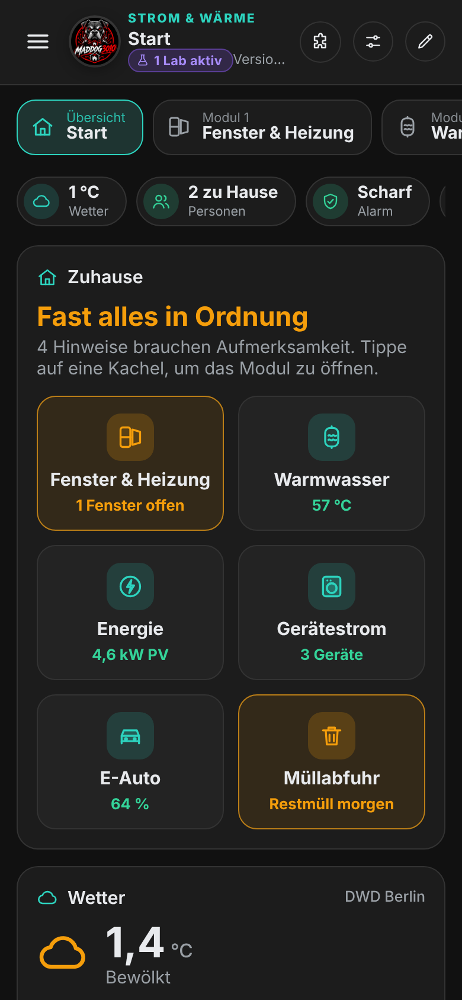
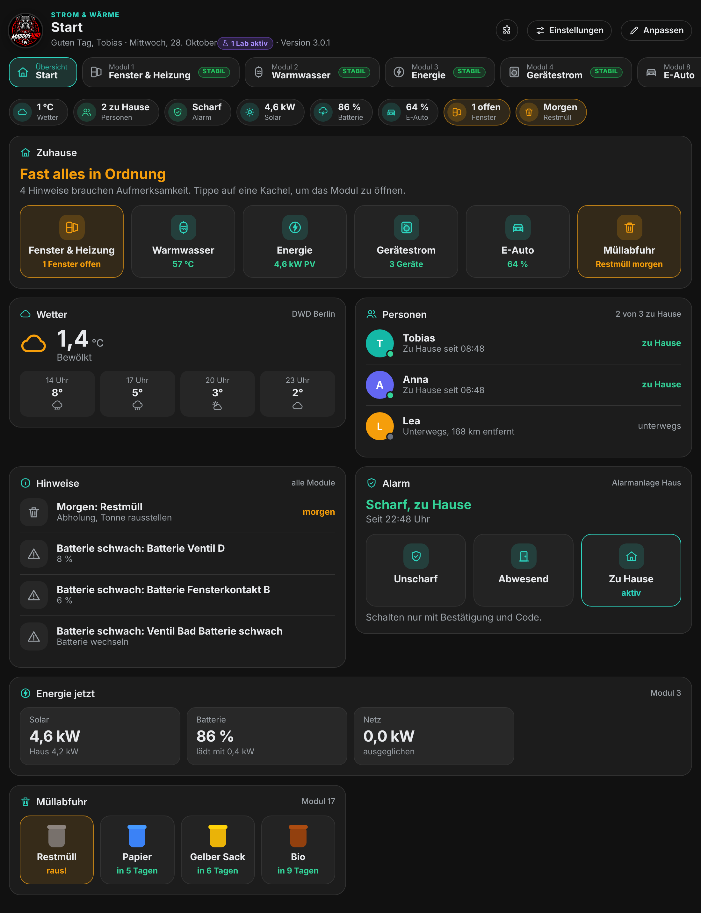
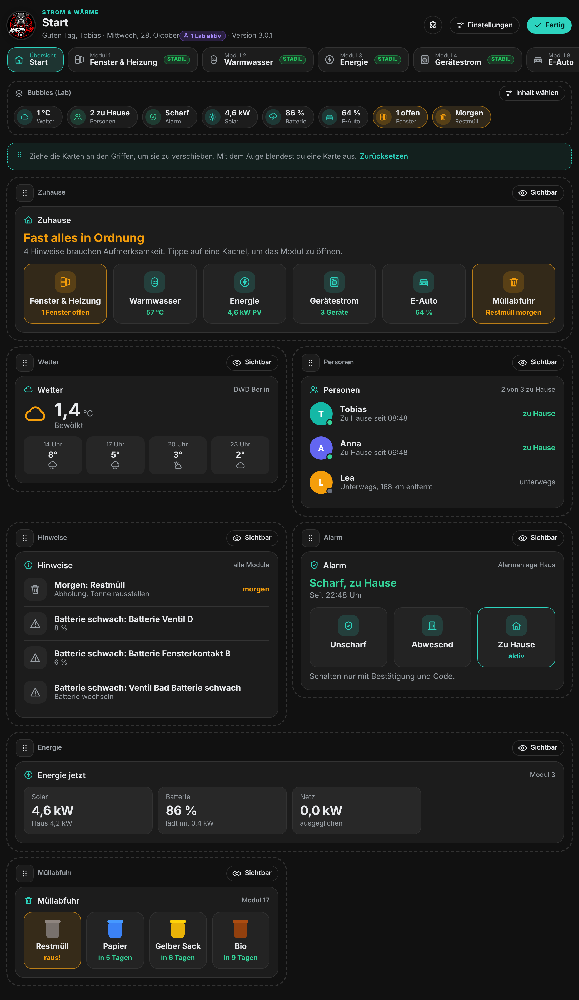
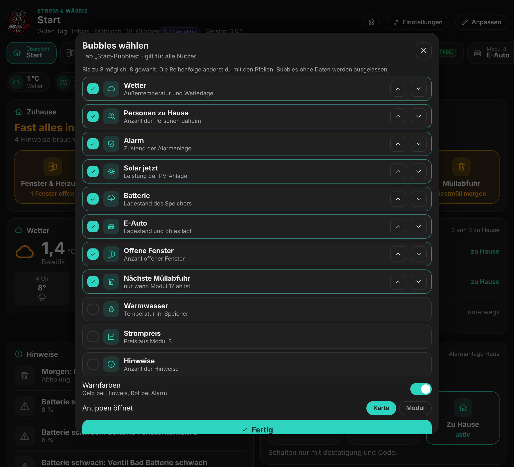
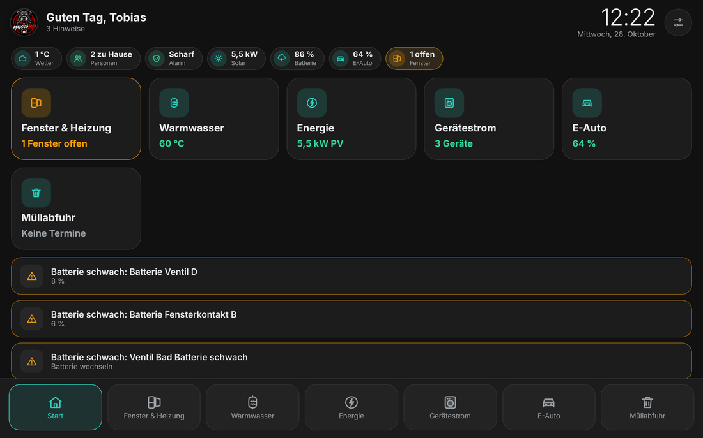
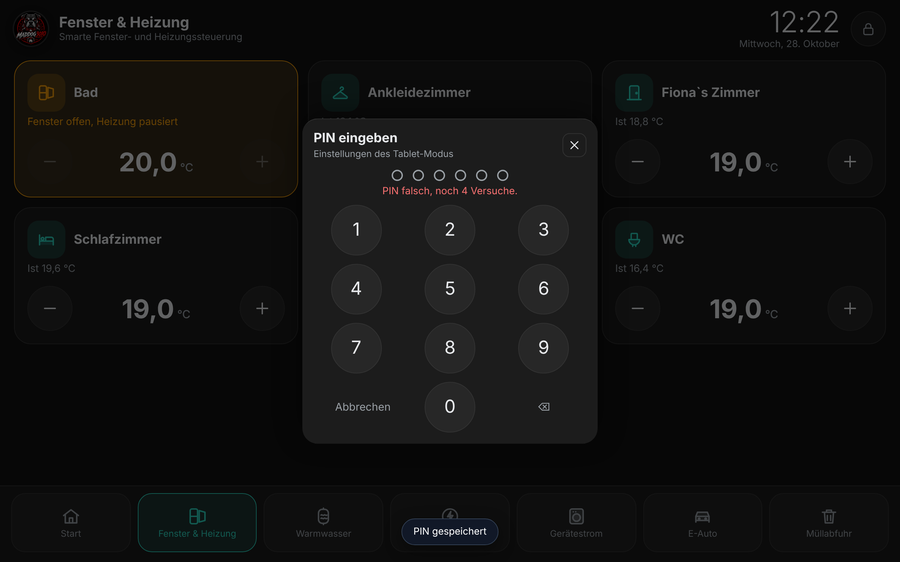
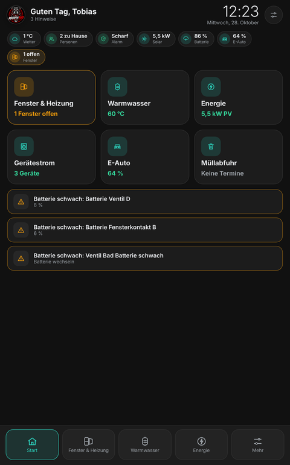
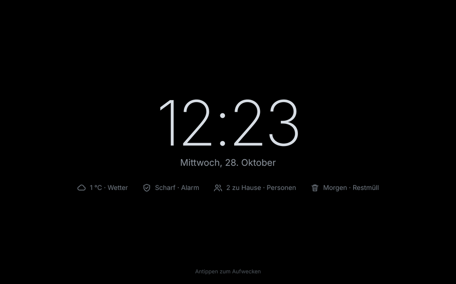
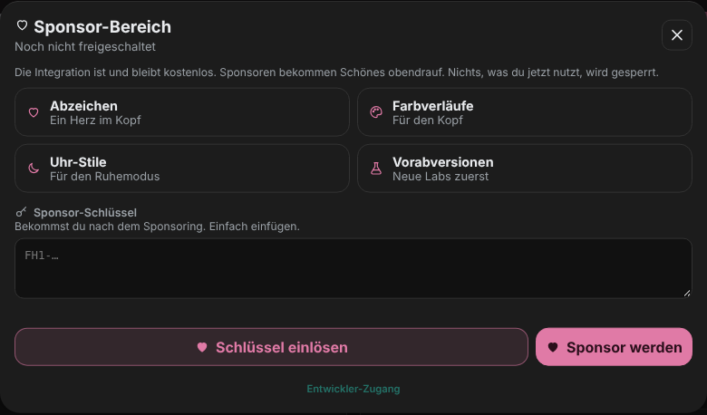
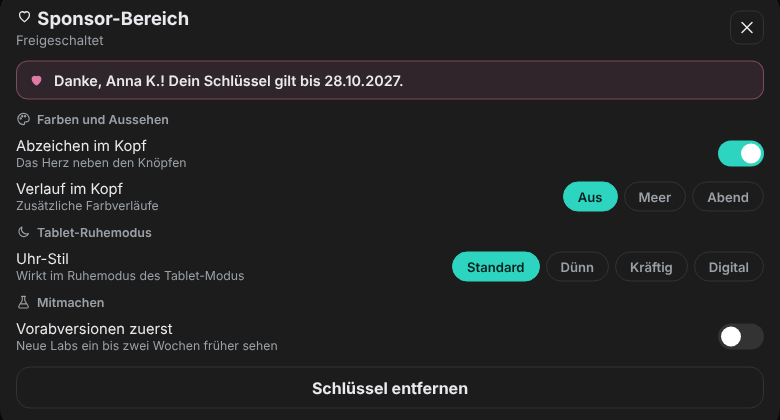

  

<h1 align="center">Strom & Wärme</h1>

  
  
  
  
  

<b>Heizung, Strom und Haus auf einer Seite in Home Assistant.</b> 
Heizkörper pausieren bei offenem Fenster, Solarstrom landet im Heizer, im Warmwasser und im Auto, und du siehst, woher der Strom deiner Geräte kommt. Du schaltest nur die Module ein, die du brauchst.

  <a href="#installation">Installation</a> ·
  <a href="#module">Module</a> ·
  <a href="#bedienung">Bedienung</a> ·
  <a href="#labs">Labs</a> ·
  <a href="#versionen-und-updates">Versionen</a> ·
  <a href="#sponsor-werden">Sponsor</a> ·
  <a href="#häufige-fragen">Fragen</a> ·
  <a href="CHANGELOG.md">Änderungen</a>

> 💗 **Kostenlos, offen und ohne Werbung, und das bleibt so.** Wenn dir die Integration hilft, freue ich mich über dein [Sponsoring](#sponsor-werden).

> 🧪 **Neu: Versionsschema nach Datum und Beta-Kanal.** Ab `2026.1029.0b1` zeigt die Versionsnummer den Tag, an dem das Update erschienen ist. Testversionen gibt es nur, wenn du in HACS Beta-Versionen einschaltest. [Mehr dazu](#versionen-und-updates)

---

## Das steckt drin

| | Bereich | Was du bekommst |
|---|---|---|
| 🪟 | **Fenster & Heizung** | Pause bei offenem Fenster, Heizpläne, Anwesenheit und Urlaub, Berichte, Elektroheizer mit PV-Überschuss, Schimmelhinweise |
| 🚿 | **Warmwasser** | Speicher, Zeitplan, Zirkulation, Legionellenschutz, Heizstab bei Überschuss |
| ⚡ | **Energie und Gerätestrom** | Solar, Netz, Batterie, Kosten und Autarkie. Pro Gerät: woher kam der Strom, was hat der Lauf gekostet |
| 🚗 | **Elektroauto** | go-e Charger lokal regeln, nach Sonne, Strompreis und Abfahrtszeit laden, Ladestatistik |
| 🌦️ | **Wetter und Sicherheit** | Eigene und amtliche Warnungen, Rauch-, Gas- und Wassermelder mit Grundriss und Wartung |
| 🏠 | **Startseite** | Ampel, Wetter, Personen, Alarm und Hinweise auf einen Blick |
| 📱 | **Tablet-Modus** | Große Knöpfe, Ruhemodus, PIN und Display per Bewegungsmelder |
| 🧪 | **Labs** | Neue Funktionen zum Ausprobieren, ab Werk aus |
| 💾 | **Sicherung** | Als Datei oder automatisch auf deinen Homeserver |

📖 [**Bedienungsanleitung (PDF)**](docs/Bedienungsanleitung.pdf): 97 Seiten mit Bildern, alle Module 1 bis 19, Datenstand 3.0.6.7 · 📲 [**Tags & Karten mit dem iPhone anlernen**](docs/Anleitung_Tags_iPhone.pdf): 5 Seiten

---

## Installation

**Du brauchst:** Home Assistant 2024.11 oder neuer und [HACS](https://hacs.xyz).

1. **HACS** öffnen, oben rechts die drei Punkte, **Benutzerdefinierte Repositories**.
2. `https://github.com/Maddog3010/ha-fenster-heizung` eintragen, Kategorie **Integration**.
3. **Strom & Wärme** installieren und Home Assistant **neu starten**.
4. **Einstellungen → Geräte & Dienste → Integration hinzufügen → Strom & Wärme**. Pro Raum ein Eintrag mit Fenstersensoren und Thermostaten.
5. In der Seitenleiste **Strom & Wärme** öffnen. Der **Einrichtungsassistent** führt in acht Schritten durch Räume, Fenstermeldung, Heizung, Luftfeuchte, PV und Meldungen. Jeden Schritt außer dem ersten kannst du überspringen.

Die Module 2 bis 4 sind ab Werk an, alle weiteren aus. Einschalten und einrichten kannst du sie unter **Einstellungen**.

---

## Module

Jedes Modul hat eine eigene **Version mit Build** (zum Beispiel „v1.1 · Build 2“) und eine **Stufe**. Ein Tipp auf die Plakette im Modulkopf zeigt die letzten Änderungen. Alle Module zusammen stehen unter **Einstellungen → System → Versionen → Modulversionen**.

| Stufe | Version | Bedeutung |
|---|---|---|
| 🟢 **Stabil** | ab 1.0 | Geprüft und für den Alltag gedacht. Einstellungen bleiben bei Updates erhalten. |
| 🔵 **Vorabversion** | 0.9 | Fertig bis auf Feinschliff. Einstellungen bleiben erhalten. |
| 🟠 **Beta** | 0.5 bis 0.8 | Arbeitet mit echten Daten, zum Testen. Fehler sind möglich. |
| ⚪ **In Entwicklung** | 0.1 bis 0.4 | Konzept zum Durchklicken mit Beispielwerten, steuert noch nichts. |
| 🟣 **Lab** | ab 0.0.1 | Experimentelle Funktion in den Labs, kein eigenes Modul. |

Eine neue Funktion hebt die Modulversion um 0.1 und setzt den Build auf 1. Eine Fehlerbehebung erhöht nur den Build.

| Nr. | Modul | Stufe | Was es macht |
|---|---|---|---|
| 1 | **Fenster & Heizung** | Stabil 1.1 | Pause bei offenem Fenster, Heizpläne, Anwesenheit und Urlaub, Berichte, Elektroheizer mit PV-Überschuss, optionaler Raumsensor je Raum |
| 2 | **Warmwasser & Zirkulation** | Stabil 1.0 | Speicher, Zeitplan, Zirkulationspumpe, Legionellenschutz, Heizstab bei PV-Überschuss |
| 3 | **Energie** | Stabil 1.0 | Solar, Netz, Batterie und Hausverbrauch, Kosten und Autarkie, zweite Solaranlage |
| 4 | **Gerätestrom** | Stabil 1.0 | Pro Gerät Solar-, Batterie- und Netzanteil, Kosten, Ersparnis, Startempfehlung |
| 5 | Lüftung & Raumluft | In Entwicklung 0.1 | Konzept, Reiter „Jetzt“ mit echten Werten |
| 6 | Rollläden & Beschattung | In Entwicklung 0.1 | Konzept, Reiter „Jetzt“ mit echten Werten |
| 7 | Wärmepumpe | In Entwicklung 0.1 | Konzept, Reiter „Jetzt“ mit echten Außenwerten |
| 8 | **Elektroauto & Wallbox** | Beta 0.5 | go-e Charger (Sonne, Sonne + Netz, Voll, Ladeplan), Planung nach Preis und Prognose, Ladestatistik |
| 9 | **Wetter & Warnungen** | Beta 0.5 | Sturm, Gewitter, Frost, Hitze und Starkregen mit Vorwarnung, DWD, NINA, MeteoAlarm, Aktionen |
| 10 | Garten & Bewässerung | In Entwicklung 0.1 | Konzept mit Gartenplan |
| 11 | **Rauch- & Sicherheitsmelder** | Beta 0.5 | Melder, Batterie, Grundriss-Baukasten, Wartung, Abfahrt-Prüfung |
| 12 | Pool & Sauna | In Entwicklung 0.1 | Konzept, Reiter „Jetzt“ |
| 13 | Batteriespeicher-Planung | In Entwicklung 0.1 | Konzept, Reiter „Jetzt“ mit echtem Ladestand |
| 14 | **Dynamischer Stromtarif** | Beta 0.5 | Stundenpreise, Preisverlauf, günstigste Zeiten |
| 15 | Wartung & Erinnerungen | In Entwicklung 0.1 | Konzept, auf Wunsch mit den Daten aus Modul 11 |
| 16 | **Solar-Prognose** | Vorabversion 0.9 | Heute und morgen, Stundenverlauf, Prognose gegen Ertrag |
| 17 | Müllabfuhr | Lab 0.0.1 | Abholtermine, Tonnen-Ampel, Erinnerung am Vorabend |
| 18 | Licht & Lampen | Lab 0.0.1 | Lampen nach Räumen, dimmen, Lichtfarbe, Szenenknöpfe |
| 19 | **Hausfluss** | Beta 0.5 · Sponsoren | Dein Haus als Fluss-Bild, die Punkte laufen je nach Leistung schneller oder langsamer |

Die Module 5, 6, 7, 10, 12, 13 und 15 zeigen **Konzeptseiten** zum Durchklicken. Alle Zahlen in den Bildern sind erfundene Beispiele, diese Module schalten nichts.

  
  
  
  

<b>1 · Fenster & Heizung</b>

 

- **Fensterregelung:** Ist ein Fenster länger als eingestellt offen, pausiert die Heizung im Raum, beim Schließen geht sie wieder an. Herstellerprofile für Tado, Homematic IP, AVM FRITZ!, Shelly TRV, Aqara und Danfoss Ally.
- **Heizplan:** Wochenplan je Raum, Sommermodus und Wetter-Anpassung.
- **Anwesenheit und Urlaub:** Home-Zone, Personen und Urlaubsplanung senken die Temperatur.
- **Raumsensor (optional):** zeigt den Raumwert neben dem Thermostat, lernt die Aufheizzeit, berechnet Taupunkt und Schimmelrisiko.
- **Elektroheizer mit PV-Überschuss:** schaltet stufenweise, wenn Solarstrom übrig ist. Die Energie wird aus der Nennleistung berechnet.
- **Bericht:** Heizzeit, Pausen und geschätzte Ersparnis in kWh, m³ oder Liter.

<b>2 · Warmwasser & Zirkulation</b>

 

Zeitplan mit Zieltemperaturen, Zirkulationspumpe, Legionellenschutz und Heizstab bei PV-Überschuss. Die Sicherheitsgrenze (zum Beispiel 65 °C) hat immer Vorrang und ersetzt keinen Verbrühschutz.

<b>3 · Energie und 4 · Gerätestrom</b>

 

- **Energie:** Solar, Netz, Batterie und Hausverbrauch mit Kosten, Deckung und Autarkie, optional eine zweite Solaranlage wie ein Balkonkraftwerk.
- **Gerätestrom:** pro Lauf eines Geräts der Anteil aus Solar, Batterie und Netz und die Kosten. Die Aufteilung ist eine Näherung aus Messwerten im 20-Sekunden-Takt.

 

<b>8 · Elektroauto & Wallbox</b> (Beta)

 

go-e Charger lokal im Netzwerk. Betriebsarten Aus, Sonne, Sonne + Netz, Voll und Ladeplan mit Abfahrtszeit, Ziel-Ladestand, Strompreis und PV-Prognose. Dazu RFID-Karten je Fahrzeug, Ladestatistik und Hausanschluss-Schutz.

<b>9 · Wetter & Warnungen</b> (Beta)

 

Eigene Schwellen für Sturm, Gewitter, Frost, Hitze und Starkregen mit Vorwarnung, dazu amtliche Warnungen von DWD, NINA und MeteoAlarm. Aktionen und Meldungen aufs Handy sind einstellbar.

<b>11 · Rauch- & Sicherheitsmelder</b> (Beta)

 

- **Grundriss-Baukasten:** Räume, Wände, Türen, Fenster und Treppen zeichnen, Melder platzieren, mehrere Etagen. Bei Alarm leuchtet der Raum.
- **Wartung:** Einbaudatum, Lebensdauer, Prüfintervall, Batterie-Prognose, Einkaufsliste und Jahresprotokoll.
- **Abfahrt-Prüfung:** zeigt offene Fenster, Türen und Geräte, wenn du das Haus verlässt.

<b>14 · Stromtarif und 16 · Solar-Prognose</b>

 

- **Dynamischer Stromtarif (Beta):** Stundenpreise, Preisverlauf und die günstigsten Zeiten, zum Beispiel aus Tibber.
- **Solar-Prognose (Vorabversion):** heute und morgen, Stundenverlauf und Vergleich mit dem tatsächlichen Ertrag. Die Module 2, 3 und 8 nutzen sie.

 

<b>19 · Hausfluss</b> (Beta, nur für Sponsoren)

 

Das Haus in der Mitte, ringsum bis zu acht Kacheln für Solar, Netz, Akku, Auto und Verbraucher. Die Punkte in den Linien zeigen Richtung und Stärke: wenige langsame bei wenig Watt, viele schnelle bei mehreren Kilowatt. Namen, Farben, Symbole und Sensoren kannst du pro Kachel wählen, Größe passend für Handy, Tablet und Desktop.

---

## Bedienung

<b>Startseite</b>

 

- **Zuhause:** eine Ampel-Kachel je aktivem Modul, ein Tipp öffnet das Modul.
- **Wetter**, **Personen** und **Alarm** (Schalten ist ab Werk aus und wird immer bestätigt).
- **Hinweise:** Fenster zu lange offen, Warmwasser, schwache Batterien, Müllabfuhr, Alarm.
- Mit **Anpassen** verschiebst du Karten oder blendest sie aus. Ein Direktlink wie `?modul=mu` öffnet gleich ein Modul.

 

<b>Tablet-Modus</b>

 

Für Tablets an der Wand: große Knöpfe, Uhr im Kopf, untere Leiste mit den aktiven Modulen. Die Einstellungen gelten nur für das jeweilige Gerät.

- **Einschalten:** Knopf im Kopf (ab 600 px Breite), Einstellung „Automatisch“ oder Direktlink `?tablet=1`, zum Beispiel als Start-URL in Fully Kiosk.
- **PIN:** sechs Ziffern schützen die Einstellungen. Nach fünf falschen Eingaben ist die Eingabe 60 Sekunden gesperrt.
- **Ruhemodus** mit dunkler Uhr, Wetter, Alarm und Personen. Eine Warnung weckt das Tablet auf.
- **Bewegungsmelder:** Bei Bewegung geht das Display an (bei Fully der Schalter „Screen“), nach 10 oder 30 Minuten ohne Bewegung wieder aus.

| | Fully Kiosk (Android) | HA-App Android | HA-App iPad/iPhone |
|---|---|---|---|
| Ruhemodus, Aufwachen per Bewegung | ja | ja | ja |
| Display einschalten bei Bewegung | ja | ja | nein |
| Display ausschalten | ja | teilweise | nein |

  

<b>Einstellungen und Store</b>

 

 

Der Knopf **Einstellungen** öffnet in jedem Modul dieselbe Seite:

- **Allgemein:** Einrichtungsassistent, Store, Labs, Personen & Standort, Darstellung
- **Meine Module** und **Weitere Module:** ein Tipp schaltet ein
- **System:** Sichern & Wiederherstellen, Diagnose, Module verwalten, **Versionen**

Der **Store** zeigt Dienste, die zu deinen Modulen passen (go-e, Tibber, Wetter, Melder, Thermostate), erkennt, was schon läuft, und führt durch die Einrichtung.

<b>Sichern und Wiederherstellen</b>

 

- **Als Datei:** Räume, Heizpläne, Anwesenheit, Aussehen und die Einstellungen aller Module. Beim Einlesen siehst du zuerst eine Zusammenfassung.
- **Automatisch auf deinen Homeserver:** WebDAV (Nextcloud, Synology, QNAP, FRITZ!NAS), SMB-Freigabe oder Ordner, bei Änderung, täglich oder wöchentlich.
- **Interne Kopien:** Fehlt eine Einstellungsdatei beim Start oder ist sie unlesbar, holt die Integration die letzte Kopie zurück.

<b>Diagnose und Entitäten</b>

 

- **Diagnose:** ob alle Geräte melden, Batterie der Ventile, Fenstersensoren, Protokoll fehlgeschlagener Schaltvorgänge.
- **Entitäten wählen:** Suchauswahl mit Name, Entity-ID und Wert, passende stehen oben.
- **Pro Raum** gibt es Schalter für Fensterregelung, Heizplan und Elektroheizer und Sensoren für die pausierte Heizzeit (heute, Monat, Jahr, gesamt).

---

## Labs

Labs sind neue Funktionen, die schon arbeiten, aber noch nicht überall erprobt sind. Sie sind **ab Werk aus** und lassen sich einzeln einschalten (Kolben-Symbol im Kopf oder Tab „Labs“). Jedes Lab hat eine Infoseite mit Bildern und Voraussetzungen.

 

**Nur Anzeige** (grün) zeigt etwas an. **Schaltet Geräte** (orange) greift ein und fragt vorher nach. Fenster auf, Abwesend und Urlaub, die Sicherheitsgrenzen und der Hausanschluss-Schutz haben immer Vorrang.

| Lab | Modul | Art | Was es macht |
|---|---|---|---|
| Bester Lüftungszeitpunkt | 1 | Anzeige | Ob Lüften jetzt lohnt (Feuchte innen und außen) |
| Autarkie-Prognose | 3 | Anzeige | Wie viel des Tagesverbrauchs heute aus Solar kommt |
| Spartipp der Woche | 3 | Anzeige | Gerät mit dem größten Netzbezug und die beste Sonnenzeit |
| Wäsche-Wetter | 9 | Anzeige | Ob Wäsche draußen trocknet |
| Lernfaktor für die Prognose | 16 | Anzeige | Gelernte Abweichung und korrigierte Prognose |
| Start-Bubbles | Start | Anzeige | Bis zu acht runde Kurzinfos auf der Startseite |
| Smart Vorheizen | 1 | Schaltet | Startet den Heizplan früher, wenn der Raum zu kalt ist |
| Duschzeiten lernen | 2 | Schaltet | Heizt vor den typischen Duschzeiten vor |
| Legionellenschutz nach Sonne | 2 | Schaltet | Legt den Schutz auf sonnige Tage |
| Ladeziel nach Kalender | 8 | Schaltet | Hebt das Ladeziel vor langen Terminen an |
| Müllabfuhr | 17 | Schaltet | Schaltet Modul 17 frei |
| Licht & Lampen | 18 | Schaltet | Schaltet Modul 18 frei |
| Tags & Karten | alle | Schaltet | RFID-Karten und NFC-Sticker lösen feste Aktionen aus |

---

## Versionen und Updates

### So liest du die Versionsnummer

Ab `2026.1029.0b1` folgt die Integration dem Schema **Jahr.MonatTag.Zähler**:

| Version | Bedeutung |
|---|---|
| `2026.1029.0` | Erschienen am 29. Oktober 2026, erstes Update des Tages |
| `2026.1029.1` | Zweites Update am selben Tag |
| `2027.105.0` | 5. Januar 2027, ab Januar ohne führende Null |
| `2026.1030.0b1` | **Testversion** (Beta), erscheint nur bei eingeschalteten Beta-Versionen |

Die stabile Version eines Tages liegt immer über ihren Testversionen: `2026.1030.0b1` < `2026.1030.0b2` < `2026.1030.0`. Was sich in einem Modul geändert hat, zeigt die **Modulversion** (siehe [Module](#module)). Bis 3.0.7.6 galt das alte Schema mit vier Stellen.

### Stabil oder Beta

- **Stabil** (Standard): HACS bietet nur geprüfte Updates an.
- **Beta:** In HACS das Repository **Strom & Wärme** öffnen, über die drei Punkte **Neu herunterladen** wählen, **Beta-Versionen anzeigen** einschalten und die gewünschte Testversion installieren. Je nach HACS-Version heißt der Schalter auch „Pre-Releases“. Zurück zu Stabil geht es auf demselben Weg.

Im Dashboard steht die installierte Version oben im Kopf, bei einer Testversion als **Beta** in Gelb. Ein Tipp darauf öffnet **Einstellungen → System → Versionen** mit den letzten 5 stabilen Versionen und ihren Änderungen, den Modulversionen und einer Erklärung des Schemas. Ist eine Beta installiert, steht oben ein kurzer Hinweis.

### Update einspielen

Über HACS aktualisieren, Home Assistant neu starten und die Seite neu laden (Strg+F5, in der App nach unten ziehen). Deine Einstellungen bleiben erhalten. Administratoren sehen im Dashboard einen Hinweis, sobald eine neuere Version erschienen ist. Wer eine Beta nutzt, bekommt dort auch neuere Betas angezeigt.

> **Hinweis für Installationen bis 3.0.7.6:** Der eingebaute Update-Hinweis kennt das neue Schema noch nicht. HACS zeigt das Update trotzdem an. Ab `2026.1029.0b1` funktioniert der Hinweis wieder.

---

## Sponsor werden

„Strom & Wärme“ entsteht in meiner Freizeit und bleibt **kostenlos und offen**. Als Dank für ein Sponsoring gibt es einen **Sponsor-Schlüssel** mit Extras. **Es wird nichts gesperrt, was ohne Schlüssel schon da war.**

| Extra | Was es macht |
|---|---|
| 💗 **Abzeichen** | Ein Herz mit „Sponsor“ im Kopf, lässt sich ausblenden |
| 🎨 **Farbverläufe** | „Meer“ und „Abend“ hinter dem Kopf |
| 🕒 **Uhr-Stile** | „Dünn“, „Kräftig“ und „Digital“ im Ruhemodus |
| 🧪 **Vorabversionen** | Neue Labs ein bis zwei Wochen früher |
| 🌊 **Modul 19 „Hausfluss“** | Das Fluss-Bild deines Hauses, nur für Sponsoren |

  
  

1. Auf [GitHub Sponsors](https://github.com/sponsors/Maddog3010) Sponsor werden.
2. Eine kurze E-Mail mit deinem GitHub-Namen an [00.verkauf_kompass@icloud.com](mailto:00.verkauf_kompass@icloud.com) schicken. Du bekommst deinen Schlüssel per E-Mail, gültig für ein Jahr.
3. Unter **Einstellungen → Sponsor-Bereich** (oder über das Herz im Kopf) den Schlüssel einfügen. Er gilt dann für alle Geräte und Benutzer.

Der Schlüssel wird lokal geprüft (Ed25519). Es gibt keinen Server und kein Konto, und es werden keine Daten von dir gesendet. Läuft er ab, gehen nur die Extras aus.

---

## Wichtige Hinweise

- Die Integration schaltet **Thermostate, Elektroheizer, Heizstäbe, Pumpen und auf Wunsch die Wallbox**. Prüfe nach der Einrichtung, ob alles wie gewünscht reagiert. Die Nutzung erfolgt auf eigene Verantwortung.
- Die Warmwasser-Regelung ersetzt keinen Verbrühschutz und keine Sicherheitseinrichtung deiner Anlage.
- Module in den Stufen In Entwicklung, Beta und Vorabversion, Labs und Testversionen können sich ändern.
- Energie- und Kostenwerte, Ersparnis und Prognosen sind **Schätzungen**. Ohne aktuelle Messwerte bleibt die Regelung zurückhaltend.
- Der Bericht braucht Verlaufsdaten im Recorder.

## Häufige Fragen

**Kostet „Strom & Wärme“ etwas?**
Nein. Ein Sponsoring ist freiwillig.

**Brauche ich die Beta-Versionen?**
Nein. Sie sind für alle, die neue Funktionen früh testen möchten. Für den Alltag reicht die stabile Version.

**Warum steht bei mir noch 3.0.7.6?**
Die erste Version im neuen Schema ist eine Testversion. Du bekommst sie nur mit eingeschalteten Beta-Versionen in HACS. Sonst kommt das nächste stabile Update mit Datum, zum Beispiel `2026.1030.0`.

**Warum steuert Modul 5 (oder 6, 7, 10, 12, 13, 15) nichts?**
Diese Module sind „In Entwicklung“ und zeigen Konzepte mit Beispielwerten. Der Reiter „Jetzt“ zeigt, wo es schon geht, echte Werte.

**Gehen meine Einstellungen bei einem Update verloren?**
Nein. Sie bleiben erhalten, dazu gibt es interne Kopien und auf Wunsch eine Sicherung auf deinem Homeserver.

**Werden Daten an einen Server geschickt?**
Nur an die Dienste, die du selbst einrichtest (Wetter, Strompreis, Tibber). Für den Update-Hinweis und die Sponsor-Sperrliste fragt die Integration GitHub.

**Wo melde ich Fehler und Wünsche?**
Als [Issue auf GitHub](https://github.com/Maddog3010/ha-fenster-heizung/issues), am besten mit Version und dem Ausschnitt aus der Gerätediagnose („Kopieren“).

## Für Entwickler

- Die technische Kennung bleibt `fenster_heizung`, nur der Anzeigename ist „Strom & Wärme“.
- `panel.js` wird aus `frontend-src/parts` gebaut: `python3 frontend-src/build.py` (mit `--check` nur prüfen). Dabei entsteht `02b-releases.js` aus `CHANGELOG.md`, daraus kommt die Liste unter „Versionen“.
- **Neue Version veröffentlichen:**
  1. Eintrag `## [2026.1030.0] - 2026-10-30` in `CHANGELOG.md` mit kurzen Punkten.
  2. `version` in `manifest.json` setzen und `build.py` ausführen.
  3. Auf GitHub ein Release mit demselben Tag ohne `v` anlegen. Für eine Testversion (`…b1`) den Haken **Set as a pre-release** setzen.
- Schreibende WebSocket-Befehle sind Administratoren vorbehalten.

---

Made with ❤ by <b>MADDOG3010</b> · „Strom &amp; Wärme“ ist ein privates Projekt und steht in keiner Verbindung zu Home Assistant oder Nabu Casa.

